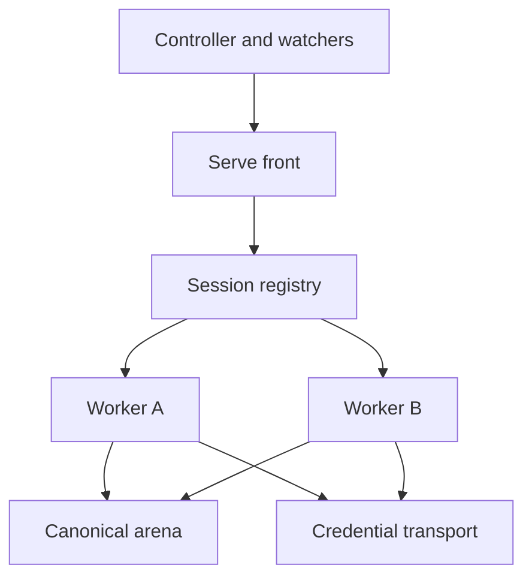
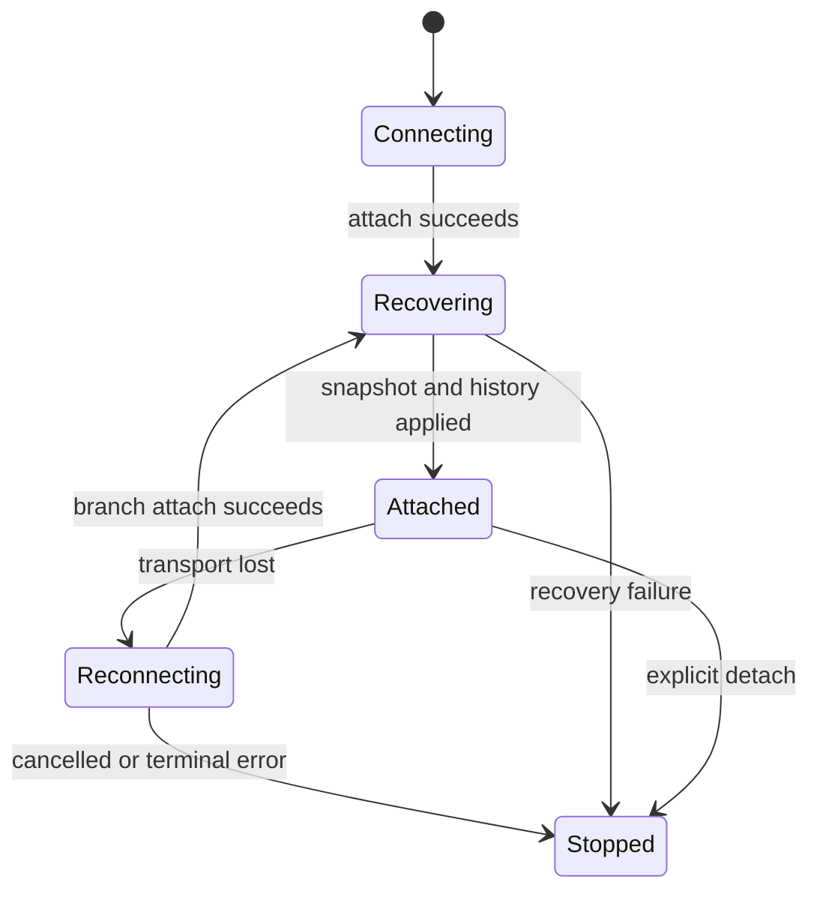

# Software Design Document: Retained remote sessions

- **Project:** pantoniou/fyai
- **Status:** Proposed; implementation has not started
- **Date:** 2026-11-14
- **Repository path:** `doc/fyai-background-sessions-sdd.md`
- **Baseline:** source inspection of `master`, with search results at commit `3a54c4e7a305b70829658d9acd076d192c048a2b`. The anonymous-session creation code was also checked at that commit. No runtime tests were executed for this document.

## 1. Decision and purpose

A single `fyai serve` invocation shall own several independent sessions. A remote client shall be able to create or attach to a session, submit work, close its connection, and later attach to the same live session. Work that the worker has accepted shall continue without a client. The client shall recover the current display, stored conversation, work state, and unanswered questions before it accepts new input.

The existing server and worker model, together with root-CAS transactions and merge fallback, is the foundation. This design extends it with explicit session retention, existing branch/session identity, reliable work admission, reconnect handling, and bounded recovery metadata. It does not replace the UI model, arena, event loop, credential transport, or worker-per-session model.

The minimum useful release supports native fyai clients, multiple retained sessions, manual and automatic reconnect, and recovery from client failure. The server must remain alive. Recovery of a running tool after a server or worker restart is outside this release.

## 2. Scope and terminology

| Term | Meaning |
| --- | --- |
| Server | The user-started `fyai serve` invocation, including project servers that it owns. |
| Session | A live execution context owned by a server and normally implemented by one worker process. |
| Branch | The durable conversation reference in the arena. Its name can change during a session. |
| Session ID | The existing branch-backed session identifier. Preserve current SDK and named-branch semantics; introduce no separate runtime session ID. |
| Worker epoch | Existing initialization marker for one worker incarnation. Clients use it to invalidate transient state after worker replacement; it is not a routing key or a field required on each request. |
| Controller | The one connection allowed to submit user intent to a session. |
| Watcher | A connection that can read session state but cannot change it. |
| Retained session | A session whose lifetime does not depend on a client connection. |
| Ephemeral session | A session that ends when its owning controller disconnects. |
| Submission | A user turn or supported queued command admitted under an idempotency key. |
| Detached | A session with no controller. It may still have watchers and may still run work. |

### 2.1 Goals

1. Run independent sessions concurrently under one server, on different branches, with one live worker per branch per server.
2. Give every retained session a reconnectable identity before work admission.
3. Keep accepted work and pending user questions alive across disconnects.
4. Reconstruct the current UI without replaying all transport frames.
5. Resolve ambiguous submission outcomes without executing the same submission twice within the same live worker.
6. Bound queues, recovery records, connection buffers, and worker counts.
7. Preserve one controller per session, with any admitted read-only watchers.
8. Give failure, cancel, detach, and close different meanings.

### 2.2 Non-goals

- Restoring process stacks, running shell commands, or pending network requests after server failure.
- Several users sharing a server or per-session ownership between different principals.
- Several simultaneous writers to one session.
- A new durable transcript store or a journal of every UI delta.
- Hosted relays, push notifications, pairing, JWT issuance, or a mobile application.
- Making every arbitrary one-shot remote command into a background job.
- Replaying terminal keystrokes after an uncertain delivery outcome.

## 3. Verified baseline and gaps

The following are source findings, not proposed behavior. Links in section 18 identify the inspected code.

| Area | Existing behavior | Required change |
| --- | --- | --- |
| Worker registry | `fyai_remote_server` holds a list of session workers. | Keep branch-based lookup; add explicit retention, lifecycle state, and status fields. |
| Named attach | `remote_attach()` finds a live worker by branch or starts one. It refuses a second controller. | Preserve one live worker per branch; add attach-only behavior for reconnect, without implicit creation. |
| Disconnect | `remote_reap()` removes the peer and leaves a named worker alive. | Make lifetime depend on retention policy rather than the original presence of a branch argument. |
| Unnamed creation | `remote_spawn()` sets `anonymous = !branch`. Later branch reporting updates the branch but does not clear `anonymous`. | A generated branch must not leave a native retained session connection-bound. |
| UI recovery | Worker initialize can repeat. It sends text and store snapshots, and native clients use `fyai_sync` for stored turns. | Specify a complete reconnect barrier, the existing initialization epoch, and failure handling. |
| Raw SDK recovery | Detached output is drained, with no raw-frame replay contract. | Keep this limitation explicit; implement SDK recovery separately. |
| One-shot commands | Noninteractive `--remote` uses `fyai_run`; client cleanup terminates its command. | Keep current behavior; add an explicit route to submit retained session work. |
| Connection failure | `remote_view_run()` exits after connection failure. | Add reconnect state and bounded retry policy. |
| Watchers | Read-only attach and directed initialization snapshots already exist. | Preserve read-only checks and bind all responses to the requesting attachment. |
| Questions | Native model questions can be answered through `fyai_answer`. SDK permission requests also have a separate control-request path. | Recover native questions; do not imply that this also recovers raw SDK hooks or permission callbacks. |

The opening status text and later sections of `remote-sessions-sdd.md` reflect different implementation stages. This SDD uses inspected code for baseline claims. It does not treat every feature marked as future work in that document as missing.

## 4. Requirements and invariants

| ID | Requirement |
| --- | --- |
| R1 | EOF, a failed transport, a slow-client eviction, and an explicit detach shall not cancel a retained session. |
| R2 | A successful create response shall contain the existing branch/session ID and ready state. Initialization shall return the existing worker epoch. |
| R3 | Attach by session ID shall never silently create a replacement worker. |
| R4 | A controller shall recover a consistent snapshot and conversation before its normal input UI becomes writable. |
| R5 | An admitted submission shall survive the loss of its controller while the worker remains alive. |
| R6 | A duplicate submission key with the same payload shall return the original disposition without running again. A different payload under that key shall fail. |
| R7 | A user question shall remain pending while detached. Detachment is neither approval nor denial. |
| R8 | A session shall have at most one controller. Watchers shall never answer, cancel, submit, resize, or send keys. |
| R9 | A session or client shall not block another session through output backpressure. |
| R10 | A worker or server failure shall be reported as loss of live execution. The client shall not automatically rerun uncertain work. |
| R11 | Durable conversation and configuration shall remain canonical in the arena. Runtime recovery records shall not become a second conversation store. |
| R12 | Authentication and confinement shall be checked on every new connection as they are today. Session IDs shall confer no authority. |
| R13 | Several sessions may run in one project on different branches. Each server shall route a branch to at most one live worker. This local routing rule is not a global branch lock; root CAS and reconciliation/merge still handle concurrent publication from other invocations or servers. |

## 5. Architecture and ownership



The front owns connections, authentication results, session lookup, attachment roles, and output fan-out. Each worker owns execution, its UI model, questions, the input queue, and the authoritative in-memory submission ledger for that worker. The arena owns committed conversation and configuration.

Each connection binds to at most one session at a time. This release does not multiplex several active session streams over one socket. Several sockets may connect to the same server, each controlling a different session or watching an existing one.

### 5.1 Registry data

Replace `anonymous` as the lifetime decision with an enum such as `REMOTE_RETENTION_EPHEMERAL` or `REMOTE_RETENTION_SERVER`. Add a lifecycle enum for `STARTING`, `LIVE`, `CLOSING`, `CLOSED`, and `FAILED`.

A registry entry contains:

- Existing branch/session ID, worker PID and channel.
- Existing worker epoch for initialization and diagnostics, not as an additional lookup key.
- Current branch and canonical project root.
- Retention policy and lifecycle state.
- Current controller attachment, attachment generation, and watchers.
- Observed execution state: idle, running, or waiting for input.
- Creation time, last user activity, detached-since time, and terminal outcome.
- Counts for queued submissions and pending questions.

Do not encode all combinations into one large state enum. Controller attachment and execution activity are independent of lifecycle. Detaching a running session changes its attachment field, not its execution state.

### 5.2 Branch identity and local worker routing

Keep the current branch/session ID and its existing SDK representation. Resolve it within the selected project using the existing mapping. Do not generate a second runtime session ID, instance ID, or server epoch. Within one server, a branch maps to at most one live worker. Additional clients attach to that worker as the controller or as watchers.

Serialize lookup and startup registration in the front’s event loop. Register a `STARTING` entry before spawning so simultaneous requests cannot create duplicate workers for the same branch. This is local process coordination; it imposes no lock on the canonical branch and does not prevent other invocations from publishing through CAS.

A branch rename or checkout updates the existing session selector according to current branch semantics. Notify attached clients of the new selector so later reconnects use it; do not claim that a branch-derived ID stays unchanged across a rename. A reconnect using an obsolete name must fail clearly rather than create a worker automatically.

When a client selects a branch already served by another worker, attach it to that worker subject to controller/watcher rules instead of moving the current worker onto the occupied branch. The source worker stays retained on its original branch. If the destination already has a controller, refuse control or permit an explicit watcher attachment; do not steal control. A busy worker’s branch-changing operation must reach its existing safe command boundary before any handoff. Recheck target registration at the handoff boundary. Do not discard queued work or move it implicitly between workers.

### 5.3 Worker epoch: initialization only

Retain the existing epoch returned by native initialization. It answers one question: does this client’s transient state belong to the worker now serving this branch? It does not identify the durable conversation, route requests, or guard transactions.

An unchanged epoch permits recovery against the same worker’s transient state and in-memory submission ledger. A changed epoch means the worker was replaced: discard cached UI text IDs, terminal handles, pending question handles, and assumptions about outstanding submissions. Fetch a fresh model and history, and tell the user that live execution was replaced. Do not automatically resend uncertain work. Clients may always rebuild the UI even when the epoch is unchanged.

The epoch is supplied at initialization, not required on attach, submit, status, cancel, or close requests. There is no server epoch. An attached connection is bound to its actual worker object; worker failure closes that attachment, and the front never silently rebinds it to a replacement. This binding prevents replacement between initialization and a subsequent mutation from redirecting that mutation. A new connection initializes again before sending intent.

Reconnect uses attach-only branch lookup. If no worker exists, report that live execution is gone. Resuming the stored branch into a new worker is a separate explicit operation. If a replacement already exists, attaching is allowed; the initialization epoch triggers a full refresh and the replacement notice rather than an attach rejection.

### 5.4 Transactional publication and merge

The project’s transactional model publishes a new root by compare-and-swap (CAS). This is an existing architectural capability, confirmed by the project owner, and is the concurrency mechanism this design must reuse. Multiple sessions on different branches do not create a semantic branch conflict. They may race on the shared root CAS; the existing transaction path must reconcile against the latest root and preserve unrelated branch updates.

A separate invocation or another server may still work on the same branch from the same committed base. A losing CAS detects that publication no longer has the expected base, and the existing reconciliation path can fall back to merge. The local one-worker routing rule does not replace or disable this fallback. The server exposes reconciliation outcomes through its worker’s state.

Required integration behavior:

1. Keep the transaction’s expected root/base and candidate change in the existing transaction layer. The front is not a transaction coordinator and stores no second canonical root.
2. On CAS failure, use the existing refresh, reconciliation, retry, and merge policy. Do not overwrite the winning root or drop an unrelated branch update.
3. For a same-branch divergence, preserve both contributions through the existing merge machinery. If it cannot settle automatically, expose a pending reconciliation condition and the existing resolution action to the controller. A detached session retains that condition for reconnect.
4. Do not retry a model turn, shell command, or external side effect merely because publication lost a CAS. Retry publication or reconciliation of the candidate result through the existing transaction semantics. Submission deduplication and transaction conflict resolution solve different problems.
5. Report a submission as completed only when its required publication/reconciliation has settled. A pending merge is neither silent success nor loss of the accepted submission.
6. After reconciliation changes the branch head, refresh history through the existing head/base synchronization path and replace affected model state. The served worker refreshes at its normal safe boundary, and its controller and watchers receive the resulting canonical state.

Add an orthogonal `reconciliation` status (`none`, `pending`, or `needs_input`) and a cause or existing merge reference when relevant. Include it in session status and submission status; `waiting_input` may describe the execution state when human resolution is required. A `merge_required` response carries a recoverable condition, not evidence that the session was rejected or its work discarded. Exact merge algorithms and transaction retry policy remain owned by the existing storage/branch layer.

The root CAS protects canonical fyai state. It does not by itself serialize external filesystem writes or make external side effects transactional. Preserve existing workspace/tool semantics; do not claim this design adds filesystem isolation between sessions.

## 6. Creation and lifetime

### 6.1 Explicit retention

Native protocol v2 session creation defaults to `retention: server`. A caller may explicitly choose `ephemeral`. Stock SDK clients retain their existing unnamed-session behavior until they opt into a defined extension. Existing named-branch SDK attachment continues to retain its worker.

The front checks the project’s branch-to-worker registry and registers startup before spawning a retained worker. An explicit create for a branch with a live or starting worker returns `session_exists`; create-or-attach reuses or waits for that entry. Neither path creates a duplicate worker. For an unnamed session it generates a branch using the existing branch naming and validation facilities, retries name collisions, and passes that explicit branch to the worker. The worker confirms readiness and branch on its internal channel; native initialization supplies the existing epoch. Only then does the front acknowledge creation.

If the initiating client disconnects during startup, creation with a valid create idempotency key continues to a bounded startup deadline. A recovery lookup by create ID retrieves the recorded outcome while it remains available. An unknown recovery lookup never creates a worker; after lost server state or expiration, report an unresolved outcome instead of automatically issuing a new create. Startup failure removes the provisional registry entry and releases worker-capacity reservations, terminates partial children, and records a bounded failed outcome. It must not leave an unreachable worker.

### 6.2 Lifetime operations

| Operation or event | Retained session | Ephemeral session |
| --- | --- | --- |
| Controller disconnect | Remove attachment; keep worker and work. | Begin worker close. |
| Watcher disconnect | Remove watcher only. | Remove watcher only. |
| Explicit detach | Same as controller disconnect. | Close, with an explicit warning in the client before ephemeral detach. |
| Cancel submission | Interrupt that submission according to existing cancel semantics. Keep session. | Same. |
| Close session | Refuse if busy unless cancellation was explicitly requested; then terminate cleanly. | Same. |
| Worker failure | Record failure; settle attached requests; close streams. | Same. |
| Server stop | Stop admissions and end workers through existing child termination paths. | Same. |

Explicit close does not delete the durable branch. Retained sessions have no default idle expiration. Optional idle expiration is permitted only when detached, idle, with no queued submissions, pending questions, active tools, or live terminal sessions. Watchers prevent expiration in the initial implementation.

## 7. Protocol v2

The existing native protocol constant is 1. Because this design changes native request and response semantics, increment it to 2 in accordance with `fyai_remote.h`. Do not present this as a backwards-compatible protocol-1 change. Stock SDK framing remains available independently.

Advertise feature names only after their behavior and tests are complete: `session-lifecycle`, `session-status`, and `submission-recovery`. Names and JSON examples below are proposed interfaces, not existing commands.

All examples use the existing control-request envelope:

```json
{"type":"control_request","request_id":"c1","request":{"subtype":"fyai_session_create","create_id":"random-client-key","branch":null,"retention":"server","args":[]}}
```

### 7.1 Session operations

| Subtype | Request fields | Response and behavior |
| --- | --- | --- |
| `fyai_session_create` | `create_id`, optional `branch`, `retention`, `args` | Return identity and ready state after worker initialization. Same key and payload returns the recorded outcome. Conflicting payload fails. A recovery-only lookup with an unknown key returns an unresolved outcome without creation. |
| `fyai_session_attach` | existing branch/session selector, `watch`, `create_if_missing` (false on reconnect) | Attach to the branch’s registered worker. Return role and attachment generation; initialize before sending intent. No replacement is created during reconnect. |
| `fyai_session_list` | optional cursor and limit | Return bounded project-local session summaries, including detached sessions and retained terminal outcomes. |
| `fyai_session_status` | existing branch/session selector | Return lifecycle, execution state, controller presence, watchers, branch, queue and question counts, outcome. |
| `fyai_session_detach` | session identity, attachment generation | Release this attachment without affecting retained work. Connection may then close. |
| `fyai_session_close` | session identity, `cancel_running` | Close only when idle, or explicitly cancel and close. Repeated close is safe for the bound worker or its tombstone; never resolve an old close against a replacement by branch alone. |

Branch-based create-or-attach reuses the registered worker or starts one when absent. Explicit create refuses an existing live or starting worker. Reconnect always requests attach-only behavior. Preserve the current branch/session ID representation and branch selector; no opaque runtime identifier is added. Session-management clients must attach and initialize before a mutation such as close, so that a replacement worker is visible to the client before it acts.

All mutating operations require the current controller attachment. A session list is scoped to the selected project and admitted authority. The current single-user admission model applies; a future scope model must apply equivalent restrictions.

Example successful creation payload inside the existing success response:

```json
{"session_id":"work/generated-name","branch":"work/generated-name","retention":"server","lifecycle":"live","execution":"idle"}
```

### 7.2 Submission operations

`fyai_session_submit` operates on the initialized attachment for the existing branch/session and takes its selector, attachment generation, a client-generated `submission_id`, and a typed payload. Initially support a user message and commands that already enter the worker's ordered input queue. Immediate terminal keys and resize events use their existing operations and are never retried as submissions.

```json
{"type":"control_request","request_id":"s1","request":{"subtype":"fyai_session_submit","session_id":"work/generated-name","attachment_generation":3,"submission_id":"random-submission-key","payload":{"kind":"user","text":"Run the project tests and explain failures."}}}
```

The success payload includes `submission_id`, `status: accepted`, and `queue_position`. Subsequent state is one of `accepted`, `running`, `waiting_input`, `completed`, `failed`, or `cancelled`. Completion summaries identify committed turn IDs when available and include a cause for failure.

`fyai_submission_status` accepts a bounded list of submission IDs and returns their authoritative dispositions. `fyai_submission_cancel` targets a submission ID rather than whichever turn happens to be active when a delayed request arrives. A queued submission can be removed before execution; cancelling a running submission uses the existing interrupt path.

### 7.3 Error codes

Return machine-readable error codes with human-readable causes: `session_not_found`, `session_starting`, `session_busy`, `session_closed`, `session_exists`, `controller_busy`, `stale_attachment`, `merge_required`, `queue_full`, `capacity_exceeded`, `submission_conflict`, `recovery_window_expired`, and `unsupported_feature`.

An unknown submission in a valid live epoch differs from an expired recovery record. The client must not treat either a changed epoch or `recovery_window_expired` as permission to rerun work.

## 8. Reliable admission and retry boundaries

The worker must validate, reserve a ledger record, and insert the submission into its queue before returning `accepted`. These steps execute in one event-loop operation with failure rollback. The front forwards the worker acknowledgment; enqueueing bytes on a socket is not acceptance.

Keep the ledger inside the worker and key it by submission ID. No epoch field is required in a submission request. Compare a canonical representation or digest of the typed payload, including execution-affecting options. A duplicate with the same payload returns the current disposition. A duplicate with a different payload returns `submission_conflict`.

The guarantee is at-most-once queue admission within one live worker and the advertised recovery window. It is not exactly-once external side effects and does not survive a worker crash. A shell command can have changed external state before failure; automatic rerun would be unsafe.

Retain active ledger entries until terminal settlement. Retain completed entries and create outcomes for a configured recovery period. Advertise that period and the client's recovery deadline. Keep a bounded tombstone set for expired keys during the same epoch, or reject retries from an expired client recovery generation. Do not simply forget a key and then accept it as new. When capacity is exhausted, reject new admissions rather than evict active entries or weaken deduplication.

The client keeps unacknowledged submission IDs and payloads until resolved. A live reconnect queries their disposition. It may retransmit the same ID and payload only after initialization confirms the same worker and while the recovery window remains valid. If the worker closes during recovery, stop: the connection must not be rebound to another worker. A restarted client may recover current session state without a saved submission journal; it must not reconstruct and resend an old prompt by guessing.

## 9. Reconnect and display recovery



### 9.1 Client algorithm

1. On transport loss, freeze submissions and terminal input. Keep the last view visible with a disconnected notice.
2. Dispose of the failed transport. Reauthenticate on a fresh connection, select the same project, and negotiate protocol v2.
3. Attach to the existing branch/session with creation disabled. If no live worker exists, report execution loss; do not create a replacement automatically.
4. Request native initialization and compare its epoch with the cached value. If unchanged, resolve unacknowledged submission IDs against that worker. If changed, discard transient state and mark uncertain submissions unresolved; never retransmit them automatically.
5. Build a replacement mirror from the snapshot. Synchronize stored turns with `fyai_sync`, respecting worker epoch and returned base.
6. Apply queued live updates after the snapshot barrier. Publish the recovered view and enable input.

Use exponential retry with jitter, starting at 250 ms and capped at 5 seconds, with a default automatic retry budget of 60 seconds. These are proposed defaults. Manual retry remains available after the budget. Authentication failures, protocol mismatch, and explicit close stop automatic retries immediately. A changed initialization epoch permits fresh-state recovery but disables automatic retry of previous submissions. A user can detach while retries are active.

### 9.2 Snapshot consistency

Reuse the existing snapshot begin/text/store/end stream. Add snapshot identity and a model revision boundary if the current implementation cannot prove a consistent cut across stores. The worker must either serialize snapshot capture against model mutation or capture immutable roots and their referenced text lengths, then queue subsequent deltas until the end marker.

The client stages a snapshot and publishes it only after a valid end marker. If a connection fails during the snapshot, discard the staging state and restart recovery. Bound both staging memory and queued deltas. If either limit is exceeded, end the recovery attempt with a clear cause; do not expose a partially recovered model.

The terminal model already uses bounded screen snapshots and text rotation. Recover terminal state through that model. Never replay old keyboard input. History synchronization continues if the branch head advances during recovery. The completion condition is a valid snapshot followed by a successful history sync and application of the queued model updates; subsequent head changes use the normal synchronization path.

## 10. Controller ownership and transport failure

Assign a monotonically increasing attachment generation whenever control changes. Include it in control responses and validate it on mutations. Use attachment-scoped request routing so a delayed response from an old controller cannot be delivered to a new controller with the same request ID. Extend the existing watcher routing mechanism to cover all attachments.

An old half-open connection must not reserve control forever. Add application-level heartbeat support across all transports: proposed interval 10 seconds, with controller release after 30 seconds without a valid response. Use event-loop timers and monotonic time. Transport-specific ping can supplement this but must not be the only implementation.

The initial release does not allow forced controller takeover. A new controller receives `controller_busy` until the old connection closes or its liveness deadline expires. Watchers can attach during that period. This avoids two clients believing they can both submit work.

Heartbeat loss releases the controller; it never interrupts the worker. A slow output consumer is dropped under existing bounded-output rules, with the same detach semantics. The front continues to drain worker output when there are no attached readers.

## 11. Questions, permissions, and SDK boundaries

Native questions remain in the worker's questions store until answered, cancelled by the underlying operation, or explicitly expired by that question's existing policy. Reattachment snapshots them with stable question IDs. An answer targets the question ID and current attachment generation. The first valid answer settles it; a duplicate answer returns the settled disposition without applying it twice. A conflicting later answer returns `question_closed`.

A worker that reaches a question while detached enters `waiting_input`. It does not invent a response, approve a tool, or cancel merely because no controller is present. Other independent work may continue if the existing engine allows it. Status and session listing expose the waiting state and question count.

Stock SDK `can_use_tool` and hook callbacks are a separate path. Native snapshots do not replay those outbound control requests. Full SDK recovery requires a registry of outstanding callbacks, stable callback IDs, reconnect re-advertisement, response deduplication, and a defined policy for callbacks that perform external effects. That is a separate implementation phase. Until it is complete, advertise no SDK callback-recovery capability and document that native retained-session guarantees do not imply transparent recovery of every stock SDK client.

## 12. CLI and client experience

Existing named-session usage remains valid:

```sh
fyai serve --daemon
fyai -b work/a remote connect
fyai -b work/b remote connect
```

Proposed v2 commands, to be added to the command schema and generated documentation:

```sh
# Create a retained session without selecting a branch name.
fyai remote connect --new

# List live and recently ended sessions of the selected project.
fyai remote sessions

# Attach to the worker for an existing branch/session.
fyai remote connect --session SESSION_ID

# Submit a user turn and return after worker admission.
fyai remote submit --session SESSION_ID --message "Run the tests"

# Explicit session close; --cancel-running is required if busy.
fyai remote close --session SESSION_ID
```

`remote submit` prints a machine-readable receipt when requested, including identity, submission ID, and accepted state. Success means admission, not completion. Its exit status must distinguish rejection from an unresolved transport outcome. It must not silently use `fyai_run`.

The native UI shows session identity, branch, connection state, and whether it is controlling or watching. `/quit` detaches. Ctrl-C and Escape retain their existing interrupt behavior while attached; they are not documented as backgrounding actions. Reconnect notices explicitly say when live execution was lost.

Browser and desktop clients can adopt the same protocol. Migrating the existing web bridge and solving browser-compatible bearer authentication are separate deliverables; the native session release does not claim that a browser reload already implements this SDD.

## 13. Resource limits and operations

Proposed initial defaults require measurement before release:

| Resource | Proposed policy |
| --- | --- |
| Live sessions | 64 per project server; reject further creation. |
| Queued submissions | 32 per session, plus an explicit aggregate byte limit. |
| Recovery records | 4,096 per session; never evict active records to admit work. |
| Recovery period | 24 hours while the owning process and its recovery records remain alive; no guarantee across replacement. |
| Startup deadline | 30 seconds, configurable for slow initialization. |
| Detached idle expiration | Disabled. |
| Peer output | Preserve existing transport bounds; eviction detaches only. |
| Snapshot and text bytes | Explicit limits derived from existing model bounds; reject or resync on overflow. |

A server of projects also needs an aggregate worker, memory, and connection budget. Per-project caps alone allow unbounded growth across projects. Enforce aggregate reservations in the top-level server before project servers create workers.

Log creation, readiness, attach, detach cause, controller release, accepted submission, terminal outcome, worker failure, and server stop with the existing branch/session ID; record the initialization epoch when useful for worker-lifetime diagnostics. Do not log prompt bodies, credentials, or full tool inputs by default. Status includes live, detached, running, waiting, and queued counts. Connection churn must not produce an unbounded diagnostic queue.

## 14. Failure matrix

| Failure point | Required outcome |
| --- | --- |
| Client closes before create reply | Recovery-only lookup of create ID returns the recorded session or startup failure; missing records do not trigger fresh creation. |
| Client closes after submit write but before acknowledgment | Query or retry the same submission ID; never generate a new ID automatically. |
| Client disappears during execution | Retained worker continues; output is drained. |
| Work finishes while detached | History and terminal disposition are available on reconnect. |
| Question opens while detached | Worker waits; reconnect restores the question. |
| Snapshot connection breaks | Client discards staged snapshot and retries. |
| Old controller becomes half-open | Heartbeat deadline releases control; worker continues. |
| Worker crashes | Mark failed, expose cause, settle requests, and close attachments. Attach-only fails if no replacement exists; a replacement is detected during initialization. Do not rerun uncertain work. |
| Server restarts | No live worker means attach-only fails. Explicit resume may start a worker; if a replacement already exists, initialization detects the changed epoch and forces fresh recovery without submission replay. |
| Submission ledger fills | Reject admission before executing new work. |
| Several sessions select the same branch | Within one server, reuse the registered worker with controller/watcher rules. Across independent invocations, retain root-CAS reconciliation/merge. |
| Same-branch publication cannot merge automatically | Preserve both contributions and expose reconciliation state; do not discard work or repeat external tools. |
| Server shutdown during work | Apply existing graceful termination; preserve committed steps and report interruption where possible. |

## 15. Implementation seams

| File or subsystem | Work |
| --- | --- |
| `src/fyai_remote_server.c` | Branch-to-worker registry, retention enum, startup handshake, create deduplication, attach-only reconnect, controller generations, status/list/close, heartbeat, limits, and serialized startup registration for one worker per branch. |
| `src/fyai_remote.c` | Session identity retention, reconnect loop, explicit submit and session management commands, retry outcome handling. |
| `src/fyai_remote_ui.c` | Frozen disconnected view, staged snapshot recovery, input barrier, question restoration, no terminal-input replay. |
| `src/fyai_claude_sdk.c` | Worker ready message, authoritative admission ledger, submission acknowledgment/status/cancel, repeat initialization, attachment-scoped responses. |
| `src/fyai_remote.h` and internal headers | Protocol version 2, feature definitions, shared lifecycle types. |
| UI model and history synchronization | Consistent snapshot boundary, epoch handling, bounded staging and live-update ordering. |
| Branch/session command path | Preserve existing root-CAS publication and reconciliation/merge; coordinate local worker handoff on branch selection without imposing a global branch lock. |
| `data/commands.yaml` and configuration schema | Proposed CLI verbs and explicit limits; regenerate related command documentation. |
| Functional harness and unit tests | Deterministic transport loss, admission races, concurrent sessions, model and question recovery. |

Reuse the borrowed event loop, child admission, credential transport, snapshot machinery, and canonical CAS paths. Do not add a second daemon or an independent worker supervisor.

## 16. Delivery sequence

| Phase | Deliverable | Exit gate |
| --- | --- | --- |
| A | Characterize current named-session behavior and add regression cases. | Two named sessions run concurrently; disconnecting either does not stop its work. |
| B | Protocol v2 branch routing, retention, generated branches, startup handshake, attach-only reconnect, list/status/close. | Unnamed native creation survives disconnect and can be rediscovered without ambiguity. |
| C | Worker admission ledger, explicit retained submission command, status/cancel, bounded retry metadata. | Lost acknowledgments and duplicate submissions cannot start work twice within the guaranteed window. |
| D | Reconnect client, attachment generations, heartbeats, consistent snapshot recovery. | Connection loss during work, initialization, and question display recovers without duplicate content or actions. |
| E | Capacity controls, aggregate project budgets, failure reporting, shutdown tests, documentation. | Load and sanitizer gates pass; limits fail cleanly. |
| F | Optional stock SDK callback recovery and web/desktop integration. | Independent SDK and browser acceptance suites pass; capabilities advertised only then. |

Phase B must coalesce concurrent requests for one branch into a single worker while allowing different branches to run concurrently. Phase D must recover the reconciled conversation and report unresolved merge state. Phases B through E define the complete native release. Phase A alone verifies the existing named-session subset. For each logical change, keep implementation, tests, and documentation in separate patches in the repository's required order; keep intermediate commits buildable.

## 17. Acceptance tests

Use the real binary, scenario-driven mock provider, private HOME/XDG directories, and marker-controlled replies. Wait for observed state rather than sleeping. PTY drivers must read continuously. Proposed case names below are new test descriptions, not claims about existing files.

| ID | Scenario | Required assertion |
| --- | --- | --- |
| T01 | Two retained sessions issue held model requests. | Both requests are in flight before either is released. |
| T02 | Disconnect A while B remains attached. | A continues, B remains responsive, and A reconnects to the same worker epoch. |
| T03 | Create without branch, then disconnect. | Generated branch and session ID remain discoverable; worker survives. |
| T04 | Lose create reply and retry same create ID. | Exactly one worker and one session registry entry exist for that create ID. |
| T05 | Lose submission acknowledgment and retry. | Mock provider sees one admission/execution, and status resolves the original ID. |
| T06 | Reuse submission ID with changed payload. | Request fails with conflict and no second execution. |
| T07 | Reconnect during partial model output. | Live text, tools, and history appear once with no missing snapshot dependencies. |
| T08 | Complete a turn with no clients. | Reconnect shows committed result and completed submission status. |
| T09 | Open question or approval while detached. | No automatic answer; reconnect displays it; one valid answer resumes work. |
| T10 | Duplicate or stale answer. | Question settles once; conflicting later answer is refused. |
| T11 | Second controller and simultaneous watchers. | Controller is refused; watchers remain read-only; snapshots reach only requesters. |
| T12 | Half-open controller transport. | Liveness expiry releases attachment without cancelling work. |
| T13 | Saturated client output buffer. | Client is detached; worker and other sessions keep progressing. |
| T14 | Disconnect during snapshot, then retry. | Incomplete model is discarded; recovered view is consistent. |
| T15 | Branch rename or selection of an already served branch. | Clients receive the updated branch selector after rename; selection attaches to the target worker under controller/watcher rules, without creating duplicates or losing source work. |
| T16 | Worker crash and server restart. | Existing attachments close. Absent workers cause attach-only failure; replacement workers return a different initialization epoch, trigger fresh recovery and a notice, and never receive automatic old-prompt resubmission. |
| T17 | Queue, worker, and recovery ledger capacity. | New work is rejected before execution; active entries remain recoverable. |
| T18 | Recovery window expires. | Retry returns expired status, never a fresh execution under the old key. |
| T19 | Explicit cancel versus detach versus close. | Each operation has the distinct behavior specified in section 6. |
| T20 | SSH and HTTP(S) transport loss. | Native retention and branch reattach match Unix-socket semantics. |
| T21 | Credential isolation enabled. | Replacement connections do not expose credentials or bypass worker admission. |
| T22 | One-shot `fyai_run` and stock SDK compatibility. | Their documented behavior stays unchanged; unsupported recovery is not advertised. |
| T23 | Late old-controller response and reused request ID. | No response or mutation is attributed to the new attachment. |
| T24 | Many project servers request workers concurrently. | Aggregate capacity reservation cannot be exceeded. |
| T25 | Two sessions publish to different branches from the same root. | Force a root-CAS race; both branch updates survive reconciliation without a semantic merge conflict. |
| T26 | A served worker and a separate invocation publish divergent changes to the same branch. | Force CAS loss; existing merge fallback preserves both contributions and neither tool execution is repeated. |
| T27 | Same-branch merge needs user resolution while detached. | Pending state survives; reconnect shows the cause and resolution flow without falsely reporting completion. |
| T28 | Concurrent create-or-attach requests for the same branch. | Exactly one worker starts; clients share that worker under controller/watcher rules; explicit duplicate create returns session_exists. |
| T29 | Merge updates a served branch observed by a controller and watchers. | Safe refresh and history synchronization converge to the canonical result without duplicate display records. |
| T30 | Initialize, then lose the worker before sending a mutation. | The attachment closes and never redirects the mutation to a replacement. No request-level epoch is needed. |
| T31 | Requests omit epoch fields. | Attach, submit, status, cancel, and close work through their normal attachment rules; initialization alone reports the worker epoch. |

Unit tests cover transitions, identity validation, payload equivalence, deduplication, expiry, single-worker branch lookup, reconciliation state, and attachment routing. Integration tests prove behavior through the actual worker and transport paths. PTY tests prove display recovery and question interaction rather than only matching raw bytes.

Follow repository validation requirements: targeted tests during development, the normal parallel suite and ASAN suite on the final series, and repeated event/PTY cases under load. Record the actual results in the implementation PR. This SDD does not claim these gates have passed.

## 18. Source references

These links identify the baseline inspected for this design. Proposed features in sections 4–17 are not claimed to exist at these locations.

- [Server structures, worker spawn, branch reporting, attach, and peer cleanup](https://github.com/pantoniou/fyai/blob/3a54c4e7a305b70829658d9acd076d192c048a2b/src/fyai_remote_server.c)
- [Client connection loop and interactive versus one-shot routing](https://github.com/pantoniou/fyai/blob/3a54c4e7a305b70829658d9acd076d192c048a2b/src/fyai_remote.c)
- [Native client UI, history synchronization, and input handling](https://github.com/pantoniou/fyai/blob/3a54c4e7a305b70829658d9acd076d192c048a2b/src/fyai_remote_ui.c)
- [Worker initialization, UI snapshots, questions, and SDK permissions](https://github.com/pantoniou/fyai/blob/3a54c4e7a305b70829658d9acd076d192c048a2b/src/fyai_claude_sdk.c)
- [Existing branch-backed SDK session identity](https://github.com/pantoniou/fyai/blob/3a54c4e7a305b70829658d9acd076d192c048a2b/doc/claude-sdk-compat.md#sessions)
- [Native protocol version policy](https://github.com/pantoniou/fyai/blob/3a54c4e7a305b70829658d9acd076d192c048a2b/src/fyai_remote.h)
- [Existing remote-session design, especially sections 6.1.1–6.1.5](https://github.com/pantoniou/fyai/blob/3a54c4e7a305b70829658d9acd076d192c048a2b/doc/remote-sessions-sdd.md)
- [Repository implementation and test conventions](https://github.com/pantoniou/fyai/blob/3a54c4e7a305b70829658d9acd076d192c048a2b/AGENTS.md)

## 19. Review decisions and release definition

This proposal selects one worker per branch per server, one controller plus watchers, existing branch/session identity, an initialization-only worker epoch, root-CAS reconciliation/merge for concurrent publication, server-lifetime retention for native sessions, explicit ephemeral opt-in, snapshot-based recovery, in-memory admission deduplication, and no automatic rerun after worker replacement. These are design choices for review, not unresolved alternatives hidden in the implementation.

Before implementation, confirm limit defaults through measurement, choose the exact branch naming helper, verify that model snapshot serialization supplies a consistent cut, and map the existing root-CAS reconciliation/merge outcomes into remote session state. Those implementation checks may refine interfaces but must preserve the requirements above.

The native feature is complete when a user can create two sessions on different branches, submit work in each, close all clients, reconnect while either session is running or after it completes, recover questions and display state, and continue without duplicated work. The same tests must distinguish client loss from worker loss and server loss. Stock SDK callback recovery and browser integration remain separately reported milestones.

## 20. Background sessions with a split worker

This step gives the minimum of the design above. It does not add protocol v2,
submission recovery, or reconnect. It uses the server, the worker per branch,
and the branch/session identity as they are.

### 20.1 The session runs at a worker

An interactive session on a terminal runs at a worker that is a child of the
terminal process (`--split`; `doc/future-cleanups.md`). The worker owns the
loop, the model stream, the tools and the arena. The terminal process is a
client: it draws the UI model and sends the keys. This is how every session
on a terminal runs: a bare `fyai`, `fyai -i`, `fyai resume` and `fyai switch`.
A prompt on the command line without `-i`, another verb, a frame mode and a
session with no terminal run in process, with the plain sink and, for `-i`
with no terminal, the line editor of the fallback. The client asks whether to
create a project that does not exist, and tells the worker with `--bootstrap`,
because the worker has no terminal.

### 20.2 `/background`

`/background` runs in the worker, at any time: with a model request in flight,
with tools running, with a question open, or with no turn.

1. The worker starts `fyai serve --daemon --once` when the project has no
   server, connects, says hello, and sends `fyai_session_adopt` with its
   branch, its process, whether a turn is in flight (`busy`), and `keep` when
   no turn is in flight.
2. The server makes that connection the channel of a session on the branch.
   The session has no child to watch: its channel closing ends it.
3. The worker answers the command on the channel of the terminal client, sends
   `{"type":"fyai","subtype":"backgrounded"}`, waits until the frames went out,
   and makes the connection to the server its channel. The client prints that
   the session left and ends. It does not wait for the worker.

Nothing is stored or restarted: the turn, the tools and the open questions go
on in the same process. The channel of the client is freed when no frame of it
is running.

A session in the terminal process has no worker to give. `/background` fails
there and says why.

A worker that a server lists already (it registered when it started,
`fyai-fleet-sdd.md` 6.2) sends no adopt: it tells that server that its client
left, and the connection of the registration becomes its channel. A server of
this project or of a project above it takes the session; a server starts for
the project only when none runs on the way up.

A worker that a server holds already (it was adopted, or the server started
it) has nothing to give: `/background` there ends the client that typed it and
leaves the session where it is. `/detach` is another name of the command.

### 20.3 The server

- `serve --once` stops when a session ran and no session has a turn, a client
  or a keep request. A turn is a message that has no `result` frame yet. A
  question that waits keeps the turn open.
- A session with `keep` (a parked session) stays until `fyai serve stop`.
- The server writes `<socket>.live` (JSON: `pid`, and `sessions` as `branch`,
  `busy`, `waiting`, `attached`) when a session starts, ends, changes its
  client, starts or ends a turn, or opens or settles a question. It removes the
  file at exit. A reader ignores and removes a record of a process that does
  not exist. It is a hint for a picker, not state.
- A worker reports an open question (`waiting`) in its `fyai_worker` frame. A
  tool permission that does not use these questions is not reported.

### 20.4 Joining and switching

- The resume picker marks a live row `[live · idle]`, `[live · running]` or
  `[live · waiting]`. Choosing it closes the client and runs
  `fyai -b BRANCH remote connect` in its place (`cfg->attach_branch`, as
  `/reload` does with `reload_branch`). The owner marks the rows for a client
  that has no record of its own.
- `fyai resume --last` and `fyai resume NAME` join the live session when the
  branch has one, in the same way, and start no second worker on it.
- A client that joined a session opens the picker (`/resume`) and chooses
  another live row the same way. The row of the session it is on is refused.
- `/continue` runs the model on the head as it is, with no new message. It
  continues a turn that stopped after a round of tools, such as one that the
  tool limit ended. It refuses a conversation whose last message is not a
  tool result, a user message or an agent message
  (`fyai_turn_continuable()`).

### 20.5 Listing, killing, and leaving a session running

- A client that leaves, by `/exit` or `/background`, writes one note on the
  terminal after its display closed. It names the session that went to the
  server, parked or in the background, and counts the other live sessions of
  the record, up to four by name and state. `fyai resume`, `session list` and
  `serve stop` are the commands it points to. It writes nothing when the
  server holds no session.

- `session list` (`ps`) shows the live sessions of the project from the record
  of the server: `branch`, `state` (`idle`, `running`, `waiting`), `attached`,
  and the `pid` of the worker. It works on the command line and in a session.
- `session kill BRANCH` ends one live session: the server sends its worker
  SIGTERM (SIGKILL with `--force`), and its clients see it end. The branch
  keeps the turns that were stored. The picker's `K` key does the same on a
  live row. A client does not close the session it is on.
- `session new` and `resume` leave the current session running when it does
  work: a turn, a tool session, an attached agent or an open question. The
  worker goes to the server as for `/background`, and the `backgrounded` frame
  tells the client what to start in its terminal (`next`: a new session, or
  `resume BRANCH`); `main()` runs it in place of the client. An idle session
  just ends, and its branch is stored. A session in the terminal process has
  no worker to leave and refuses while it does work.

### 20.6 The terminal goes away

A split worker whose channel closes (the terminal closed, the connection
dropped, the client was killed) while it does work gives itself to the server,
as `/background` does, and goes on: the turn, the tools and the questions are
as they were. An idle worker ends with its client. A worker that a server
already holds ends only if the server goes.

### 20.7 `durable`

With `durable` set, the turn in flight is stored before each model request,
when every call of it has its result. A worker that is lost then leaves the
conversation up to the last round, which `/continue` runs, and a client that
joins sees the rounds so far. The key is on by default; `durable: false` stores
a turn only when it ends.

A round costs one publish: on the benchmark `tests/bench/durable_rounds.sh`
(a mock provider, one tool call a round) it adds 1.2 ms a round at 50 rounds,
1.7 ms at 200, 1.6 ms at 500 and 2.2 ms at 1000, whatever the size of the
tool results (1 KB to 100 KB). The arena grows by about 0.3 KB a round. A
round is a ref-log entry of the kind `checkpoint`. The next publish takes
its place, so a finished turn leaves no checkpoint and `BRANCH@{N}` counts
exchanges as it does without `durable`.

#### Pending work

With `durable`, each publish also records the named waits, the monitors, the
commands and sub-agents in the background of the run, and the events that wait
for the model, in the store of the branch, as the member `pending`. A record holds the name, the command or the reason, the due
time (wall clock, in milliseconds), the time limit, and the owner: the pid and
the start time of the process. The table is staged by the publish itself
(`fyai_pending_stage()`), so it commits with the conversation of the same
round.

The table exists only while its owner runs. A run that ends, and `/clear`,
`/reset`, `/resume` and `/checkout`, remove it with the work. A table that
outlives its owner therefore means the owner was lost. A worker or an
interactive session that starts on the branch, and `/continue`, take such a
table over (`fyai_pending_restore()`):

- a wait opens again for the time that remains; one that is past due fires at
  once;
- a monitor or a command in the background starts again with the time limit
  that remains, in the view of the restored root, and the model gets one event,
  `[monitor 'NAME' restarted: ...]`, because lines it printed before can print
  again;
- a monitor whose limit has passed ends with the event of its limit;
- a sub-agent in the background starts again with its stored call. Its
  conversation is on its own branch, which `durable` stores before each of its
  model requests, so it revives that branch and goes on from the last round
  that it stored. Its task is sent again with a line that says so, and the
  model gets one event, `[agent 'NAME' restarted: ...]`.

- an event that waited for the model (the end of a sub-agent, a wait that
  fired) is queued again, before the work above. The table holds at most 64 of
  them; an event that a waiter has seen, and agent input, are not stored.

A session in a view stores the state of its view with each checkpoint, and a
start after a loss puts the view back to it before the session runs; the
section on a session in a view of `agent-filesystem-views-sdd.md` has the
rules.

A table whose owner still runs is left alone. A `wait` that holds a tool call
is part of the round in flight: the model asks it again. A change that no
publish follows (a wait that fires while the session is idle) is stored by the
next publish, and a loss in that gap fires the wait again. An event is stored
by the first publish after it was queued. The end of a sub-agent, a wait and a
monitor are also kept by their own records until then, so a loss in that gap
delivers them again. What nothing backs is lost: a message between agents, and
what a person typed. A restarted sub-agent and its parent are told that a
message can be lost; the person sees the break and types again.

A restarted sub-agent takes over the table of its own branch before its first
turn, as the session does for its branch: a sub-agent that it had in the
background is started again, and told so, and so on down. Each level keeps its
own table, with its own owner, so a level that lost no process is left alone.

### 20.8 Limits

- The new client connects to the default socket of the project. A client of
  another endpoint (`--remote`, ssh, HTTP) does not join a live row.
- A worker keeps its own directory and configuration when it moves, so an
  unstored `--set` goes with it. A session that a client attaches to by name
  starts a worker in the directory of the server.
- The conversation of a running turn is stored when the turn ends, so a client
  that joins sees the live display and not the turn so far in the history.
- A row that ended before the user chose it fails at the connection.
- A frame that a joining client sends in the moment between the answer of the
  server and the new channel of the worker is lost. The client initializes
  again when it sees no answer.
