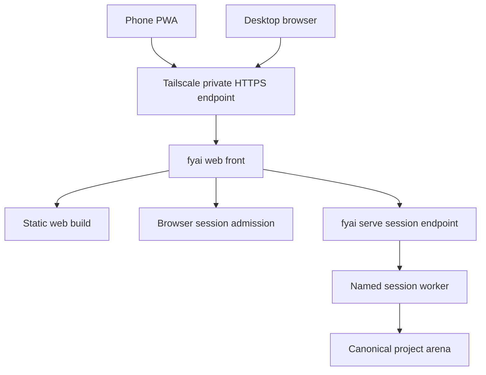
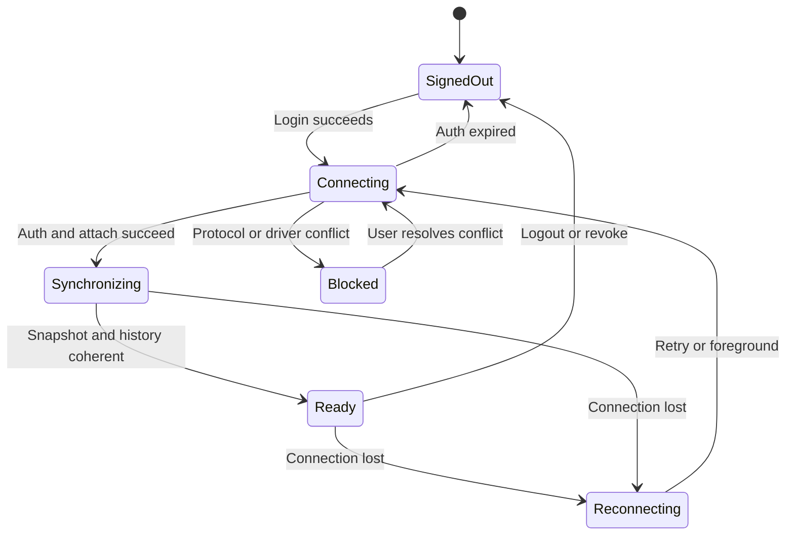

# Software Design Document: fyai mobile access over Tailscale

**Status:** Proposed, implementation-ready design; no implementation changes made.

**Date:** 13 November 2026

**Repository:** `pantoniou/fyai`

**Reviewed baseline:** `3a54c4e7a305b70829658d9acd076d192c048a2b`

**Repository path:** `doc/fyai-mobile-tailscale-sdd.md`

**Related work:** Remote sessions P6–P8; fyai web W10–W11. This document specifies the mobile client integration. It supplements the remote sessions design and does not replace the existing protocol.

## 1. Decision and scope

Build a mobile client from the existing fyai web application. Deliver an installed progressive web app (PWA) first. Connect it to persistent, named sessions in `fyai serve`. Use Tailscale for private network access and a browser-trusted HTTPS origin. Add a native wrapper only after the PWA passes the recovery and control tests.

Use the existing UI model stream, snapshots, history synchronization, questions and terminal interfaces. Do not build a second session engine, store authoritative history in the browser, or reconstruct server state from rendered terminal output.

The first release uses one server origin and one selected project/session at a time. The server can serve several projects; the client must select a project before it attaches. Each session retains one driver and zero or more watchers. Watching a desktop session from the phone is supported. Controlling it requires the desktop driver to detach. Automatic takeover is out of scope for the first release.

### 1.1 Goals

1. Open a private HTTPS URL on a phone, authenticate, and install the page.
2. List permitted projects and conversations, create a named session, and attach to a live session.
3. Send prompts, see live output and tools, answer questions, cancel work and use supported commands.
4. Let a named session continue while the phone is locked, disconnected or suspended.
5. Restore the current state and stored history when the phone returns.
6. Observe a session that another client drives, without changing it.
7. Keep provider credentials and canonical conversation state on the server.
8. Reuse the web backend seam and preserve the llama-server and legacy bridge backends.

### 1.2 Non-goals

- A public relay, hosted account service, public internet exposure or Tailscale Funnel.
- Guaranteed execution of browser code while the phone is in the background.
- Push notifications in the first release. Tailscale alone does not supply a push service.
- Offline execution, offline prompt submission queues or automatic replay of commands.
- Multi-user tenancy. Paired devices represent the server owner; scopes reduce their authority.
- Simultaneous drivers, forced takeover or implicit termination of a desktop connection.
- Pixel-identical terminal mirroring as a prerequisite for useful mobile chat.
- A rewrite of the existing C server, Svelte UI or storage model.

## 2. Evidence and implementation baseline

The following statements describe the reviewed commit. Proposed behavior appears in later sections.

| Area | Existing implementation | Remaining integration |
| --- | --- | --- |
| Network transport | HTTP/HTTPS WebSocket endpoint at `/api/fyai/session`; bearer admission; TLS and pin/CA support for the CLI | Browser admission, public-origin handling and UI delivery |
| Session lifetime | Named branch workers can survive client EOF and accept a new attachment | Mobile lifecycle must use named sessions and distinguish disconnect from cancel |
| Client ownership | One driver; watchers can initialize and synchronize | Read-only UI, busy-session handling and explicit handoff instructions |
| UI model | Initialize with `fyai: {model: 1}`; text/store frames and scoped snapshots | TypeScript replica and rendering adapter |
| History | `fyai_sync {have, depth}`, base selection and worker epoch | Web replica and live/stored reconciliation |
| Questions and terminals | `fyai_answer`; terminal input, size, close and dismiss requests | Mobile controls and feature gates |
| Web transport | `streamFyaiTurn()` uses POST `/api/fyai/chat` and SSE | Implement `fyai-remote` transport |
| Legacy bridge | Spawns a process per turn; response/request close can kill active work | Keep as legacy mode, not the reliable mobile session path |
| PWA | Existing install assets, hooks and tests | Validate authentication, caching, updates and device behavior |
| Device security | Shared bearer token grants full authority | Device enrollment, revoke and scopes remain planned |

The opening status paragraph of the remote SDD is older than its later implementation sections. In particular, sections 6.1.4–6.1.5 describe implemented model snapshots, synchronization and watchers. Do not infer that these must be built from scratch. P6a–P6c are recorded as done; P6d–P6g remain open.

The backend kind `fyai-remote` already exists as a constant. Its existence does not mean the web transport has been implemented.

## 3. Requirements and invariants

| ID | Requirement |
| --- | --- |
| R1 | A lost browser connection must not cancel a named-session turn. |
| R2 | Only an explicit authenticated cancel request interrupts work. |
| R3 | No worker starts before authentication and project authorization succeed. |
| R4 | A snapshot becomes visible atomically; partial snapshots never replace the active view. |
| R5 | Canonical stored turns replace matching live content without duplicate rows. |
| R6 | A prompt with an unknown submission outcome is not resent automatically. |
| R7 | Watchers cannot submit prompts, answers, commands, terminal keys or cancellation. |
| R8 | A new worker epoch invalidates transient state from the old worker. |
| R9 | Provider secrets, auth tokens and enrollment secrets never enter model input, transcripts or logs. |
| R10 | Server checks enforce authority; hiding a client button is not an access check. |
| R11 | Every queue, incoming frame and client replica has a size limit and a recovery path. |
| R12 | Disabling or losing Tailscale produces a connection error, not silent fallback to a public service. |

## 4. Target architecture



### 4.1 Browser-facing front

Extend the existing Node server with a distinct **remote gateway mode**. In this mode it serves static files, handles browser sessions and forwards authenticated WebSocket connections to the existing C endpoint. It does not spawn a process for each turn, reconstruct conversation state, run shell commands on behalf of HTTP routes, or implement a second agent protocol.

This is the initial delivery choice because it lets the C remote protocol remain stable and reuses web packaging. Integrating static delivery and cookie admission directly into the C HTTP front is a later consolidation option. The browser-facing URL contract must remain the same if that consolidation occurs.

Separate the legacy process bridge and gateway lifecycle code. A gateway disconnect or shutdown closes upstream connections; it must not stop an independently launched `fyai serve`. Desktop ownership of a child server remains an explicit launcher policy.

### 4.2 Upstream transport

For the initial gateway, use a WebSocket-capable Node implementation to connect to a loopback `fyai serve` HTTP listener. The gateway reads the existing shared token from a protected file and supplies the bearer header. Do not assume Node's browser-compatible WebSocket API supports custom handshake headers; select and test a maintained server/client WebSocket dependency during implementation.

The upstream is configured locally. An HTTP request cannot choose an arbitrary upstream address. Validate the upstream URL at startup. Loopback HTTP is allowed for a same-host deployment. A remote upstream requires verified TLS; invalid certificates fail closed.

The gateway validates the browser Origin before upgrade. It must not forward the public HTTPS Origin unchanged to a plaintext C listener that expects a matching HTTP origin. As a non-browser upstream client, it omits Origin; the existing C code accepts absent Origin. It must not copy user-supplied Authorization, forwarded identity or cookie headers upstream.

This gateway initially exercises the owner's shared-token authority. It cannot provide device-scoped engine authorization by itself. Section 8 defines the transition to server-verified device identity.

### 4.3 Single-origin routes

All names below, except the existing session endpoint, are proposed interfaces.

| Route | Behavior |
| --- | --- |
| `GET /` and hashed assets | Serve the installed web build; no secrets in HTML |
| `GET /api/fyai/info` | Minimal backend identity, protocol compatibility and authenticated state; no project paths before login |
| `POST /api/fyai/auth/login` | Exchange a bootstrap token for a browser session cookie |
| `GET /api/fyai/auth/session` | Read own session expiry, device label and effective authority |
| `POST /api/fyai/auth/logout` | Revoke browser session, clear cookie and close its sockets |
| `GET /api/fyai/session` | Authenticated WebSocket upgrade; gateway proxies frames |
| `POST /api/fyai/auth/pair` | Later: redeem a one-time device enrollment code |

Do not expose the legacy provider-key routes in gateway mode. Provider configuration remains a host operation for the first mobile release. Static SPA fallback applies only to page routes, never unknown `/api/` paths.

## 5. Tailscale deployment

### 5.1 Recommended topology

Run fyai and the web gateway on the same host. Bind both private application listeners to loopback. Use Tailscale Serve to publish the gateway as HTTPS on the node's full `.ts.net` hostname. Install and connect Tailscale on the phone, subject to the tailnet policy.

Keep the gateway's configured public origin exact, including scheme and non-default port. A hostname suffix match is insufficient. Retain application authentication even when the tailnet already restricts network access.

An illustrative deployment sequence, not a claim that the proposed gateway flags exist today:

1. Start the existing `fyai serve` with a loopback HTTP listener and its protected token file.
2. Start the proposed remote gateway with the upstream address, token-file path, static directory and exact public origin.
3. Run `tailscale serve --bg http://127.0.0.1:9331` for the gateway port.
4. Open the HTTPS URL reported by Tailscale from the phone.
5. Log in, attach to a named session, and install the page.

Tailscale Serve provides HTTPS reverse proxying inside a tailnet. Validate the specific deployed Tailscale version and tailnet HTTPS setup before producing a final runbook. Do not use Funnel for this design.

### 5.2 TLS and proxy boundary

The browser uses normal certificate validation. A self-signed certificate pin that works in the fyai CLI is not a browser trust mechanism. Native pinning is an optional future deployment mode, not the PWA default.

Set the public origin through trusted startup configuration. Do not derive it from arbitrary `Forwarded` or `X-Forwarded-*` headers. Only the configured proxy may reach a non-loopback gateway listener; loopback is the default. Tailscale identity headers may be recorded as supplemental audit context after the proxy boundary is verified; they do not substitute for a device session.

### 5.3 Operational lifetime

The host and fyai invocation must stay running. Phone suspension does not keep a sleeping host available. Document host sleep behavior and explicit server start/stop commands. An optional system service is a separate, user-enabled installation choice; opening the page must not install or start an unannounced resident process.

## 6. Browser authentication

### 6.1 Initial owner-only mode

Use a bootstrap secret supplied by the owner on the host. Accept it only in an HTTPS POST body. Never put it in a URL query, browser storage, generated HTML, QR content, telemetry or error text. Compare valid-length values in constant time.

On success, generate a separate random opaque session token with at least 256 bits of entropy. Store only its verifier, creation time, expiry and connection associations in the gateway's auth state. Return:

```http
Set-Cookie: __Host-fyai_session=<opaque>; Secure; HttpOnly; SameSite=Strict; Path=/
Cache-Control: no-store
```

The cookie has no Domain attribute. Default absolute expiry is seven days, configurable by the host. Do not require periodic foreground activity to keep a turn running. Cookie expiry stops client access, not the named worker. In the first version the gateway keeps browser sessions in memory: a gateway restart requires login again. This limitation must be visible and tested. Persistent device sessions arrive in section 8.

Limit login requests, body size and concurrent handshakes. Initial limits: 4 KiB login body, five failed attempts per source per minute with a bounded tracking map, and a global failure budget. Rate limits must not depend solely on a spoofable forwarded address. Tune these values through tests.

### 6.2 Request protection

For browser state-changing requests require an exact Origin match, JSON content type and valid session cookie. Refuse absent/null Origin on browser mutation routes. Reject cross-origin WebSocket upgrades before allocating an upstream connection. Native admission, when implemented, has a separate explicit bearer path and does not weaken browser checks.

A session record binds every accepted browser socket. Logout or expiry closes all associated downstream and upstream sockets promptly. Authentication expiry must also be checked on already-open connections. Clear the cookie on logout. Return stable error codes without echoing secrets.

Use `Cache-Control: no-store` for all auth and API responses. Apply a CSP that permits only required local scripts, styles and connections; validate it against the existing renderer. Treat Markdown, tool output and terminal output as untrusted. Disable terminal clipboard writes and arbitrary URL schemes. Use `Referrer-Policy: no-referrer` on login/enrollment pages.

### 6.3 Failure UX

Show server URL, connection state and a specific next action. An unauthenticated fyai page must ask for fyai access, not a provider API key. A handshake failure can be opaque to JavaScript; follow it with a same-origin auth/session probe to distinguish expired login from a network failure. Do not loop login attempts automatically.

## 7. Web remote backend

### 7.1 Modules and responsibility

Proposed modules under `web/src/lib/services/`:

| Module | Responsibility |
| --- | --- |
| `fyai.remote.connection.ts` | WebSocket lifecycle, request correlation, timeouts and negotiated capabilities |
| `fyai.remote.protocol.ts` | Validated frame types and typed request builders |
| `fyai.remote.replica.ts` | Text/store mirror, epoch handling and atomic snapshots |
| `fyai.remote.history.ts` | `fyai_sync`, ancestry reconciliation and stored turn pagination |
| `fyai.remote.backend.ts` | Existing backend seam adapter and remote operations |
| `fyai.remote.lifecycle.ts` | Foreground recovery and network/retry policy |
| `fyai.remote.auth.ts` | Browser session status, login and logout |

Keep state scoped by server identity, project root and branch. Do not let frames from an old connection update a newly selected project. Give each connection a local generation ID and discard callbacks from older generations.

### 7.2 Connection and attachment

Use the current protocol envelope and subtype names. Determine the protocol constant from the build or a generated contract; do not hardcode the old document's illustrative version.

Connection order:

1. Read backend and auth status.
2. Open same-origin WSS `/api/fyai/session`.
3. Send `fyai_hello` with supported protocol/features; reject incompatible versions visibly.
4. Select the project with `fyai_project` and wait for its response.
5. Attach with `fyai_session_attach`, a named branch and the chosen driver/watch mode.
6. Initialize with `fyai: {model: 1}`.
7. Collect the initial snapshot and epoch; obtain stored turns through `fyai_sync`.
8. Publish the coherent view and enable only permitted operations.

A new conversation must receive a server-authoritative branch identifier before its first prompt. Do not guess a branch from a local timestamp if the server already provides session creation. Existing branch listing can be adapted through documented commands with structured output. A dedicated structured project/session list operation is preferred where the current command transport does not expose a stable parseable result. Do not scrape formatted terminal tables. This is an integration gate, not an assertion that a new REST collection already exists.

### 7.3 Rendering contract

Use the UI model as the live source. Render text only to the lengths referenced by the applicable store. A text frame can arrive before the store that makes those bytes visible. Preserve recorded ranges so committed tool bands do not appear twice.

Stored history comes from `fyai_sync`, including display records, user messages, calls and results. Adapt these into current web components. Avoid simultaneously appending SDK deltas and model text for the same answer. Unknown store fields are ignored safely; missing required stores disable the dependent feature.

Mobile MVP renders transcript, turn state, tool output, todo/work summaries and questions. Rich terminals are a later feature gate. Never advertise terminal control simply because a tool produced text output.

### 7.4 Mutations and commands

Prompts use the existing session input contract. Questions use `fyai_answer {qid, replies}`. Commands whose scope is view remain local; other permitted commands use `fyai_command`. Cancel uses the existing interrupt control. Do not issue a generic CLI process for every operation when a session operation already exists.

Disable history editing, regeneration, branch deletion and rename until their mapping and concurrent-turn semantics are tested. The legacy bridge's rewind algorithm must not be copied blindly into a live worker. Return a clear busy/conflict state rather than mutating a branch beneath a running turn.

## 8. Device enrollment, scopes and revocation

This is required for a generally usable multi-device release. It is not required for the explicitly owner-only first milestone.

### 8.1 Enrollment

The owner creates a one-use code on the host. Expiry is five minutes. A QR encodes the trusted server URL and an enrollment value, preferably in the URL fragment so it is not sent in HTTP logs. The enrollment page removes the fragment before any further navigation and redeems it in a POST body. A stolen code is a credential until it expires; codes never appear in analytics.

Show the server identity, requested device label and requested scopes before enrollment. Bind redemption to the exact server and atomic one-use consumption. Concurrent redemptions result in one success. Rate-limit failures and cap active codes.

### 8.2 Authority propagation

Implement the existing remote design's device identity/scopes at the C frame dispatcher. Carry the identity through a projects front to its project server. Check every mutation there, including session attachment, answers, commands, terminal operations and configuration access. Browser login must not turn a restricted device into the gateway owner's shared-token identity.

Choose the existing P6d signed-token design when implementing this phase. The gateway authenticates the browser session and presents a server-verifiable credential for that same device upstream. A restricted credential must never be replaced by the owner bearer as a fallback. Signing keys and device verifiers live outside the arena with owner-only permissions. An auth-state restart must not restore revoked access.

Map scope names to the canonical remote SDD before coding. At minimum distinguish observation, prompting/control, answering/approval, terminal control, configuration and pairing. Do not grant remote changes that weaken the sandbox merely because a device can send prompts. Apply the planned `x-fyai-remote` policy to configuration and command paths.

### 8.3 Revoke and rotate

List device label, created time, last use and scopes, without secrets. Revocation invalidates refresh/session credentials and closes existing sockets across gateway and server. Token expiry must close active connections as well as reject new ones. Rotate bootstrap credentials separately from device credentials. Test revocation with both a live connection and a suspended phone.

Native wrappers keep long-lived credentials in the OS secure store. A PWA uses HttpOnly cookies; JavaScript does not store bearer tokens in localStorage, IndexedDB or the service worker cache.

## 9. Recovery and consistency

### 9.1 State machine



The UI also records driver/watch mode, which is independent of connection state. A watcher can be Ready but cannot mutate the session.

### 9.2 Snapshot and history rules

Build snapshots in a staging replica keyed by request ID. A begin frame clears staging, not the visible replica. Apply texts and stores there. At the matching end, validate references and atomically swap. Live frames around a snapshot must retain server ordering. Buffer them only within a fixed budget; overflow discards staging and requests a fresh snapshot.

On a worker epoch change, discard transient texts, stores, pending question handles and terminal replicas. Reload history through synchronization. Do not clear the user's unsent draft.

For `fyai_sync`, send the supported exponential ancestry sample in `have`. If the server returns `base`, remove local turns after that base and append the returned turns. A null base replaces the relevant history window. Detect duplicate IDs and invalid ancestry. Refresh when the session head changes. Paginate older history and virtualize rendered rows.

Do not invent a universal event replay cursor from the model's store `seq` fields. Full event replay is not guaranteed by the current protocol. The baseline recovery mechanism is a fresh model snapshot plus canonical history sync. Any future delta replay must be an explicitly negotiated capability.

### 9.3 Network lifecycle

Use exponential retry with jitter, starting near one second and capped at 30 seconds while foregrounded. Stop retrying for authentication, protocol and permanent authorization errors. Foreground/visibility and network-online events trigger a prompt attempt; an online event is only a hint, not proof the server is reachable.

Use a bounded application liveness probe supported by the server. Browser JavaScript cannot originate WebSocket protocol ping frames. If a new probe is necessary, add it as a negotiated feature. Initial target: detect an unresponsive foreground connection within 45 seconds. Resume must not depend on a background timer firing.

If the previous driver socket has not yet been removed, reconnect may get a busy response. Retry briefly while displaying the conflict; offer Watch. Never kill the previous driver. A future reconnect lease could improve this, but requires identity binding and explicit protocol work.

### 9.4 Ambiguous submissions

A send can reach the server just before the socket fails. Request IDs correlate replies; they are not automatically durable idempotency keys. Without a server deduplication contract, show “Submission status unknown”, synchronize, and require explicit user action before resending.

An optional later `client_action_id` feature binds the ID to project, branch, identity and payload digest. The server rejects reuse with a different payload and returns the original acceptance outcome for a duplicate. Durable exactly-once execution is not promised by an in-memory ledger. Across a server restart, unresolved actions remain ambiguous unless acceptance is persisted through the canonical command path. The first release uses no automatic resend.

### 9.5 Questions and terminals

After reconnect, show only questions in the new snapshot. A stale answer receives an already-settled/not-found error, then the client refreshes. The server decides the winner; the UI cannot assume success from a button tap.

Terminal recovery uses the current model's bounded screen snapshot/text mechanism. Input is never replayed. Only the driver with terminal authority can resize or send keys. Watchers use local scaling/scrolling and cannot change the remote PTY dimensions. Preserve resize ordering relative to output.

## 10. Mobile presentation and PWA behavior

Use the existing responsive shell, with a single primary chat pane and a drawer for projects/sessions. Always show server/project identity and a compact connection indicator. Display a clear Watching state when read-only.

Support safe-area insets, software-keyboard viewport changes, portrait/landscape transitions, accessible touch targets, screen-reader labels and text zoom. Keep the composer visible without obscuring the latest response. Preserve a draft across reconnects and session switches. Default drafts to memory; persistent draft storage is optional and clearly described because it contains user content.

Attachments use existing supported text/image forms and capability checks. Account for the 16 MiB WebSocket message limit and base64 expansion. Preflight against the advertised wire limit and the actual serialized frame size. Do not claim the protocol's unavailable binary image mode is required for ordinary JSON/base64 media. Add binary media transport only as separate negotiated work. Reject unsupported audio/video with a clear message.

Cache only the static app shell and hashed assets. Explicitly exclude `/api/`, auth responses, conversations, images from sessions and WebSocket traffic from service-worker caches. The offline page says that the server is unavailable; it cannot submit work. Never cache a logged-in HTML bootstrap with secrets.

A waiting service worker offers an update. Do not force a reload during editing or interaction. After update, negotiate protocol compatibility again. A cached old app that cannot speak to the server shows an update action. Installation must be tested in Safari and Chrome, including whether standalone launch preserves the expected auth context; do not assume browser and installed-app storage are identical on every OS version.

## 11. Resource limits and observability

Preserve the C transport's reviewed 16 MiB message limit and bounded output behavior. Set the gateway limit no higher than the upstream. Use bounded queues in both directions; pause upstream reads where supported and close a slow browser when the queue cap is reached. Never let one phone stall a worker or other clients. If reconnect repeatedly overflows, expose the cause instead of a retry loop.

Suggested initial browser budgets: 32 MiB transient text replica, 200 rendered history rows with virtualization, and a bounded history window with explicit older-page loading. Final limits are measured on reference phones. Never evict text still referenced by active stores without initiating a coherent resync or reducing the subscribed surface.

Log connection ID, non-secret device ID, project/session identifier subject to privacy settings, role, negotiated protocol, disconnect category, snapshot duration and queue high-water marks. Exclude cookies, tokens, enrollment values, prompts, tool output and attachment bytes. Provide metrics for reconnect success, snapshot failure, unknown submissions, auth rejection and slow-client eviction. No telemetry leaves the host by default.

## 12. Implementation plan

| Phase | Changes | Exit gate |
| --- | --- | --- |
| M0: Contract audit | Read current hello/initialize/model/sync contracts; capture fixtures; confirm structured discovery and prompt input | Fixtures from real mock-backed server; list every missing capability |
| M1: Private browser front | Gateway mode, static build, cookie login, exact Origin checks, WSS forwarding, Tailscale runbook | Phone authenticates through private HTTPS; unauthenticated/malicious-origin sockets rejected |
| M2: Remote web backend | Project/session discovery, named attach, snapshot replica, history sync, prompt/cancel and watch UI | End-to-end chat on existing server; no per-turn process bridge in remote mode |
| M3: Mobile recovery | Foreground reconnect, epoch handling, ambiguity UI, slow-client limits and driver conflicts | Lock/unlock, network switch, reload and dropped replies produce coherent state without duplicate work |
| M4: Device access | P6d–P6f integration, pairing, expiry, revoke, command/config policy | Device authority enforced in server and active connections revoked |
| M5: Rich mobile controls | Questions, task/work panels, supported attachments, optional terminals and responsive QA | Feature-specific device tests and scoped-control tests pass |
| M6: Native package | Same web build in selected wrapper, OS secure storage, QR scanner, app lifecycle hooks | iOS/Android build, upgrade, revoke and foreground recovery tests pass |

Questions and basic task/work summaries should ship in M2/M3 when the existing renderer adapter is small; M5 is the completion gate for all rich controls. M1–M3 form the owner-only PWA milestone. M4 is required before advertising per-device security. Terminal and native packaging work must not block a useful chat PWA.

Each phase follows the repository sequence: implementation, tests, documentation. Keep each change reviewable. Update the existing SDD status sections to avoid leaving contradictory completion claims.

## 13. Test and acceptance matrix

Use the fyai mock provider, explicit markers and state-based waits. Do not rely on arbitrary sleeps to decide that a turn is active or complete. This document does not claim these tests have been run.

| ID | Scenario | Required result |
| --- | --- | --- |
| T01 | Login with absent/wrong token | Rejected; no upstream connection or worker |
| T02 | Cross-origin login or WS upgrade | Rejected before forwarding; no wildcard CORS |
| T03 | Authenticated connect | Hello, project, named attach and initialize succeed in order |
| T04 | Stream text/tools | Correct live output; committed history has no duplicate rows |
| T05 | Lock phone during long turn | Server finishes or continues; return shows authoritative state |
| T06 | Disable Tailscale, then reconnect | Clear offline state; no public fallback; coherent resync |
| T07 | Switch Wi-Fi to cellular | Session survives; prompt is not resent |
| T08 | Drop connection after prompt acceptance, before response | Unknown-outcome UI; sync identifies existing work where possible |
| T09 | Reload mid-turn | Named worker persists; snapshot/history restore active state |
| T10 | Restart gateway | Named worker persists; first-version browser login required again |
| T11 | Restart fyai worker/server | Epoch change clears stale transient state; stored history restored; no fabricated continuation |
| T12 | Phone watches desktop driver | Snapshot and deltas render; every mutation is refused |
| T13 | Phone attempts drive while desktop drives | Busy response; Watch offered; desktop untouched |
| T14 | Desktop detaches, phone attaches | Control acquired without starting duplicate work |
| T15 | Answer already-settled question | Conflict handled and stale card removed |
| T16 | Explicit Cancel | Worker interrupted once; reconnect alone never interrupts |
| T17 | Truncated snapshot or missing text reference | No partial publication; bounded retry or visible error |
| T18 | History rewound by another permitted operation | Base reconciliation removes obsolete descendants |
| T19 | Slow browser / queue overflow | Browser dropped or resynced; worker and other clients stay responsive |
| T20 | Oversize attachment/frame | Rejected before expensive allocation or upload where possible |
| T21 | Expire/logout/revoke with socket open | Access closes promptly; named worker continues |
| T22 | Restricted device sends raw forbidden frame | Server refuses even if client UI is bypassed |
| T23 | Service-worker offline and upgrade | No API data cached; update does not silently duplicate or discard a submission |
| T24 | Malicious Markdown/terminal output | No script execution, automatic clipboard write or credential leak |
| T25 | Mobile keyboard, rotation, zoom and installation | Composer and controls remain usable; auth behavior documented |
| T26 | Multi-project front | Project authorization preserved through handoff; no cross-project replica contamination |

Unit tests cover frame validation, correlation, snapshot staging, history ancestry, stale-generation discard, retry decisions, auth parsing and scope decisions. Integration tests cover gateway plus real C server against the mock provider. Browser automation covers the application flow. Physical-device tests cover OS suspension, installed PWA auth, keyboard and network transitions that desktop emulation cannot prove.

Provisional performance targets on a documented reference phone, host and tailnet: ready within three seconds on warm foreground recovery with a small history window; first visible coherent state within five seconds on a normal attach; no unbounded memory growth during a one-hour stream/reconnect soak. Record RTT and data size with results. These are acceptance targets, not measured claims.

## 14. Compatibility, migration and rollout

Keep `fyai-bridge`, `fyai-remote` and llama backends distinct. Remote gateway `/api/fyai/info` reports the remote backend explicitly. Do not silently fall back to legacy spawning if a remote handshake fails. That would change session lifetime and authority without user intent.

Feature negotiation gates watch mode, model replication, questions, terminals and optional action IDs. Unknown optional features do not break basic chat. Unsupported protocol versions stop with an actionable version message. Do not change stock SDK behavior while implementing browser extensions.

The initial remote backend exposes only operations whose server mappings are verified. Disable unsupported import/export/fork/edit controls rather than updating an in-memory browser copy that appears canonical.

Roll out first on a private test project, then one real owner project. Keep the legacy bridge selectable as a separate mode during migration. Rollback closes remote clients and restores the older web build; it must not delete arena data or stop named workers. Avoid canonical arena schema changes for client-only features.

## 15. Risks and decisions

| Risk | Decision or mitigation |
| --- | --- |
| Old documentation understates server capability | Ground contracts in the pinned source and mock-backed fixtures |
| Gateway adds a resident component | Explicit start/stop; reuse Node packaging; no hidden process creation |
| Gateway token has owner authority | Label owner-only milestone; implement end-to-end device identity before scoped release |
| Phone suspension defeats continuous transport | Recover from snapshots/history; no background-runtime promise |
| Driver conflict after abrupt disconnect | Bounded retry, Watch and explicit handoff; no automatic takeover |
| Stored and live renderers diverge | Shared adapter fixtures; one authoritative source for each row |
| Web build caches outlive server upgrades | Version negotiation and controlled app update |
| Proxy HTTPS differs from upstream HTTP | Exact public Origin validation at gateway; explicit trusted upstream policy |
| Native wrapper amplifies scope | Defer until PWA works; use the same protocol and recovery tests |

Decisions made here: PWA first; same-origin private HTTPS; explicit gateway mode first; secure cookie browser sessions; existing UI model/sync protocol; one driver; no automatic resend; no push in MVP.

Implementation-time decisions still required: exact structured discovery contract, maintained Node WebSocket dependency, shared types generation strategy, default server retention/resource values, and native wrapper selection. These do not require a new architecture decision unless evidence contradicts the current contracts.

## 16. Definition of done

The owner-only milestone is complete when a phone can install the PWA, authenticate over Tailscale, select a project, attach to a named session, send a prompt, observe live work, lock the phone and later recover the correct state without duplicate execution. Watching a desktop-driven session works, and a busy session never loses its driver implicitly. The auth, disconnect, reconciliation and device tests are recorded.

The multi-device release additionally requires server-enforced scopes, one-use enrollment, per-device revocation that closes active sockets, persistent auth-state handling and remote configuration restrictions. Native packaging is a separate deliverable and does not redefine these correctness requirements.

## 17. Sources

Repository links are pinned to the reviewed commit. Designs and code must be rechecked against the target branch before implementation.

- [Remote sessions SDD](https://github.com/pantoniou/fyai/blob/3a54c4e7a305b70829658d9acd076d192c048a2b/doc/remote-sessions-sdd.md): transport, sections 6.1.1–6.1.5, auth plans and P6 status.
- [Remote server](https://github.com/pantoniou/fyai/blob/3a54c4e7a305b70829658d9acd076d192c048a2b/src/fyai_remote_server.c): attachment, watcher routing and snapshots.
- [Remote HTTP front](https://github.com/pantoniou/fyai/blob/3a54c4e7a305b70829658d9acd076d192c048a2b/src/fyai_remote_http.c): bearer admission and WebSocket upgrade.
- [Web SDD](https://github.com/pantoniou/fyai/blob/3a54c4e7a305b70829658d9acd076d192c048a2b/doc/fyai-web.md): W10 and W11.
- [Web fyai service](https://github.com/pantoniou/fyai/blob/3a54c4e7a305b70829658d9acd076d192c048a2b/web/src/lib/services/fyai.service.ts): current POST/SSE transport.
- [Node bridge](https://github.com/pantoniou/fyai/blob/3a54c4e7a305b70829658d9acd076d192c048a2b/web/server/bridge.mjs): process and disconnect behavior.
- [Bridge authentication](https://github.com/pantoniou/fyai/blob/3a54c4e7a305b70829658d9acd076d192c048a2b/web/server/auth.mjs): existing token, cookie, host and origin checks.
- [Backend kinds](https://github.com/pantoniou/fyai/blob/3a54c4e7a305b70829658d9acd076d192c048a2b/web/src/lib/services/backend/kinds.ts): remote kind placeholder.
- [Repository guidance](https://github.com/pantoniou/fyai/blob/3a54c4e7a305b70829658d9acd076d192c048a2b/CLAUDE.md): implementation conventions and documentation sequence.
- [Tailscale Serve reference](https://tailscale.com/docs/reference/tailscale-cli/serve): private HTTPS reverse proxy deployment, checked during the preceding review.
