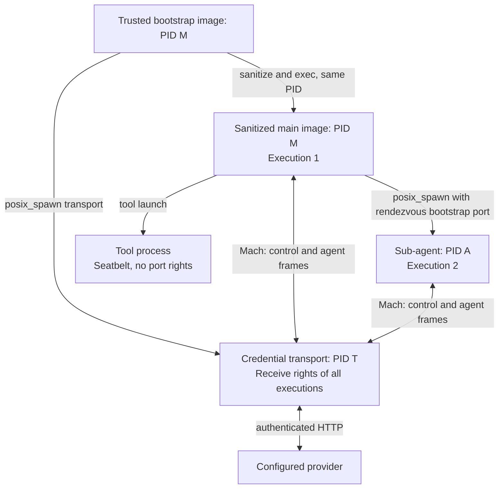
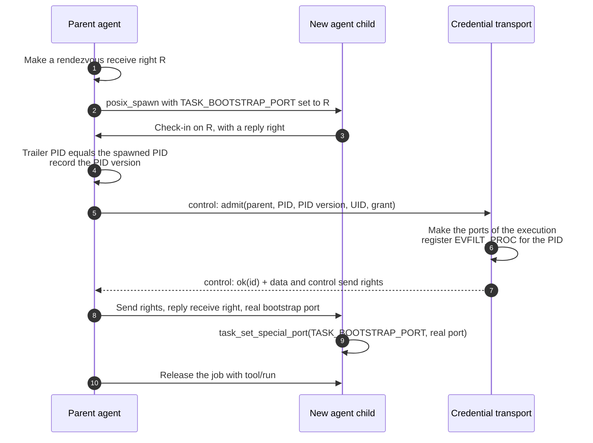

# Software Design Document: credential isolation for agent transports on macOS

**Status:** Proposed; not implemented
**Date:** 2026-10-28
**Scope:** One fyai invocation and its complete agent tree on macOS
**Related designs:** [Credential isolation for agent transports](agent-transport-isolation-sdd.md),
[Native macOS sandbox and project views](macos-native-sandbox-views-sdd.md)

## 1. Purpose

The Linux transport keeps provider credentials out of every agent and tool
process. A separate transport process holds the credentials and sends the
model requests of admitted agents. On macOS, `agent/transport_isolation`
stops the invocation for every value except `none`, because the host backend
does not declare the isolation capability.

This document gives a macOS design that keeps the invariants of section 2 of
the Linux design. It does not use signed helper bundles, XPC services, or a
launchd job, so the standalone CLI can use it. It adds no daemon: the
transport is a child of one invocation, as on Linux.

The design replaces the proposal of section 10 of the Linux design. That
section assumes that a macOS channel can identify its peer only when the
connection opens. A Mach message carries the identity of its sender in a
trailer that the kernel writes, for each message. That is the property that
Linux gets from `SCM_CREDENTIALS`.

## 2. Decision summary

- The agent data channel and the control channels are Mach ports, not Unix
  sockets. The frame format of the Linux transport does not change: a Mach
  message carries one frame, up to `FYAI_TRANSPORT_MAX_FRAME` bytes.
- The transport reads the audit token from the trailer of each received
  message. The token holds the PID, the PID version, the effective UID, and
  the audit session. The PID and the PID version together identify one
  process; a reused PID has a different version.
- The first port right reaches an agent through its bootstrap special port at
  spawn. The agent restores its real bootstrap port before it starts a tool.
  No name is registered with launchd.
- Seatbelt confines tools: no credential source, no Keychain service, no
  inspection of or signal to another process. The macOS sandbox backend
  supplies the profile.
- The fyai binary is signed with the hardened runtime and without the
  `get-task-allow` entitlement. An ad-hoc signature is sufficient. A process
  of the same user without root then cannot get the task port of the
  transport.
- The level has its own name, `level-m`. `auto` selects it on macOS. It does
  not claim level A or level B.

## 3. Mechanism mapping

| Linux mechanism | Function | macOS mechanism |
| --- | --- | --- |
| `SOCK_SEQPACKET` socketpair | Private message channel for each execution | One Mach receive right in the transport for each execution; the agent holds a send right |
| `SCM_RIGHTS` | Pass a channel to a child or to the transport | A port right in a Mach message |
| `SCM_CREDENTIALS` for each datagram | Kernel identity of each sender | Audit trailer (`MACH_RCV_TRAILER_AUDIT`) for each message |
| pidfd | Identity that a reused PID cannot take | PID and PID version from the audit token |
| pidfd poll for exit | Retire an execution | `EVFILT_PROC` with `NOTE_EXIT`; a no-senders notification on the execution port |
| `PR_SET_DUMPABLE` 0, no core dump | Same-user processes cannot read the transport | Hardened runtime without `get-task-allow`, `PT_DENY_ATTACH`, `RLIMIT_CORE` 0 |
| Landlock and the seccomp UDP filter | Tools cannot open credential sources or reach the network | Seatbelt profile of the tool |
| memfd | Anonymous in-memory handoff | A Mach message or a pipe |
| cgroup v2 subtree (level A) | Bound the descendants of an agent | No equivalent (section 9) |

## 4. Threat model

The threat model of section 2 of the Linux design applies without change.
The trusted computing base is the bootstrap, the transport, the agent runtime
before it starts tools, the XNU kernel, Seatbelt, the code-signing
enforcement of the hardened runtime, and the credential resolver.

Invariant 3 of the Linux design names "the protected Linux security context".
On macOS it reads: a model request is accepted only from a live, registered
agent of this invocation, identified by PID, PID version, and UID.

The design does not protect against root, a kernel compromise, a debugger
that the user runs outside fyai with administrator rights, or code execution
in the agent runtime itself.

## 5. Process model

The roles of section 3.1 of the Linux design do not change. The bootstrap
starts the transport, registers itself, and executes fyai again with a
sanitized environment. Each sub-agent is an executed child of the agent that
delegates to it. `agent/spawn: fork` is not available with `level-m`, because
the handoff of section 6.2 needs an exec. A delegation that needs `fork`, such
as a transient run or a pinned root, is refused, as it is with level B.

## 6. Channels

### 6.1 Ports

The transport makes three receive rights for each execution:

| Port | Holder of the receive right | Holder of the send right | Purpose |
| --- | --- | --- | --- |
| Agent data | Transport | Agent | Requests, credit, and cancellation |
| Control | Transport | Agent | Control requests of the execution subtree |
| Reply | Agent | Transport | Response frames and control replies |

The port that receives a message selects the execution, as the channel does
on Linux. A claimed execution ID in a frame is not authorization.

The transport accepts no port right and no out-of-line memory in a message on
an agent data port. A message that carries one is a framing error: the
transport destroys the rights and retires the channel. A control port accepts
a port right only in an admission request.

### 6.2 Handoff to a new agent

A port right is not inherited across `fork()` or `exec()`, except a special
port of the task. The bootstrap special port carries the first right:

The child starts no tool and runs no model request until the restore is
complete. A tool started before the restore would inherit R. The parent
destroys R after the check-in, so a second check-in fails.

The transport admits the PID that the trailer of the check-in names, with
its version. If the child exits before the admission, the PID version does
not match a later process with the same PID.

The root execution uses the same steps: the bootstrap is the parent and the
transport is the first child. The bootstrap gives the transport its own ports
through its bootstrap special port.

### 6.3 Checks for each message

The transport receives with
`MACH_RCV_TRAILER_TYPE(MACH_MSG_TRAILER_FORMAT_0) |
MACH_RCV_TRAILER_ELEMENTS(MACH_RCV_TRAILER_AUDIT)`. For each message:

1. The receiving port selects a registered execution, or the message is
   dropped.
2. The audit token names the PID, the PID version, and the effective UID of
   that execution. A mismatch is a wrong sender: the transport drops the
   message, reports an event, and keeps the channel, as on Linux.
3. The execution is live. An `EVFILT_PROC` exit or a no-senders notification
   retires it.
4. The frame checks of section 4.2 of the Linux design apply without change.

A send right that leaked to a tool or to another process of the user sends
with the audit token of that process, and the transport rejects it.

### 6.4 Event loop

`src/fyai_event_mac.c` adds a Mach port source with `EVFILT_MACHPORT`.
Each borrower removes its sources, as for every other source. A forked child
that does not execute drops the port sources in `fyai_ctx_loop_abandon()`.

## 7. Process and credential protection

### 7.1 The transport

The transport hardens itself before it resolves a credential:

- The binary has the hardened runtime and no `get-task-allow` entitlement.
  The release build signs it with `codesign -o runtime`; a development build
  signs it ad hoc in the same way.
- `ptrace(PT_DENY_ATTACH)` and `RLIMIT_CORE` 0.
- It closes descriptors that it does not need and receives no raw key in its
  arguments.

The startup refuses `level-m` when the running binary does not have the
hardened runtime flag. The check reads the flags of the running code with
`csops()`; the design must not trust a path name.

### 7.2 Agents and tools

Seatbelt has one restriction that sets the shape of this part: a sandboxed
process cannot apply a second sandbox profile (section 10.1 of the macOS views
design). An agent under Seatbelt thus cannot give its tools a stricter
profile. Thus:

- Agents run without Seatbelt. They have no credential in their environment,
  arguments, or descriptors. This is the boundary of level B on Linux, where
  agents are not confined either.
- Tools run under the Seatbelt profile of the tool backend, applied one time
  in the tool child before `exec()`.

The tool profile adds these rules to the configured policy:

- Deny the credential sources: the login store, the files that
  `api_key` and `catalog_update/credentials` name, and the private state of
  the transport.
- Deny `mach-lookup` of the Keychain services (`com.apple.SecurityServer`,
  `com.apple.securityd.xpc`, `com.apple.secd`), so a tool cannot read a
  Keychain item of the user.
- Deny `process-info*`, `mach-task-name`, `mach-priv-task-port`, and `signal`
  outside the process group of the tool.
- Network policy as the configured profile states it.

A tool holds no port right of the transport. The tool child resets its
bootstrap port to the one of the agent, which is the real bootstrap port after
the restore of section 6.2.

### 7.3 Credential sources

| Source | Holder | Protection |
| --- | --- | --- |
| Environment variable of `api_key` | Bootstrap and transport | `fyai_env_sanitize()` before the main exec and before each child exec |
| Keychain items of `fyai_secret_keychain.c` | Transport | Tools: `mach-lookup` denied |
| Login store and configured files | Transport | Tools: Seatbelt file deny |

Each Keychain item that fyai writes can also have an access control list
that names the fyai binary. An ad-hoc signature changes with each build, so
this list is optional; the Seatbelt deny is the required control.

## 8. Configuration and status

`agent/transport_isolation` takes a new value, `level-m`. `auto` resolves to
`level-b` on Linux and to `level-m` on macOS. `level-a` and `level-b` stop the
invocation on macOS, and `level-m` stops it on Linux. The status reports the
level, as it does now.

The host backend of macOS sets `isolation` only when the build has the Mach
channel backend. The startup also checks the hardened runtime (section 7.1)
and the exec path. A failure of any check stops the invocation with its
cause. There is no fallback to direct model HTTP.

## 9. Guarantees and limits

| Property | Level B (Linux) | Level M (macOS) |
| --- | --- | --- |
| Kernel identity of each sender | PID and UID | PID, PID version, and UID |
| PID reuse | pidfd | PID version |
| Leaked channel used by another process | Rejected | Rejected |
| Same-user read of transport memory | Not dumpable | Hardened runtime, `PT_DENY_ATTACH` |
| Descendants of an agent bounded | No | No |
| Tools denied credential sources | Planned (Landlock) | Seatbelt |
| Agents denied credential sources | No | No |

Limits:

- Nothing bounds the descendants of an agent. A descendant is never
  admitted, so it cannot send a request, but it can live after the agent.
  This is the writer-barrier gap of the macOS views design.
- `sandbox_init()` is a deprecated interface. A change in a macOS release can
  remove the tool confinement; the startup must then refuse `level-m`.
- Agents are not confined. A full protected mode needs a separate tool
  launcher that is not under the sandbox of the agent, or a profile that
  serves the agent and its tools.
- Auxiliary HTTP (MCP, OAuth, catalogue update) has the same open items as
  on Linux (section 7 of the Linux design).

## 10. Verification before implementation

A standalone probe on a macOS host must pass these checks before fyai code
changes. Each check has a positive control.

| Check | Pass condition |
| --- | --- |
| Bootstrap handoff | The child gets its rights through R; after the restore, a grandchild does not hold R or any transport right |
| Audit trailer | The receiver reads the PID and PID version of the sender; a send right passed to another process is rejected by its token |
| PID reuse | A token of an exited process does not match a new process with the same PID |
| Hardened runtime | A process of the same user without root cannot get the task port of the transport, or attach `lldb`, also with Developer Mode on; the same binary without the runtime flag can be attached |
| Seatbelt tool profile | A tool cannot read a Keychain item, a denied file, or the process information of the transport, and cannot signal it |
| SSH session | All checks pass in a session that starts over SSH, which has its own launchd context |

## 11. Implementation plan

1. Probe of section 10.
2. A channel backend for the transport (`src/fyai_transport_chan_backend.h`):
   the socket backend of Linux and a Mach backend for macOS, selected as the
   other platform backends are. The registry, the frame format, and the
   control protocol stay in the portable files.
3. The Mach source of the event loop.
4. The handoff of section 6.2 in the agent spawn path, and the exec path of
   sub-agents on macOS.
5. The tool profile rules of section 7.2 in `src/fyai_sandbox_macos.c`.
6. The hardened-runtime signature in the build and the startup check.
7. `level-m` in the schema, the startup, and the status.
8. Tests: unit tests of the channel backend and the handoff in `fyai_test`,
   functional cases of a transport run, and a CI job
   `macos-latest - Release (transport security)`.
9. Documentation: this design, the Linux design, and the user guide.

## 12. Open decisions

- Whether a later protected mode runs agents under Seatbelt with a separate
  unconfined tool launcher, or keeps agents unconfined.
- Whether release builds use a Developer ID signature with a Keychain access
  control list, or the ad-hoc signature only.
- Whether `EVFILT_PROC` or the no-senders notification is the primary signal
  of the end of an execution.
