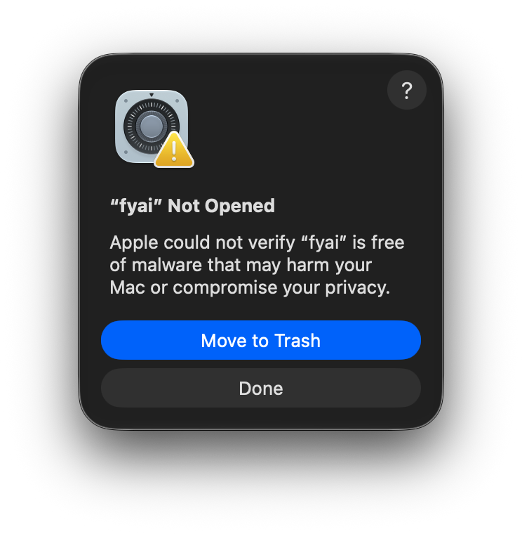
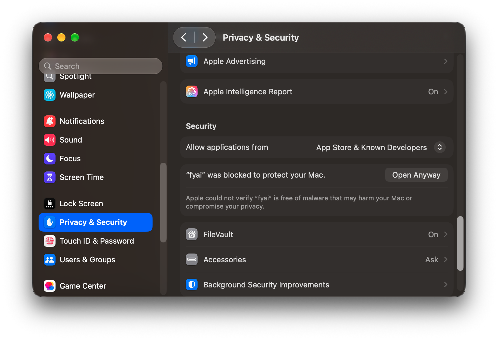
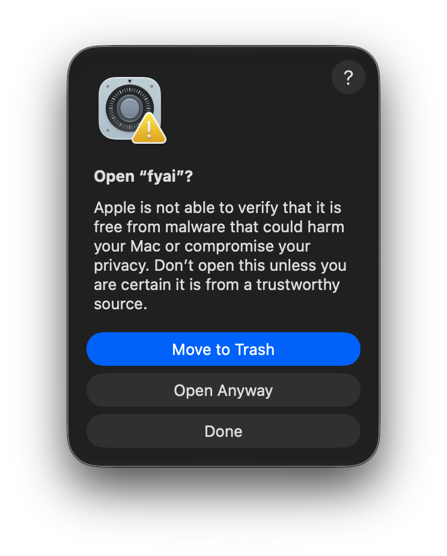
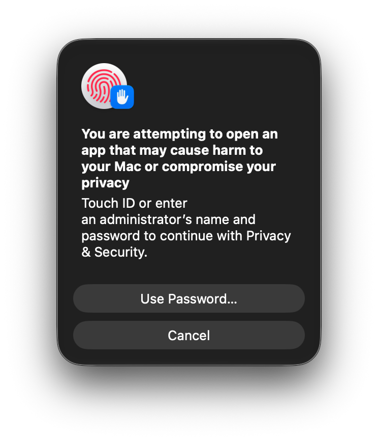
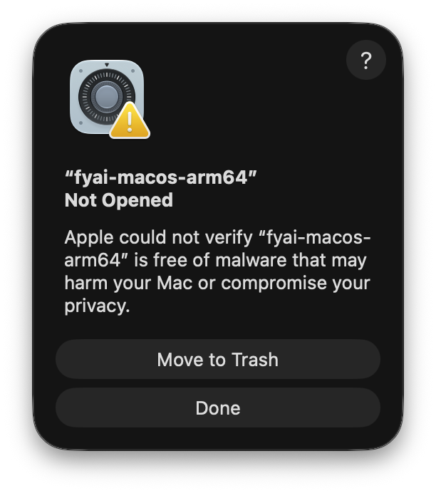
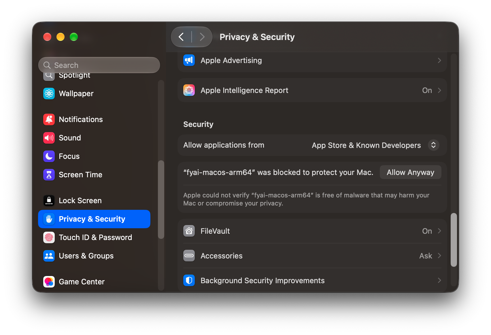
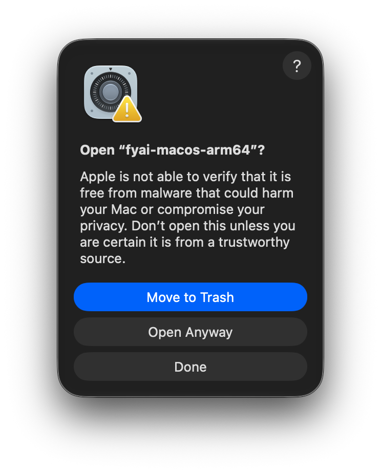
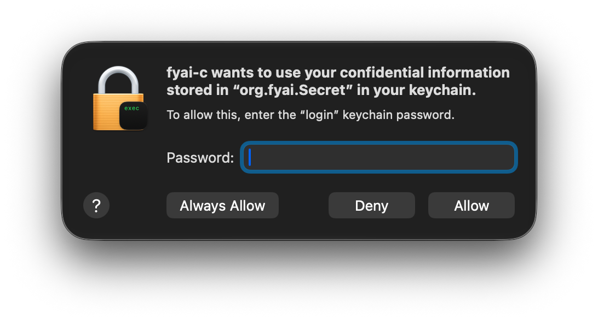

# fyai on macOS

This guide tells you how to install fyai on a Mac and how to give it an
Anthropic API key. For everything else, see the [user guide](user-guide.md).

Each release has two macOS assets for Apple silicon (arm64):

| Asset                      | Contents                                         |
| -------------------------- | ------------------------------------------------ |
| `fyai-macos-arm64.tar.gz`  | the `fyai` command-line program                  |
| `fyai-app-macos-arm64.zip` | `fyai.app`, the desktop app, with its own `fyai` |

Download them from the
[releases page](https://github.com/pantoniou/fyai/releases): a `vX.Y.Z`
release, or `nightly` for the newest build of `master`. There is no Intel
build.

## Gatekeeper

The release is not signed with an Apple Developer ID and is not notarized. The
app and the command-line program have only an ad hoc signature.
A file that a browser downloads gets the quarantine mark
(`com.apple.quarantine`), and Gatekeeper refuses to start a quarantined program
that is not notarized. The message says "Apple could not verify “NAME” is free
of malware that may harm your Mac or compromise your privacy."

Do one of these steps one time for each download:

- Allow the program in System Settings > Privacy & Security, after macOS
  blocks it one time. The sections below show each dialog. According to
  Apple, a right click on the app and Open also does this on macOS 14 and
  earlier. macOS 15 and later do not have that shortcut.
- Remove the quarantine mark with `xattr`, as the sections below show.

`curl` and `gh release download` do not set the quarantine mark. A file that
they download needs neither step:

```sh
gh release download nightly --repo pantoniou/fyai \
	--pattern 'fyai-macos-arm64.tar.gz' --pattern 'fyai-app-macos-arm64.zip'
```

To see whether a file has the mark:

```sh
xattr -l FILE
```

## Install the app

1. Unpack the archive. Finder does this when you double-click it, or:

   ```sh
   ditto -x -k fyai-app-macos-arm64.zip .
   ```

2. Move `fyai.app` to `/Applications`.

3. Allow the app with System Settings or with Terminal, as the next two
   sections show.

4. In the app, File > Open Project selects the project directory. When the
   app starts with no project, it uses
   `~/Library/Application Support/fyai/project`.

### Open the app with System Settings

1. Double-click `fyai.app`. macOS blocks it and shows "“fyai” Not Opened".
   Click Done. Do not click Move to Trash.

   

2. Open the Apple menu and select System Settings.

3. Click Privacy & Security in the sidebar.

4. Scroll down to Security. A message says "“fyai” was blocked to protect
   your Mac." Click Open Anyway.

   

5. macOS shows "Open “fyai”?". Click Open Anyway. Do not click Move to Trash.

   

6. macOS asks for Touch ID, or for the name and password of an administrator.
   Give one of them. The app then starts.

   

macOS keeps this exception, so later starts of this copy of the app are not
blocked. According to Apple, Open Anyway shows for about one hour after the
blocked start. If you do not see it, double-click the app again, or use the
Terminal command.

### Open the app with Terminal

Remove the quarantine mark from the bundle and from all files in it:

```sh
xattr -dr com.apple.quarantine /Applications/fyai.app
```

Replace the path when the app is in a different directory. Then open the app
as usual: macOS shows no warning.

The app uses its own copy of fyai, `fyai.app/Contents/Resources/fyai`. You do
not have to install the command-line program for the app. `web/README.fyai.md` describes the app.

## Install the command-line program

1. Unpack the archive into `~/.local/bin`. It holds one file,
   `fyai-macos-arm64`:

   ```sh
   mkdir -p ~/.local/bin
   tar -xzf fyai-macos-arm64.tar.gz -C ~/.local/bin
   ```

   `tar` copies the quarantine mark of the archive to the file that it
   unpacks.

2. Remove the quarantine mark:

   ```sh
   xattr -d com.apple.quarantine ~/.local/bin/fyai-macos-arm64
   ```

3. Make a symbolic link with the name `fyai`:

   ```sh
   ln -sf fyai-macos-arm64 ~/.local/bin/fyai
   ```

   A new release replaces `fyai-macos-arm64`, and the link stays. Remove the
   quarantine mark from each new file.

   You can copy the program instead of a link. Unpack it in a different
   directory, remove the quarantine mark there, and then do one of these
   steps:

   ```sh
   install -m 0755 fyai-macos-arm64 ~/.local/bin/fyai          # this user
   sudo install -m 0755 fyai-macos-arm64 /usr/local/bin/fyai   # all users
   ```

   `/usr/local/bin` is in the default `PATH`, so step 4 is not necessary for
   it.

4. macOS does not put `~/.local/bin` in `PATH`. Add it to `~/.zshrc`:

   ```sh
   export PATH="$HOME/.local/bin:$PATH"
   ```

5. Make sure that the program starts:

   ```sh
   fyai --help
   ```

If the shell reports `killed` and the exit status is 137, macOS stopped the
program. The terminal shows no other message. There are two possible causes:

- The file still has the quarantine mark. Find it with
  `xattr -l ~/.local/bin/fyai-macos-arm64`, and remove it as step 2 shows.
- The kernel refused the code signature. This occurs when a tool changed the
  file after the build. Give the file a new ad hoc signature:

  ```sh
  codesign --force --sign - ~/.local/bin/fyai-macos-arm64
  ```

### Allow the program with System Settings

In place of step 2, System Settings can allow the program. Do steps 1, 3 and
4 of the installation first, so that `fyai` is in your `PATH`:

1. Run `fyai`. macOS shows "“fyai-macos-arm64” Not Opened", and the shell
   reports `killed`. Click Done. Do not click Move to Trash.

   

2. Open System Settings > Privacy & Security, and scroll down to Security. A
   message says "“fyai-macos-arm64” was blocked to protect your Mac." Click
   Allow Anyway.

   

3. Run `fyai` again. macOS shows "Open “fyai-macos-arm64”?". Click Open
   Anyway. Do not click Move to Trash.

   

4. macOS asks for Touch ID, or for the name and password of an administrator,
   as for the app. Give one of them. The program then starts, and later runs
   show no dialog.

   

The release program links its dependencies statically. It needs only the
system libraries, so Homebrew is not necessary to run it. To build fyai
yourself, see [Build](user-guide.md#build).

## Anthropic API key

Make a key on the API keys page of the Claude Console,
<https://platform.claude.com/settings/keys>. fyai looks for a key in this
order:

1. the environment variable `ANTHROPIC_API_KEY`;
2. the secret `api-key/anthropic` in the macOS Keychain.

Do not write the key into a configuration file. fyai refuses a raw key in
stored configuration; it accepts only a reference such as
`api_key: {type: env, value: ANTHROPIC_API_KEY}`.

### Keychain

The Keychain is the recommended store. Both the app and the command-line
program read it, and the key stays when the Mac restarts.

```sh
fyai secret set api-key/anthropic      # asks for the key; shows nothing
fyai secret status api-key/anthropic   # tells whether the key is set
fyai secret                            # names the backend: macOS keychain
```

`fyai secret set NAME --stdin` reads the key from standard input, for example
from a password manager. fyai never takes the key as an argument.

fyai keeps the key as a generic password with the service `org.fyai.Secret`
and the account `fyai:api-key/anthropic`. Keychain Access shows it under the
name `org.fyai.Secret`.

The app holds the same `fyai` program as the command-line release of the same
version, so each of them reads a key that the other stored. A different build
of fyai, such as a new release, makes macOS ask for permission to use the item.
Enter the password of your login keychain, normally your Mac password, and
click Always Allow, so that macOS does not ask again for that build. Allow
gives access one time. If you click Deny, `fyai secret status` reports the key
as `unavailable`. It reports a store that does not work in the same way.



A key that you enter in the app, in Settings > General > Provider keys, goes
into the same Keychain item.

### Remove the key

> **WARNING: This command removes the API key from the Keychain.** It does
> not ask for confirmation, and you cannot undo it. The app and the
> command-line program both lose the key. To use Anthropic again, store the
> key again with `fyai secret set api-key/anthropic`. Keep a copy of the key
> in a different place, or make a new key in the Claude Console.

```sh
fyai secret delete api-key/anthropic
```

The command removes only the copy in the Keychain. The key stays valid at
Anthropic. To stop all use of the key, revoke it in the Claude Console.

### Environment variable

```sh
export ANTHROPIC_API_KEY=sk-ant-...
```

Put the line in `~/.zshrc` to keep it for each terminal. An app that Finder or
the Dock starts does not read `~/.zshrc`, so `fyai.app` does not see the
variable. Use the Keychain for the app.

### Select a Claude model

```sh
fyai list models                        # the models of the catalogue
fyai -m claude-sonnet-5.5 "hello"       # one invocation
fyai config set model claude-sonnet-5.5 # store it on the current branch
```

`fyai list models` shows the name `claude-sonnet-5.5`. The Anthropic name,
`claude-sonnet-5-5`, selects the same model.

Without a model setting, fyai uses `gpt-5.4-mini`, and it then asks for an
OpenAI key. To use Claude in every project, do one of these steps:

- Store the model in each project, one time:

  ```sh
  fyai config set model claude-sonnet-5.5
  ```

  `fyai --set model=claude-sonnet-5.5` also stores it.

- Write the model into the user configuration file,
  `~/.config/fyai/config.yaml`:

  ```yaml
  model: claude-sonnet-5.5
  ```

  fyai reads this file only for a project that has no stored configuration,
  and `fyai init` stores one. Thus load the file with `-C` on each
  invocation. An alias in `~/.zshrc` does this for you:

  ```sh
  alias fyai='fyai -C ~/.config/fyai/config.yaml'
  ```

  The alias works only in a shell. The app does not use it.

## Sandbox

On macOS the sandbox uses Seatbelt (`sandbox_init`) in place of Landlock and
namespaces. fyai applies the profile in the tool child before it runs the
command, so the command and all its descendants stay confined. Seatbelt is
deprecated by Apple, but it still works. fyai tests at run time that it can
apply a profile.

The sandbox profiles are the same ones that Linux uses
(`sandbox_profile`, `sandbox_profiles`; see
[Sandboxing](user-guide.md#7-sandboxing-and-secret-boundaries)). The default
profile is `dev`. On macOS the sandbox confines files:

- A tool can read the system and toolchain directories (`/System`, `/usr`,
  `/bin`, `/Library`, `/Applications`, `/opt` and others), and it can read and
  write the project, the scratch directory and the `allow` paths of the
  profile. It cannot read other files, such as your home directory.
- The paths in `deny` take precedence over every grant. The `.fyai` directory
  of the project, which holds the arena, is always denied.
- `PATH` keeps only the directories that the grants reach.
- Seatbelt resolves symbolic links, so `/var` and `/private/var` are one
  path.

Make sure that your toolchain is under a granted path. Add the location of a
toolchain in your home directory, such as `~/.cargo/bin`, to `allow` in the
profile. The `dev` profile has the usual ones.

These parts of a profile are not available on macOS:

- **Network limits.** TCP and UDP ports are not restricted: network access
  stays open. A profile that lists network ports still runs, but each model
  request reports warnings such as these:

  ```text
  config: warning: sandbox 'dev': TCP egress remains open; Landlock ABI 4 is unavailable
  config: warning: sandbox 'dev': UDP egress remains open; Landlock ABI 10 is unavailable
  ```

  The warnings are correct. They say that the network part of the profile
  does nothing here. The profile `lockdown` is thus not isolated from the
  network on macOS.
- **Mounts, covers, `home` and `expose`.** A profile that needs a mount
  namespace is rejected. The profile `yocto`, which has a private home, is
  one of them.
- **Read-only exceptions inside a denied tree and append-only modes.** The
  modes of an `allow` entry are `ro` and `rw` only.
- **A second sandbox.** Seatbelt does not nest. A tool that applies its own
  sandbox, for example one that confines its own build, fails with
  `sandbox_apply: Operation not permitted`.

fyai also reports that it cannot hide the project arena in a namespace, and
it names AppArmor and bubblewrap as the fix. These fixes are for Linux only.
Seatbelt denies the arena, so the arena is protected. To stop this warning,
set the cover to `none`:

```sh
fyai config set sandbox_cover none
```

The network warnings stop only for a profile that has no `network` key, or
with `sandbox_profile none`. `none` removes all file confinement: do not use
it only to silence a warning.

`fyai sandbox enter -- COMMAND` runs a command under a profile, so you can
check what a profile allows. `sandbox_on_failure` (`warn` or `fail`) says
what happens when the sandbox cannot start. Use `fail` where an unconfined
tool is not acceptable.

## Project views

A project view is a private, writable copy of the project. Nothing that a
command writes in it reaches the project until you apply the view. On Linux a
view is an OverlayFS mount. On macOS fyai makes it as a cloned directory and
runs native commands in it, with the macOS compiler, SDK and your configured
tools.

```sh
fyai view create try-build
fyai view enter try-build -- cmake --build build   # a command, after --
fyai view diff -u try-build
fyai view apply --dry-run try-build
fyai view apply try-build
```

How it works:

- fyai captures the project into immutable blobs under `.fyai` and clones them
  into `SCRATCH/fyai-view-XXXXXX/project`. On APFS a clone shares the file
  data with the original, so a large tree takes little space. When the volume
  cannot clone, fyai copies the files. `view/scratch_dir` selects the
  directory that holds `SCRATCH`; an empty value selects `$TMPDIR`.
- The view has a different absolute path from your project. Inside it, `pwd`
  shows that path, and a command that names the original checkout is denied,
  not redirected. fyai maps the project path in `PWD`, in `CPATH`,
  `CMAKE_PREFIX_PATH` and the other supported path-list variables. It sets
  `TMPDIR` to private scratch space in the view. It does not rewrite command
  lines or files.
- The command runs under Seatbelt. It can write the view and its scratch
  directory, and it cannot read or write the original project or the arena.
  This confinement is always on for a view, also when the sandbox profile is
  `none`. The rules of your profile (`deny`, `allow`) still apply.
- The directory is the same for each later `view enter` of the same name, so
  an incremental build continues where it stopped.
- When the command exits, fyai scans the tree, stores the result in the
  arena, and leaves the project unchanged. `view diff` and `view apply` work
  as on Linux, with the same three-way check, and `view apply` is the only
  step that changes the project.

Limits:

- **Standalone commands only.** `view enter` works on the command line, and a
  command comes after `--`. `view enter` in a session, `--profile`,
  `--lockdown`, `view mount`, and the internal view commands are not
  available. Neither are agent execution in a view and a session that runs in
  a view (`view/isolate_session`).
- **Build output with absolute paths.** A CMake cache or a `build.ninja` file
  that you made in the original checkout names the original path. Configure
  the build again in the view, in a new build directory.
- **Detached processes.** A command that starts a background process that
  outlives the command can still write to the view when fyai captures the
  result. Stop such processes before the command exits.
- **Temporary directories.** The work directory is temporary data. If the
  system removes it, `view enter` stops with an error and does not start again
  from the baseline, so that your recorded changes are not lost. The last
  completed result stays in the arena, and `view diff` and `view apply` still
  work. fyai does not remove old directories by itself.

The user guide has the full text of [Project views](user-guide.md#8-project-views).

## Features that are not available

These features need the Linux kernel and are not available on macOS:

- the Landlock network limits, the mount, PID and user namespaces, and what
  they give: covers, a private home, and the hiding of denied paths (see
  [Sandbox](#sandbox));
- project views in a session, for agents, with a mount, and with `--profile`
  or `--lockdown` (see [Project views](#project-views));
- the kernel secret store. The Keychain replaces it.

`/session lockdown` takes the strongest isolation that the host can enforce.
On macOS that is less than on Linux: it gives the file sandbox, but it gives no
network restriction and no view of the session.
