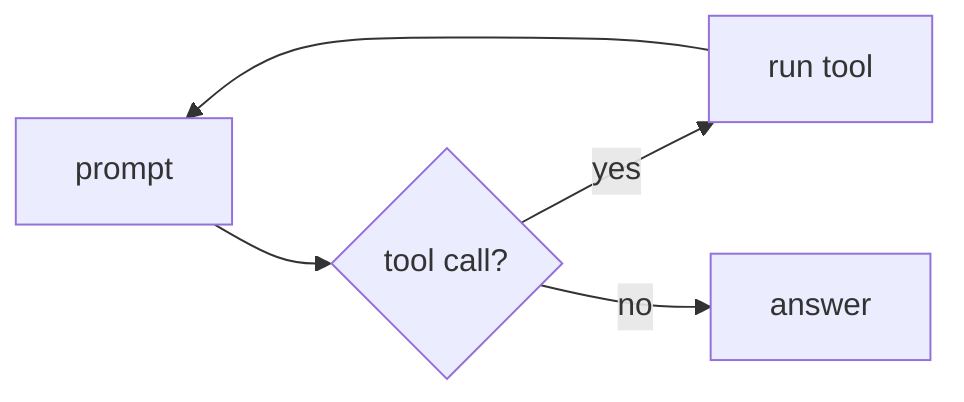

# fyai User Guide

This guide describes how to use `fyai`. For the list of features, see the [README](../README.md).

Authority, in order: the implementation and its tests, `fyai help VERB` for the syntax of a command, `/help` for the commands of a session, `fyai config describe [PATH]` for the configuration schema, and `config.yaml.sample` for annotated examples.

1. [Getting started](#1-getting-started)
2. [The mental model](#2-the-mental-model)
3. [Core workflows](#3-core-workflows)
4. [Models, providers, and authentication](#4-models-providers-and-authentication)
5. [Configuration](#5-configuration)
6. [Tools and sub-agents](#6-tools-and-sub-agents)
7. [Sandboxing and secret boundaries](#7-sandboxing-and-secret-boundaries)
8. [Project views](#8-project-views)
9. [Credential transport](#9-credential-transport)
10. [MCP servers](#10-mcp-servers)
11. [Observability and maintenance](#11-observability-and-maintenance)
12. [Interactive mode](#12-interactive-mode)
13. [CLI reference](#13-cli-reference)
14. [Architecture and operational notes](#14-architecture-and-operational-notes)
15. [Where to look next](#15-where-to-look-next)

## 1. Getting started

`fyai` is a Unix-style AI coding agent. A normal invocation starts a process, discovers or opens the repository arena, loads the selected branch and its configuration, runs the requested command or agent loop, publishes any durable state, prints the result, and exits.

There is no required daemon or resident agent service. Interactive mode keeps one process alive for convenience, but it uses the same durable state model as batch invocations.

### Build

```sh
cmake -S . -B build
cmake --build build
```

A mostly-static build links fyai's dependencies statically while leaving the host C library dynamic:

```sh
cmake -S . -B build-static -DFYAI_MOSTLY_STATIC=ON
cmake --build build-static
```

A self-contained musl binary can be built with:

```sh
MODE=musl scripts/build-static-docker.sh ./fyai
```

### Initialize a project

```sh
fyai init
```

This creates a repository-local `.fyai` arena. Later invocations search upward from the current directory for the nearest `.fyai` directory unless `arena_dir` or another explicit selector is used.

An invocation that finds no arena does not make one on its own. On a terminal it asks whether to create the project at the directory it selected, and an answer of yes initializes it with the default configuration. Without a terminal it stops and names `fyai init`, so a run started in the wrong directory leaves no `.fyai` behind.

To initialize from an explicit configuration document:

```sh
fyai init path/to/config.yaml
```

### Configure credentials

The default is `api_key: { type: auto }`. After the provider is resolved, fyai tries these in order:

1. `--api-key` / `-k`;
2. the provider's environment variable, such as `OPENAI_API_KEY`;
3. the logical secret `api-key/<provider>`.

Raw API keys are not valid in stored configuration. See chapter 4 for secrets and for the ChatGPT subscription login.

### Run the first task

```sh
fyai "inspect this repository and suggest the next cleanup"
```

A prompt invocation may call the model several times and use tools until it reaches a final answer, the configured iteration limit, an interrupt, or an unrecoverable error.

An error in the tool loop does not discard the turn. The turn keeps the steps up to the last tool round that has all its results, and the report names the cause. A tool call that returns no result gets a tool error, and the turn continues. The log of a fullscreen session shows the rows that report errors first.

Run with no prompt, or pass `-i`, to enter interactive mode:

```sh
fyai
fyai -i
```

### Shell completion

`fyai completion SHELL` writes a completion script to standard output. The
supported shells are `bash`, `zsh` and `fish`. Other shells, such as `ash` and
`dash`, have no programmable completion.

To load the script in each new shell, add one line to the start-up file:

| Shell | Start-up file | Line |
| --- | --- | --- |
| bash | `~/.bashrc` | `source <(fyai completion bash)` |
| zsh | `~/.zshrc` | `source <(fyai completion zsh)` |
| fish | `~/.config/fish/config.fish` | `fyai completion fish \| source` |

To install the script once instead, write it to the completion directory of
the shell:

```sh
fyai completion bash > ~/.local/share/bash-completion/completions/fyai
fyai completion zsh  > "${fpath[1]}/_fyai"
fyai completion fish > ~/.config/fish/completions/fyai.fish
```

The script asks `fyai __complete` for the candidates, so it completes verbs,
slash-command words, options, branch names, models and configuration paths
from the stored state. It completes in the project of the current directory,
and it needs no network access and no credential.

### Sessions

An interactive invocation that names no branch starts a **new session**. It
does not continue the conversation the last session left. The session works on
a branch of its own, under `session/`, named for the time it started:

```text
session/20260908T142355.123456
```

A new session starts with the configuration of the branch last updated in
this directory, so a setting changed in one session applies to the next. With
no such branch, it takes the configuration of the branch `HEAD` names.

The name is invocation state until the first exchange, so a session that asks
nothing stores nothing unless `/reload` publishes it. A slash setting or
`/clear` alone is not an exchange: the session applies it, and stores it only
with an exchange or `/reload`. Starting a session does not move arena `HEAD`.

Continue a session with `resume`:

```sh
fyai resume                  # choose a session from the picker
fyai resume <branch>         # resume one session by name
fyai resume --last           # resume the most recently updated one
fyai resume --all            # offer the sessions of every directory
```

A session records the directory it started in. `resume` offers only the
sessions that started in the directory the invocation runs in; `--all` offers
every one of them. Sessions stored before this release record no directory and
appear only under `--all`.

Resuming restores the conversation and the branch configuration. It does not
change the working directory of the process, and it does not move arena `HEAD`:
a resumed session is selected for that invocation, exactly as `--branch` is.

With no argument, `resume` opens the branch hierarchy over the whole window
and selects the most recently used session. Branch name components form
collapsible groups.

| Key | Action |
| --- | --- |
| Up/Down or `k`/`j` | Move through the sessions |
| Left/Right or `h`/`v` | Collapse or expand a group |
| Enter | Resume the selected session |
| `/` | Filter the names |
| `f` | Show or hide unimported Claude Code and Codex sessions |
| `i` | Preview the session |
| Escape | Leave the inspection, then cancel and exit |

Foreign sessions start hidden. When shown, they join imported sessions under
the `import/claude-code` and `import/codex` groups. A cancelled picker stores
nothing. The picker needs an interactive terminal; without one, name a session
or use `--last`.

## 2. The mental model

### Durable state

The running process is not the source of truth. Durable state is stored as immutable values in a libfyaml content-addressed arena. Publication replaces the arena root atomically; unchanged values are shared structurally.

This gives batch commands, scripts, interactive sessions, and delegated agents the same persistence model.

### Canonical content is provider-independent

`fyai` supports three API grammars:

- OpenAI-style Responses;
- OpenAI-style Chat Completions;
- Anthropic-style Messages.

Provider request and response details may be retained for inspection, but the durable conversation is represented canonically. A continuation can therefore be resolved through another provider or API grammar without making the provider's wire transcript the permanent conversation format.

Capabilities still vary by provider and model. Model resolution determines the provider, endpoint, API grammar, wire model identifier, context window, token limit, and relevant feature support.

### Branches

Each branch owns:

- its conversation head;
- its stored configuration;
- its provider and model catalogue;
- the time it was created and the time of its current entry;
- the directory it started in;
- descriptive metadata;
- agent metadata where the branch belongs to a sub-agent;
- a branch-local reflog.

Configuration, catalogue, and conversation history are all branch-local. A new branch starts with the catalogue of its start point.

At the start of an invocation, the current branch is selected in this order:

1. `--branch NAME` / `-b NAME`;
2. `FYAI_BRANCH`;
3. the session `resume` names, or the new session an interactive invocation
   starts;
4. arena `HEAD`;
5. the default branch.

A one-shot `--branch` selection does not move arena `HEAD`. `checkout` does.
Within an interactive invocation, `/branch NAME` changes the selected branch
and moves `HEAD`.

### Turns, exchanges, and steps

A provider request may produce more than one model/tool step before a logical assistant answer is complete. The stored turn records canonical messages, provider observations, metadata, and normalized usage.

An exchange groups a user request with the assistant and tool activity that answers it. Branch merge and rebase operate on exchanges so a question is not separated from its answer.

```sh
fyai list turns
fyai list exchanges
fyai transcript
fyai dump anchors
```

## 3. Core workflows

### Inspect durable history

```sh
fyai transcript
fyai transcript --last 20
fyai history --range 10,30
```

`history` and `display` are aliases for `transcript`. The transcript is a human-facing rendering, not a serialization format.

For canonical inspection:

```sh
fyai dump state
fyai dump anchors
fyai dump providers
```

### Start over or compact

```sh
fyai clear
```

`clear` publishes a null conversation head on the selected branch. The branch reflog records the operation.

```sh
fyai compact
fyai compact "preserve the deployment decisions and unresolved test failures"
```

Compaction performs one tool-disabled summary request, starts a fresh canonical chain, and records the previous head as provenance.

For a one-invocation experiment that must not be published:

```sh
fyai --transient "try a different approach"
```

### Explore alternatives on branches

```sh
fyai branch create experiment
fyai checkout experiment
fyai "try the alternative design"
```

Or create and switch in one command:

```sh
fyai checkout -b experiment
```

Create a branch from a symbolic historical point:

```sh
fyai branch create keep main@{3}
fyai checkout -b retry main~4
```

Branch names are path-like:

```text
main
main/parser
main/parser/review
```

Configuration follows the branch. Different branches can use different models, API grammars, reasoning settings, and tool policies.

### Inspect and recover branch movement

```sh
fyai branch
fyai branch show
fyai list reflog
```

Move the selected branch's conversation head:

```sh
fyai reset HEAD~2
fyai reset main@{1}
```

A reset does not immediately discard the displaced state. The old branch entry remains available through the reflog until garbage collection removes entries outside the retained window.

Compare two reflog entries:

```sh
fyai diff
fyai diff main@{3} main@{1}
fyai diff before main
```

`diff` compares the exports of the two entries, so it shows the turns and the changes of the branch store between them. `<from>` is `HEAD@{1}` and `<to>` is `HEAD` when omitted: a bare `diff` shows the last change. A reference is `<branch>` or `<branch>@{N}`; `<branch>~N` names a turn and is refused. `/diff` does the same in a session.

On a terminal, `diff` shows line numbers and syntax highlighting.

- A palette theme colours a changed row with a colour mixed with the background that the terminal reports.
- With `display/markdown=false`, a terminal gets the rows in the colours of the theme.
- `-u` or `--unified` shows the unified diff in colour, as `git diff` does.
- A file or a pipe always gets the plain unified diff.
- With `--root`, both references are read in that root, so the result does not change when the arena changes.

```sh
fyai branch rename old new
fyai branch describe new "alternative provider and tool policy"
fyai branch delete new
fyai branch delete new --force
```

### Join branches

Rebase places the other branch's exchanges first, then the current branch's own exchanges:

```sh
fyai rebase other
```

Merge interleaves exchanges according to their recorded times:

```sh
fyai merge other
```

Both require a common conversation point unless `--allow-unrelated` is supplied. Joining conversations is an ordering operation rather than a textual file merge.

### Pin an exact state for automation

```sh
root=$(fyai root print)
fyai --root "$root" branch
fyai --root "$root" -b main dump state
```

A pinned invocation is read-only. Commands that would publish state are refused rather than silently discarded.

```sh
historical_root=$(fyai root print main@{3})
fyai --root "$historical_root" transcript
```

Root handles are local to one arena and remain valid only while the corresponding roots are retained. Garbage collection may invalidate old handles.
`--root` also accepts a symbolic reference such as `main@{3}`, but that
reference is resolved afresh on every invocation and moves as the reflog grows.
Capture the emitted root handle, as above, when automation must see the same
state repeatedly.

### Attachments

A message can carry an image or a text file beside its text. Each way to
attach one is explicit: a path typed into a message is attached only when
`@` comes before it.

```sh
fyai --image shot.png "what is wrong in this screenshot?"
fyai "what is wrong in @shot.png and @~/notes.txt"

fyai -i
> /image add shot.png       # or: /image paste, from the system clipboard
> /attach notes.txt         # an image, or a text file the model reads
> what is wrong in this screenshot?
```

A path with blanks is quoted, `@"my shot.png"`, or escapes them,
`@my\ shot.png`; `\@` and `@@` are a literal `@`. Tab completes the path
after `@`, as it does after `/attach`, `~/` too. A `!` line completes no path.
A text file of at most 256 KiB, or `media/max_bytes` when that is smaller, goes
to the model as its text, and the transcript shows one row for it. A file that
is neither an image nor text is refused. A line with a mention that cannot
attach is not sent, in a session and in a prompt on the command line alike:
fix the path and send it again. A prompt that starts with `/` has no
mention, and neither has the task of `fyai agent`.

An attachment waits for the next message and travels with that message only:
a line typed later does not send it again. `/image list` shows what is
waiting, and `/image clear` drops it.

The bytes are kept in the message, in the arena, and the transcript names
them by digest. They are encoded when a request is built, so a conversation
that gained an image on one API continues on another. The model must read
images: `fyai model` and the note that `/image add` prints say whether the
selected model takes one. The limits are 4 MiB per image and 8 per
message; nothing is downscaled.

`/image paste` runs a clipboard helper (`wl-paste`, `xclip`, `xsel`, or
`pngpaste`), because no terminal escape can read a clipboard. Set
`media/clipboard_command` to a program of your own if the search does not find
one. The full design is in `doc/media.md`.

### Export and import

`fyai export` writes a branch as one Markdown document. The document holds the
provider-independent conversation and the history of the branch store: the
configuration, the catalogue and the skills. It leaves out provider request
IDs, tool-call IDs, timestamps and stream data. `fyai import` reads it back.

```sh
fyai export -o conversation.md            # the current branch
fyai export -b main -o main.md            # another branch
fyai export -o before.md 'main@{1}'       # a branch as it was at a reflog entry
fyai import -i conversation.md            # replaces the active branch
fyai -b copy import -i conversation.md    # into an empty branch
fyai export | ssh host fyai import        # to another machine
```

- Export and import use standard output and standard input unless you give
  `-o FILE` or `-i FILE`.
- `--branch` selects the source on export. On import it selects an empty
  destination. Without it, import replaces the active branch.
- A reference is `BRANCH` or `BRANCH@{N}`. `BRANCH~N` names a turn, not a
  reflog entry, and export refuses it.
- An image in a message is exported with its bytes, so another arena can
  restore it.
- A compaction is exported as the operation and its instructions. Import makes
  the model request again with the current model. `--ignore-compact` skips
  these requests.
- `--dry-run` checks a file and stores nothing.

`doc/textual-export-format.md` describes the format.

#### Foreign sessions (experimental)

`fyai import --from` reads the sessions of other programs. The supported
sources are Claude Code (`claude-code`) and Codex (`codex`). This feature is
experimental. The converted conversation can differ from the original, and
the options can change.

```sh
fyai import --list                                   # sessions of this directory
fyai import --list --all --from codex                # in every directory
fyai import --from claude-code --session ID          # import one session
fyai import --from codex -i rollout.jsonl            # import a file
fyai import --from auto -i session.jsonl --dry-run   # check, store nothing
```

- `--from auto` detects the source from the file.
- `--source-root DIR` names the state directory of the source. The defaults are
  `$CLAUDE_CONFIG_DIR` or `~/.claude`, and `$CODEX_HOME` or `~/.codex`.
- The import creates the branch `import/SOURCE/SESSION-ID`. An import of the
  same session again continues that branch.
- Import is offline. It sends no request and runs no recorded tool call.
  Recorded calls are history only.
- The conversation continues with your current model, system prompt, tools and
  permissions. The instructions, model choices, permissions, hooks and
  credentials of the source are not taken over.
- Compactions and rewinds of the source are applied, so the branch holds the
  context that the source had at the end.
- Content that fyai cannot represent becomes a labeled placeholder. The import
  succeeds and reports each loss as a warning.
- A file with a malformed record, a cycle or an unclear source is refused
  before anything is stored. A partial last record is skipped with a warning.
- `--root` allows `--list` and `--dry-run` only.

The resume picker (`fyai resume`, `/resume`) lists these sessions too. Press
`f` to show them. Choosing one imports it and continues it.

## 4. Models, providers, and authentication

### Model selection

```sh
fyai -m gpt-5.4-mini "review this patch"
fyai config set model openrouter/some-model
```

A plain model name selects its canonical catalogue offering. `provider/model` pins a provider offering.

```sh
fyai list providers
fyai list models
fyai catalog
fyai context
```

Interactive equivalents include:

```text
/model
/model gpt-5.4-mini
/status
/context
```

Changing the model re-resolves provider, endpoint, API grammar, wire model identifier, context window, token limit, and credentials where appropriate.

### The catalogue

Each branch has its own provider and model catalogue. A branch that has none uses the catalogue built into `fyai`. Edit it as you edit the configuration:

```sh
fyai catalog get models/gpt-5.5/context_window
fyai catalog set models/gpt-5.5/context_window 400000
fyai catalog set providers/openai/models/gpt-5.5/pricing '{input: 1.25, output: 10}'
fyai catalog delete models/old-model
fyai catalog edit
fyai catalog validate
fyai catalog reset
```

A path is slash-separated. An item of a sequence is named by its index or by its name; a model that a provider offers is named by its `canonical_id`, or by the id the provider gives it. A name that holds a `/` or a `~` writes them as `~1` and `~0`, as in JSON Pointer: `providers/fireworks/models/accounts~1fireworks~1models~1glm-5p3`. Configuration paths read the same escapes: `fyai config get display/keys/prompt/Ctrl-~1`. A `set` on an item that does not exist adds it. Every change is checked against the catalogue schema (`fyai catalog schema`), and a change that fails it writes nothing.

`fyai catalog update` runs `catalog_update/command`, `scrape-providers` by default, and takes the catalogue that it writes. `--provider NAME` replaces only that provider and the models that the scrape describes; `--curated` is passed to the command. The command gets only the provider keys that `catalog_update/credentials` names. In a session, `/catalog update` takes the same options and runs the command in a tile of the work pane. The session commits the catalogue when the command ends and no turn runs.

`fyai context` reports the projected fill of the next request. The same
projection is enforced: a prompt that cannot fit the model's context window is
refused before it reaches the provider, and the output allowance is reduced to
the room the prompt leaves. Compact or clear the conversation to recover.
Tool results have limits for the same reason, so one large file or one command with long output cannot fill the window: `read/max_bytes` bounds a `read_file` result
(which also takes `offset` and `limit` to read a window of lines), and
`shell/max_output_tokens` bounds shell output. Use a reported `offset_bytes`
to continue after a byte-limited read. See `doc/context-compaction.md`.
`-m` selects the model for one invocation. `/model NAME` persists the selection
on the current branch, as does `fyai config set model NAME`.

### API grammar

```sh
fyai api
fyai api responses
fyai api chat-completions
fyai api messages
```

Interactive equivalents are `/api` and `/api MODE`.

### Local and self-hosted servers

```sh
fyai \
  --set api=chat-completions \
  --set api_url=http://localhost:11434/v1/chat/completions \
  --set no_auth=true \
  -m llama3 \
  "inspect this tree"
```

### API keys and secrets

On Linux, a logical key can be stored in the kernel secret store:

```sh
fyai secret set api-key/openai
fyai secret status api-key/openai
fyai secret delete api-key/openai
```

### ChatGPT subscription login

For OpenAI Responses requests, an eligible ChatGPT subscription may be used instead:

```sh
fyai auth openai login
fyai auth openai login --no-browser
fyai auth openai status
fyai auth openai usage
fyai config set auth chatgpt
```

`auth: auto` prefers an available API key and otherwise falls back to a saved ChatGPT login. `auth: api-key` disables that fallback. `auth: chatgpt` selects subscription access explicitly.

The first login registers fyai with OpenAI and requests permission to use your
ChatGPT plan. No client ID from a developer dashboard is required. fyai saves
an opaque host ID before login and saves the issued client ID for later login
and token refresh. It verifies the ID token and the granted plan-usage scope.
Old Codex-compatible credentials require a new login.

Use `fyai auth accounts` to list saved registrations. Use
`fyai auth login --account CLIENT_ID` to authorize one again, or
`fyai auth login --new-account` to register another account or workspace.
Logout clears the active registration's tokens and retains its client ID and
the host ID. A failed login does not replace another account's credentials.

For a browser on another machine, use `fyai auth login --manual` and paste the
complete callback URL. In a session, use `/auth login --manual`. Open the
link in your local browser and paste the callback URL from its address bar
even if the loopback page cannot load. No SSH port forwarding is required.
A bare authorization code is not accepted. The
subscription registration flow does not support device-code login.

Subscription requests use the public Responses API with streaming enabled and
server-side storage disabled. They send the full required history and group
local tools in a namespace. They do not use ChatGPT's private backend endpoints
or fall back to an API key after a subscription failure. See
[OpenAI's registration documentation](https://developers.openai.com/siwc/token-sharing-open-source/sign-in)
and [preview limits](https://developers.openai.com/siwc/token-sharing-open-source/preview-limitations).
The [authentication flow](chatgpt-auth.md) documents registration, refresh,
logout, and credential ownership with Mermaid diagrams.

`fyai auth status` shows the configured mode, effective method, and plan
permission. `fyai auth usage` shows selected-conversation token totals and links to
ChatGPT Settings, where you can review
app limits and control whether the app may use credits after plan limits.

### Authentication commands

```sh
fyai auth openai login
fyai auth openai login --no-browser
fyai auth openai status
fyai auth openai info
fyai auth openai usage
fyai auth openai usage --json
fyai auth openai logout
```

Interactive shortcuts:

```text
/auth
/auth status
/auth login
/auth logout
/usage
```

Subscription tokens are machine-local credentials and are not written to the repository arena.

## 5. Configuration

### Sources and precedence

There is one persisted repository configuration: the selected branch's arena configuration.

The user file at `$XDG_CONFIG_HOME/fyai/config.yaml`, or `~/.config/fyai/config.yaml`, is bootstrap input only when the arena has no stored configuration.

```text
stored branch config (or user bootstrap)
    -> --config FILE
    -> command-line configuration overlays, in argument order
    -> built-in defaults for absent keys
```

`--config`, `-m`, `--sandbox`, `--color`, and `--theme` affect only the current
invocation. Global `--set` and `--delete` operations also participate in that
ordered overlay, but are persisted to the selected branch unless `--transient`
is active. `--api-key` is a separate invocation-only credential override.

### Inspect and edit configuration

```sh
fyai config show
fyai config effective
fyai config get model
fyai config export
fyai config set reasoning/effort high
fyai config set display/tool_detail full
fyai config delete reasoning/summary
fyai config edit
fyai config import path/to/config.yaml
```

The value `none` of `reasoning/effort` and `reasoning/summary` sends no
reasoning field in the request. It overrides a value from a lower layer.

Slash paths address nested keys. Values are parsed as YAML values rather than untyped strings.

Global operations apply before the selected verb or prompt:

```sh
fyai --set reasoning/effort=high --get model
fyai --delete display/prompt_top "continue the review"
```

### Validate and discover the schema

```sh
fyai config validate
fyai config schema
fyai config describe
fyai config describe sandbox_profiles
```

These commands describe and validate the configuration nodes covered by the
schema. The validator accepts unknown keys, and some transport
extensions are not enumerated there, so consult `config.yaml.sample` for the
annotated supported-key catalogue as well.

### Model access to the configuration

The `model` column of `config describe` gives what the model can do with
each key: `hidden`, `read`, `review` (the user approves each change) or
`write`. The model reads the configuration with the `settings` tool: it
searches for a key, describes it, and reads its value. A hidden key, such
as a credential reference, is left out of every answer.

The model never writes the configuration. It presents a change and an
explanation; fyai checks it and makes the diff. fyai applies a change of
`write` keys at once only when `model_access` is `write` and the sandbox
denies the arena to the shell. Every other change appears in a review
page: the explanation and choices on the left, the diff on the right, and
a reply input box spanning the width below both columns. Select Other to
focus the input box, or start typing. Right from the choices focuses the
diff; Down from the last choice focuses the input box, and Up returns to the
choices. Tab cycles between these components. The focused diff takes Up and
Down for scrolling; the input box keeps Left and Right for editing.
Page Up and Page Down scroll the diff. The scroll bar also moves it by one
row with its arrows, or by one page with its track. The layout is the
`ask_permissions` page; [page panels](page-panels.md) can be placed in other
parts of a page. Reject
is the first option; Down and Enter accept; a typed reply rejects the
change and goes back to the model. Spaces and digits enter the reply; they
do not choose an option in a permission review. When nobody can review a
change, as in
a one-shot prompt, it is kept as a proposal:

```sh
fyai config proposals
fyai config review p1
fyai config approve p1
fyai config reject p2
fyai config changes
fyai config revert c3
fyai config keep c4
```

`config revert` takes back one change of the model and keeps every later
change; a key that changed since is a conflict, and `--force` takes back
the others. `config keep` stores a change that the model made as a trial
for one session. Approving or rejecting in a session tells the model.

The same tool reads the catalogue (`document: catalog`): the model can
search the models by name, capability or provider before it suggests one.
The model can use a source it inspected itself. `settings` accepts
`document: catalog`, `action: change`, a `source`, and up to 32
`{path, value}` or `{path, delete: true}` changes. Paths may
change model properties under `models/NAME` and provider offerings under
`providers/NAME/models/ID`; provider URLs and endpoints are outside this
action. fyai checks the whole change against the catalogue schema and makes a
diff. Under the normal `model_access: review`, a session presents the same
review panel as a configuration change; a one-shot run keeps a proposal for
`config review`, `config approve`, or `config reject`. Under `model_access:
write`, fyai applies the change directly only when the arena is protected,
as it does for configuration changes. `config revert` applies only to
configuration changes; use `catalog set` or `catalog delete` to correct an
approved catalogue entry. A sub-agent has no settings tool.

For a question over many entries, such as "which model of Anthropic is the
cheapest?", the model uses `select`: it filters, sorts and projects the
keys of the configuration or the items of the catalogue in one call. For a
deeper search it can `export` either document to a file that fyai names and
removes at the end of the session, and read it with a program such as jq.
An export of the configuration leaves the hidden keys out.

`model_access: read` allows reads only, and `none` removes the tool. See
`doc/declarative-state.md`.

## 6. Tools and sub-agents

The model has these built-in tools. `fyai catalog tools` lists them with their descriptions (`/tools` in a session; add `--full` for the complete text).

| Tool | Purpose |
| --- | --- |
| `read_file`, `write_file`, `apply_patch` | Read, write and patch files in the workspace. |
| `exec_command` | Run a shell command, in the background or in a named terminal session. |
| `shell_input`, `shell_output`, `shell_close` | Type into, read and end a terminal session. |
| `monitor` | Watch a long-running command. Each output line is an event. |
| `wait`, `time` | Wait for a time or for background work, and read the clock. |
| `cancel`, `list` | Stop background work and list what the model owns. |
| `agent`, `agent_message`, `agent_input`, `project_view` | Delegate work, talk to a running sub-agent, and review its view. |
| `ask_user`, `ask_parent` | Ask the user, or the delegating agent, a question. |
| `todo_write`, `skill`, `settings`, `structured_output` | Task list, skills, configuration and structured final answer. |
| `tool_search`, `mcp_resource` | Find MCP tools and read MCP resources. |

The shell tool is called `exec_command`. A call under its old name, `shell`, still works, so a stored conversation replays.

Run one tool directly, without a model call:

```sh
fyai tool read_file '{"path":"README.md"}'
fyai tool exec_command '{"command":"git status --short"}'
```

### Shell commands on a terminal

`exec_command` takes `tty: true`. The command then runs on a pseudo-terminal.
The result is the screen that libfyvterm interprets from the byte stream,
with the lines that scrolled off it in front. Use it for a program that behaves
differently without a terminal.

```sh
fyai tool exec_command '{"command":"git log --oneline -5","tty":true}'
```

The screen has the size of the terminal of the user. It follows that terminal
when the window changes size, because the parent watches `SIGWINCH` and gives
the new size to the session. `shell/tty_rows` and `shell/tty_cols`
set a fixed size instead, and the model can ask for one with `rows` and
`cols`.

`shell/tty` gives a terminal to a call that asks for none. It is the only way
to put the native `shell_call` of the Responses grammar on a terminal, because
that grammar has no field the model could ask with.

A command with no terminal writes to pipes, and the result is the bytes that
it wrote. A program can send control sequences to a pipe anyway: it moves the
cursor, erases a row, sets a colour, or overwrites a row with a carriage return,
as a build tool does for its progress. From the first such byte, fyai gives the
output of that stream to a screen, and the result is what the screen shows, as a
terminal run gives, with the rows that scrolled off it before. The screen has the
size that a terminal run of the call gets (`shell/tty_rows` and `shell/tty_cols`,
else the terminal). Output with no such byte is not changed.

### Background commands

`exec_command` takes `background: true` to start a build, a server, or any program that
runs on while the model works. The call returns at once. The command has no terminal and no
time limit, and its output is not kept: redirect it to a file to read it later. The invocation
keeps it as a quiet monitor, and the model is told when it ends, as
`[shell 'NAME' ended: status N]`. `name` names it; without one it is `bg-N`. `wait` with `for`
holds the turn until it ends, `list` with kind `monitors` shows it, and `cancel` with its name
stops it. `tty` and `timeout` do not apply to it.

A `name` (letters, digits, `-` or `_`) labels the daemon: `list daemons` shows it as the
`label`. The model stops it with `cancel` and the name, or with the pid that `list`
shows. The user stops it with `/kill NAME-OR-PID`, which tries a shell session and a
sub-agent of that name first. A daemon gets SIGTERM, and SIGKILL after
`sandbox_grace_ms` if it stays. All processes with the label stop together, so a server
and what it started end as one.

```sh
fyai tool exec_command '{"command":"python3 -m http.server 8000 > server.log 2>&1","background":true}'
```

### The shell a command runs under

A command of the shell tool runs under bash where the system has it (`/bin/bash`,
`/usr/bin/bash` or `/usr/local/bin/bash`), and else under `/bin/sh`; the other commands
of this program, such as a helper or a catalogue update, run under `/bin/sh`. Set
`shell/shell` to choose another shell for every call, such as `/bin/sh`. The `shell`
argument names another shell, and `login` starts that shell as a login shell,
which reads the profile of the user.

```sh
fyai tool exec_command '{"command":"node --version","login":true}'
fyai tool exec_command '{"command":"echo $BASH_VERSION","shell":"/bin/bash"}'
```

Ask for `login` when a command needs a tool or a variable that the profile
sets up, such as a version manager that puts an interpreter on the path. It
costs the time the profile takes, so a command that does not need it should
not ask for it.

`shell/shell` and `shell/login` decide for a call that names neither. They
are also the only way to reach the native `shell_call` of the Responses
grammar, which has no field for either.

### An interactive terminal session

Give the shell call a `name` and a terminal with `tty: true`, and it stays
open as a session: one program on a terminal of its own, addressed by that
name. Use it for a program that expects a person, such as a shell, an editor,
or a program that draws a screen:

```sh
fyai tool exec_command '{"name":"repl","command":"python3","tty":true}'
```

A session needs the terminal, and a `name` without `tty` is refused. On pipes
a command has a definite end and the caller asked for its output, so it runs
to completion and answers with what it wrote, as every other command does.

The call answers as soon as the session exists. From there:

- `shell_input` types into it. The text is keystrokes, thus a control
  character works: `\u0003` interrupts, `\u001b` is escape. A return is added
  unless `enter` is false.
- `shell_output` reads it without typing: `new` for what appeared since the
  last read, `screen` for the whole screen, `region` for a part of it.
- `shell_close` ends it. Drive the program out itself where you can, such as
  `:q!` in an editor, so that it can save what it owns.

The reading follows what the program did. A program that writes lines is read
as lines, whole and in the order of arrival. A program that draws, such as an
editor, is read as the screen that it drew. Its bytes are cursor movements and
give nothing on their own.

How a session is shown:

- The call that opens a session shows its screen live, marked running while the program runs. The screen is committed to the transcript when the program stops.
- `shell_input` and `shell_output` show nothing of their own, because their work appears on that screen.
- Each row of the screen has a margin under the name of the call. `display/session_margin` sets the margin. An empty string draws none.
- This is what the user sees. The arena keeps the calls as they were, and the model receives each result.

A session lives for one invocation. A later invocation cannot reach it. It
ends with the invocation, with `shell_close`, when its program ends, or after
`shell/session_timeout_ms` with no read and no write.

Refer to `doc/pty-terminal-plan.md`.

### A session that waits for input

A program in a session can stop and wait for input. No person is at that
terminal, so the model answers. The parent reads the state of the program from
the kernel. It then raises a turn that names the session and carries its
screen, because the screen holds the question:

```text
  │ [shell 'setup' is waiting for input: Continue? [y/N]]
● shell_input [setup] y
```

Answer a session with `shell_input`, and a sub-agent with `agent_input`. A
sub-agent that ended is not typed into. Call `agent` with its name instead.

`shell/input_poll_ms` sets how often the parent asks the state of a program.
The value 0 stops the question.

### Listing what the model owns

`list` gives the model the objects that it can name in another call. A row has the name that the model gave the object.

| Kind | Objects |
| --- | --- |
| `agents` | The sub-agents it started, running or ended. |
| `views` | The views that isolated sub-agents left. |
| `shells` | Its open terminal sessions. |
| `waits` | Its pending named waits. |
| `monitors` | Its running monitors. |
| `questions` | Its background questions that still wait for an answer. |
| `daemons` | The processes that the scope of the exchange holds. |

The tool lists only what the calling agent owns. The views and branches of the user, and the objects of other agents, are not rows. Branches are not a kind.

### Telling the time, and waiting

The system instructions are frozen when a conversation starts, so they cannot
say what the time is now. `time` answers that, and measures how long something
took.

`wait` waits. It starts no process, unlike a shell that sleeps, and an
interrupt reaches it:

```text
wait{seconds: 5}                     # holds the turn for five seconds
wait{until: "14:00"}                 # holds it until a wall-clock time
wait{name: "build", seconds: 30}     # returns at once and fires later
```

A named wait does not hold the turn. The call returns when the wait is armed,
and the model continues. When the wait fires, the model receives a report that
no person typed. A report that arrives while the model works joins the same turn
before the next model request, after the active tool calls finish. A report that
arrives while the session is idle starts a turn of its own:

```text
  │ start the build and come back to it
● wait [build] the build should be done
    [wait 'build' started: 30 seconds]
  Started it. I will pick it up when the wait fires.
  │ [wait 'build' fired: the build should be done]
  Checking the build now.
```

`seconds` and `until` are exclusive, but an empty argument is not an argument:
a call that sends `until: ""` beside `seconds` asks for the seconds.

A wait lives for one invocation, as a terminal session does. fyai has no daemon to receive it, so a wait that did not fire is dropped when the run ends.

### Waiting for what the model started

`wait` with `for` holds the turn until something the model started ends. It
takes the name of a background sub-agent, a terminal session or a named wait,
or a list of up to 16 names:

```text
wait{for: "review"}                            # until one thing ends
wait{for: ["a", "b", "c"], mode: "all"}        # until every one ends
wait{for: ["a", "b"], mode: "any", seconds: 60}  # the first, or 60 seconds
```

`mode: any` is the default. `seconds` or `until` set the longest wait; the
call then returns the reports it has and names what still runs. A report that
the wait returns is not given again in a later turn. A sub-agent or session
that stops to ask for input ends its part of the wait.

Waits in one response run at the same time, and an event that several of them
wait for reaches each of them: both results hold the report. A wait does not
poll. The event loop wakes it when an event is queued, when what it waits for
changes, or at its time limit, and the interface and interrupts keep working.

Background work belongs to the conversation that started it. `/clear`,
`/resume`, `/checkout` and `/reset` end the background sub-agents, monitors and
named waits of the old conversation and drop its queued events, so nothing
reports into the new one. Terminal sessions stay, as they are on the screen.

### Monitors

The `monitor` tool watches a long-running command. The command runs in the
background as a shell call, with the confinement, the environment and the
time limit of one. Each complete line that it prints reaches the model as an
event between its tool calls, and the end of the command is the last event:

```text
  │ [monitor 'ci'] build: step 3 of 9 passed
  │ [monitor 'ci' ended]
```

The default time limit is five minutes and the most is thirty. Both output
streams are events, so the command should print only the lines that the model
acts on. A monitor that sends more than 200 events is stopped. `wait` with
`for` holds the turn until a monitor reports, `list` shows the running ones,
and `cancel` stops one.

### Background sub-agents and cancel

An `agent` call with `background: true` starts the sub-agent and returns at
once. When the sub-agent ends, the model receives its final report as a turn of
its own, as it does for a named wait:

```text
  │ [agent 'review' finished]
  <final report of the sub-agent>
```

A sub-agent that fails reports `[agent 'NAME' failed: CAUSE]`. A background
sub-agent lives for one invocation and is stopped when the run ends.

The `cancel` tool ends background work by name: a pending wait, a running
sub-agent (with every process it started), a monitor, a question that waits for
the user, or an open terminal session. Give `kind` (`wait`, `agent`, `monitor`,
`question` or `shell`) when one name refers to more than one
object. A session is killed at once; use `shell_close` when the program must
save its work. The user can stop a sub-agent with `/kill`.

### Delegated agents and persistent branches

A sub-agent started by the model's `agent` tool is a proper arena branch, not a
throwaway conversation. Its branch persists after the delegated run and can be
inspected with:

```sh
fyai branch --all
```

Normal branch listings may hide agent branches to keep the primary workspace concise; `--all` includes them.

The calling model controls how the sub-agent context starts:

- **Fresh context:** the agent begins with a new context suited to the delegated task. Its work is still recorded on its own persistent agent branch.
- **Forked context:** the agent is a true continuation from the parent branch at the delegation point—the parent's conversation is its starting history.

A forked sub-agent is fixed to the same model as its parent. This preserves the semantics of a true continuation rather than silently changing the model at the branch point. A fresh-context agent may use the persona and model policy selected for that delegated role.

The parent controls delegation and receives the agent's report, while the agent branch retains its durable conversation and metadata for later inspection, comparison, or continuation.

### Reaching a sub-agent again

A sub-agent commits its
conversation on its own branch, under the name that the call gave it. A later
`agent` call with that name continues that conversation, and the sub-agent
keeps what it learned. Ask it what it found, or give it the next step, and it
does not repeat its earlier work. A new name starts a new sub-agent.

A name that belongs to a sub-agent that still runs is refused, because that
sub-agent owns its conversation. Wait for its report, then call it again.

### Transient and persona agents

Run one transient agent explicitly with:

```sh
fyai agent "find the parser entry points and report their responsibilities"
```

The standalone `agent` verb uses the built-in sub-agent persona and restricted
tool set, prints the final report, and does not publish conversation history or
create an agent branch. It also has an `--rpc` mode for the transient standalone
agent control protocol.

For model-delegated calls, configured personas may select a system prompt,
model, reasoning policy, tools, or context behaviour subject to the fork rule
above. A persona that gives `tools` offers its agent only those tools.
Independent sub-agent calls in one assistant message may execute concurrently.
A model-delegated sub-agent can delegate again. `agent/max_live_agents`
limits the complete invocation to 16 live agents by default. The existing
`agent/max_branch_depth` limit also applies. Direct agents show their output
in the work pane. Their children show compact progress; deeper work contributes
descendant counts. `/branches` shows the complete branch tree and live states.
The tile header of a sub-agent shows the branch, the model, the execution id,
and the running time after the agent description. While a turn runs, the input
pane header shows the running time of the turn.

### Questions to the user

The `ask_user` tool puts one to four questions to the user. Each question has
a `header` of at most 12 characters, the question text, and two to four options.
An option has a `label`, a `description`, and optionally a `preview`. The user
can always type an answer of their own, so the model does not offer an
"Other" option. A question with `multi_select` allows more than one choice.

In an interactive session the questions take the input area. One question is
shown at a time, with its position when there are several:

| Key | Action |
|---|---|
| Up, Down | move the cursor over the options |
| `1` to `9` | choose an option, or toggle it in a many-choice question |
| Space | toggle the option under the cursor, or choose it |
| Enter | take the typed text or the option under the cursor and go on |
| Left, Right | go to the question before, or after one that is answered |
| Escape, `^C` | decline every question |

After the last of several questions a review lists every answer. Enter sends
them, Left goes back to change one, and Escape declines. Text typed in place of
the options is the answer; in a many-choice question it adds to the options
that were toggled.

A `preview` is Markdown. While the option is under the cursor, the page draws
it under the options, and a fenced `mermaid` block is drawn as a diagram. Only
a question that allows one choice has previews.

The model receives the answers as JSON. Every question has an `id`, which is
`q1`, `q2` and so on unless the model named it, and every option has an `id`,
which is its label unless the model named it:

```json
{"status": "answered", "answers": [
  {"id": "q1", "header": "Scope", "question": "How wide?",
   "selected": ["medium"], "other": "but not the parser"}]}
```

`status` is `declined` when the user gave no answer. Without a terminal page,
`ask_user` writes each question as text, and a number or a list of numbers
separated by commas chooses; `--answer` supplies one answer for each question
in order, and a blank answer declines.

A call with `background: true`, or with a `name`, does not hold the turn. It
returns at once with the name of the question (`ask-1`, `ask-2` and so on when
the model gave none), and the user answers when ready. The model then has the
same tools as for other background work: `list` with kind `questions`, `cancel`
to withdraw it, and `wait` with `for` to hold a call for the answers. `wait`
with `poll: true` looks once and reports what has ended and what still runs.
The answers arrive in a turn of their own when nothing waits for them:

```text
  │ [question 'ask-1' answered]
  {"status": "answered", "answers": [...]}
```

Without a terminal page a background call is asked at once like any other.

### A question from a sub-agent

A sub-agent uses `ask_parent` to ask its delegating agent for a decision. The
question returns at once; `wait` with its name receives the answer. The parent
answers with `agent_message` and the question's `reply_to` ID. The root session
alone has `ask_user` to ask the person. An agent resumed directly by the user
has `ask_user` again.

Only a question the root asks with `ask_user` reaches the main prompt.

Use `/branch attach <full-branch-name>` to view a running agent and submit
additional input to it. The same process handles this input after its current
turn. Attachment preserves stored `HEAD` and the main conversation's draft.
`/branch detach` returns to the main conversation. A completed attachment stays
read-only until detached. `/zoom`, `/kill`, and `/sessions` also reach nested
agents. A short agent name must be unambiguous; a full branch name is exact.

### The todo list

The model keeps a task list for a job of several steps with the `todo_write`
tool. Each call replaces the whole list. An item has a `content` text (at most
512 characters), a `status` and a `priority`:

| Field | Values |
| --- | --- |
| `status` | `pending`, `in_progress`, `completed`, `cancelled` |
| `priority` | `high`, `medium`, `low` |

A list holds at most 64 items. The tool tells the model to keep one item
`in_progress` at a time.

The list is branch state, like the configuration, so it survives a restart. A
sub-agent branch starts with a copy of the list of its parent and then keeps
its own.

In the terminal UI the list is a panel of the page. It shows each item with
the mark of its state, and it stays while the branch holds a list. Outside the
UI, and in a session, you read it with a command:

```sh
fyai todo            # show the list
fyai todo clear      # drop the list
```

`/todo` and `/todo clear` do the same in a session.

### A structured final answer

A program that uses fyai as the CLI of the Claude Agent SDK can ask for an
answer in a shape. With `output_format` of type `json_schema`, the model gets
the tool `structured_output`, whose parameters are your schema. A call whose
arguments match the schema is the answer, and the turn ends. A call that does
not match gets the problems back and can correct them. `doc/claude-sdk-compat.md`
has the details.

### Skills

A skill is a set of instructions for one kind of task, such as a review
checklist or the conventions of a project. It is a `SKILL.md` file with a YAML
front matter and the text files beside it, in the Agent Skills format that
Claude Code reads.

```markdown
---
name: review
description: Review the staged change against the conventions of the project.
argument-hint: "[path]"
context: fork
allowed-tools: Read, Bash(git:*)
---
Review the staged change in $ARGUMENTS. Read `skill:review/checklist.md` first.
```

Skills are branch state, like the configuration. A new session, a new branch
and a sub-agent take the skills of the branch they start from. fyai does not
look for skills in the file system: a `SKILL.md` in the repository changes
nothing until you import it.

```sh
fyai skill import path/to/review          # a directory with SKILL.md and its files
fyai skill import path/to/skills          # a directory of such directories
fyai skill import --claude all            # the skills and commands of Claude Code
fyai skill list
fyai skill show review
fyai skill new review                     # write one in $EDITOR
fyai skill exec review src/main.c         # run one turn with the skill
fyai skill export review ./out            # write it back to files
```

The model and the user run a skill in two ways:

- The model sees the skills in the description of the `skill` tool. It loads a
  skill when the task fits the `description`, and reads a supporting file with
  `{skill, file}`.
- You run a skill with `/NAME ARGS` in a session, `fyai skill exec NAME ARGS`
  or `fyai "/NAME ARGS"`. A command with the exact name wins over a skill. Use
  `/skill exec NAME` to reach the skill. Tab completes the names.

The body takes `$ARGUMENTS`, `$ARGUMENTS[N]` and `$N` (word N from 0), `${CLAUDE_SKILL_DIR}` and
`${CLAUDE_SESSION_ID}`.

| Front matter | Effect |
| --- | --- |
| `name` | Lowercase letters, digits and `-`, at most 64. |
| `description` | Required. The model chooses a skill from this text. |
| `when_to_use` | More text for the choice. |
| `argument-hint` | The arguments, shown in the lists and in completion. |
| `disable-model-invocation` | `true`: the model does not see the skill. |
| `user-invocable` | `false`: `/NAME` does not run the skill. |
| `context` | `fork` runs the skill as a sub-agent. `inline` is the default. |
| `agent`, `model`, `allowed-tools` | The persona, the model and the tools of a forked skill. |
| `isolated`, `background`, `timeout` | fyai only: run a forked skill in a private view, without holding the turn, with a time limit in milliseconds. |

Other commands:

| Command | Purpose |
| --- | --- |
| `skill files NAME` | List the supporting files. |
| `skill edit NAME [FILE]` | Edit the skill or a file in an editor. |
| `skill enable NAME...`, `skill disable NAME...` | Keep a skill stored and unused, or use it again. |
| `skill remove NAME... [--file REL]` | Remove skills, or one supporting file. |
| `skill import PATH --into NAME [--as REL]` | Store one text file as a supporting file. |
| `skill import --claude SCOPE` | `project`, `user`, `plugins` or `all`. |

An import with an existing name keeps the stored skill, unless you give
`--force`. An import reads text files only, to a depth of 8: at most 256 KiB
for each text, 256 files and 8 MiB for one skill. A skill with files is
written to a private temporary directory when it loads, so a command such as
`python scripts/check.py` works. The directory is removed when the invocation
ends.

fyai does not support discovery at run time, `!`command`` preprocessing of the
body, `model` and `allowed-tools` for an inline skill, and binary supporting
files. `doc/skills.md` has the details.

## 7. Sandboxing and secret boundaries

The sandbox confines the commands that tools run. It is Linux only. It uses Landlock for paths and ports, and mount, PID and user namespaces for the arena and the processes of an exchange. `doc/sandbox-namespaces.md` explains the namespaces.

### The policy

A sandbox policy is a profile of `sandbox_profiles`; `sandbox_profile` names the one in use. There is no other key for it.

```sh
fyai sandbox profiles                 # list the profiles
fyai sandbox show dev                 # the policy that a profile resolves to
fyai sandbox enter -- make            # run a command under a profile
fyai config set sandbox_profile none  # no sandbox
```

A profile is a mapping:

```yaml
sandbox_profile: tight
sandbox_profiles:
  tight:
    extends: dev
    deny:
      - secrets
      - ~/.ssh
    allow:
      - { path: /ro/data, mode: ro }
      - { path: /src, mode: edit }
    network:
      tcp: { ports: [443], bind_ports: [] }
      udp: { ports: [], bind_ports: [] }
```

- The `.fyai` arena is always denied to sandboxed tools.
- Path modes are `rw`, `ro`, `edit` and `append`.
- `network.tcp.ports` and `network.udp.ports` list the permitted destination ports. `bind_ports` lists the permitted local ports. An empty list denies the operation. A protocol that is not listed is unrestricted.
- A UDP send also permits an ephemeral source bind. Local Unix sockets stay available.
- TCP limits need Landlock ABI 4. UDP limits need ABI 10. On an older ABI, fyai reports that the restriction is not available. A kernel with no network rights leaves egress open, and fyai warns once for each process.
- On a kernel below ABI 10, a profile that permits no UDP port is enforced with a seccomp filter instead, and fyai does not warn. The filter denies datagram and raw IP sockets and `io_uring_setup()`. It cannot test a port, so a profile that lists a UDP port, such as `dev` with port 53, keeps UDP open there and fyai warns. `doc/seccomp-network-filter.md` describes the filter.
- On a system without Landlock, the portable tool policy stays in force.

### Profiles

`sandbox_profile` names the policy. `none` confines nothing. Any other name is a profile. The default is `dev`.

Profiles are the `sandbox_profiles` key. `config.yaml.sample` has `dev` and `lockdown`. An arena that starts from the sample stores them, and `fyai config show` lists them. An arena that stores none of them uses those of the sample.

A profile has these keys:

| Key | Meaning |
| --- | --- |
| `description` | Text for `/session profile`. |
| `extends` | The profile to start from, or nothing. |
| `deny`, `allow`, `network` | As in the policy. `allow` adds to the parent. The other keys replace the parent's. |
| `view` | `true` runs the session in a view. |
| `home`, `mounts` | A private home and extra mounts. |
| `expose` | What the tool needs from the host. Adds to the parent. |
| `list_root` | Lets the tool open and list `/`. `dev` has it. |

`extends` with the name of the profile itself starts from the sample profile of that name. An unknown name, or a cycle of `extends`, is an error.

A path can use `{{hostname}}`, `{{os}}`, `{{arch}}` and `{{host_specific}}` (`~/.fyai/hosts/{{hostname}}`). One configuration can then serve hosts that differ. Any other placeholder is an error.

```yaml
sandbox_profile: node
sandbox_profiles:
  node:
    description: a Node project
    extends: dev
    allow:
      - { path: "{{host_specific}}/tools", mode: ro }
    network:
      tcp: { ports: [80, 443, 3000] }
```

The top row of the prompt names the profile (`{sandbox}` in `display/prompt_top`): ` · sandbox dev`, or ` · no sandbox`.

### Built-in profiles

| Profile | What it is |
| --- | --- |
| `dev` | Project work. The default. |
| `dev-view` | `dev` with the session in a view. |
| `lockdown` | The project and nothing else, no network, session in a view. |
| `build` | `dev` with `expose: [userns]`, for BitBake and tools that make a namespace for each task. |
| `yocto` | `build` with a private home that holds a copy of `~/.gitconfig`. |

`dev` reads and writes the project, runs the toolchains of the user and reads the git configuration.

- Read and execute: `~/.cargo/bin`, `~/.rustup`, `~/.nvm`, `~/.local/share/pnpm`, `~/go/bin`.
- Read and write: `~/.cargo/registry`, `~/.cargo/git`, `~/.npm`, `~/.cache/yarn`, `~/.cache/pip`, `~/.cache/ccache`, `~/.cache/go-build`, `~/go/pkg`.
- Read: `~/.gitconfig`, `~/.config/git`.
- A path that does not exist is skipped.
- Denied: `~/.ssh`, `~/.aws`, `~/.gnupg`, `~/.netrc`, `~/.config/gh`, `~/.docker`, `~/.kube`, `~/.npmrc`, `~/.cargo/credentials.toml`.
- TCP connects to ports 80, 443 and 9418 (git and registries). UDP sends to port 53 for DNS on Landlock ABI 10 or newer. Binds are not restricted.
- Git over SSH does not work, because `~/.ssh` is denied.
- A server on a local port needs that port in `network.tcp.ports`. Landlock does not tell loopback from other addresses.

`lockdown` takes the same keys. A key that it omits keeps its default. `deny` lists `~/.ssh` and the secret location of the platform. `network` has an empty port list: TCP connects and binds are denied, and on ABI 10 or newer UDP sends and binds are denied. Each omitted protocol keeps its lockdown default. The older key `sandbox_lockdown` also changes it.

```yaml
sandbox_profile: lockdown
sandbox_lockdown:
  deny: [~/.ssh, ~/.aws]
  network:
    tcp: { ports: [443], bind_ports: [] }
    udp: { ports: [], bind_ports: [] }
```

### Switching profiles in a session

- `/session profile` lists the profiles and marks the current one.
- `/session profile NAME` stores the profile and its `view` setting and restarts the session, as `/reload` does. Live shells and sub-agents must finish first.
- `/session dev`, `/session lockdown` and `/session yolo` select `dev`, `lockdown` and `none`. They also set the credential transport and the view (chapter 9).
- A session in a view is restarted by its supervisor, which stays outside the view. The supervisor first applies the changes of the view to the project, as `/session push` does. If a path conflicts, nothing changes and the stored profile is put back.
- The new session runs in a view or outside one as the profile says. A session outside a view restarts in one for a profile that asks for it.
- The credential must come from the environment or `fyai auth`, not from `-k`, because the new session has no command line to carry it.

### The cover: arena and namespaces

Landlock cannot hide `.fyai` from a tool and still let the tool create files in the project root. Where the host allows it, a tool therefore runs in a private mount namespace:

- Each existing denied path and the arena are covered. A directory is covered by an empty read-only mount, a file by `/dev/null`. Landlock gets no deny for them.
- The tool has a PID namespace and sees only the processes of its scope.
- The host and other processes are not changed.

`sandbox_cover` chooses how the tool gets the namespaces:

| Value | Meaning |
| --- | --- |
| `auto` | The default. Try `userns`, then `bwrap`. |
| `userns` | The tool makes the namespaces itself. Needs unprivileged user namespaces. |
| `bwrap` | fyai starts one bubblewrap process that holds the namespaces. Each tool joins them. |
| `none` | Landlock denies the arena. A tool cannot create files directly in the project root. |

If neither works, fyai warns at the start and when the profile changes, and falls back to Landlock for the arena. Ubuntu 24.04 and later restrict user namespaces with AppArmor, so a stock install is in this case. Either of these fixes is enough.

Install the AppArmor profile of fyai:

```sh
fyai sandbox apparmor | sudo tee /etc/apparmor.d/fyai >/dev/null
sudo apparmor_parser -r /etc/apparmor.d/fyai
```

The profile is for the binary that runs. It grants `userns` and confines nothing else.

Or install bubblewrap with its AppArmor profile. On Ubuntu 24.04 the profile is in the `apparmor-profiles` package, not in the bubblewrap package:

```sh
sudo apt install bubblewrap apparmor-profiles
sudo install -m 644 /usr/share/apparmor/extra-profiles/bwrap-userns-restrict /etc/apparmor.d/
sudo apparmor_parser -r /etc/apparmor.d/bwrap-userns-restrict
```

`doc/apparmor-userns.md` has the details and the checks.

### Processes of an exchange

All tool calls of an exchange run in one scope. A program that a command leaves running, such as a build server, stays alive for the later calls of the same exchange. It ends when the exchange ends: the final answer, an error or an interrupt. The result of a call that left a process says so, and `list daemons` shows it.

A named terminal session, a monitor and a background sub-agent keep the scope until they end. Where no namespace is possible, the tool child tracks the processes it left, and fyai stops them when the exchange ends.

- `sandbox_scope` chooses the lifetime: `exchange` (default), `session` (until the interactive session ends) or `call` (the process ends with its call). The model cannot change it.
- `sandbox_grace_ms` is the time that the processes have to stop after SIGTERM before SIGKILL. The default is 5000. Give a build server more.
- A program that a call detaches stays a daemon: `list daemons` shows it, and `cancel` and `/kill` stop it by label or pid. A command that the model starts with `background` is not one: it is a quiet monitor.

See `doc/exchange-scope.md`.

### Private home and mounts

A profile can give the tools a home of their own. fyai mounts a new tree over the real home in the namespace of each tool. `HOME` and the paths under it do not change, and the tool sees only the tree.

```yaml
sandbox_profiles:
  private-home:
    extends: dev
    home:
      private: true            # a new tree over ~, removed at the end
      copy: [~/.bashrc, ~/.gitconfig, ~/.vimrc, ~/.config/nvim]
      env: [CARGO_HOME, "GIT_CONFIG_GLOBAL=~/.gitconfig"]
      method: overlay          # or copy
    mounts:                    # other mounts, made after the home
      - { kind: bind, source: /dev/dri, mode: rw }
```

- Each path of `copy` and each variable of `env` gives the tools a private version at the same place.
- A directory is an overlay of the original. Nothing is copied, and the original does not change. With `method: copy` it is a copy that shares blocks with the original where the file system can.
- The paths that the sandbox grants under the home, the project among them, are mounted into the tree and stay visible.
- A path under a `deny` entry is left out.
- `mounts` makes other binds and overlays.
- A host that cannot make a namespace cannot make the home. `sandbox_on_failure` then chooses between a warning and a stop.

### Exposures

`expose` names what a tool needs from the host. It adds to the exposures of the parent profile.

`userns` lets a program make a user namespace of its own, as BitBake does to cut off the network of a task. Without it, the write to `/proc/self/uid_map` is denied and the program stops with a message about user namespaces.

- The exposure grants write and truncate on `/proc` and mounts `/proc/sys`, `/proc/sysrq-trigger`, `/proc/irq`, `/proc/bus` and `/proc/fs` read-only.
- It needs a cover, which gives the tool a PID namespace, so the program cannot write the memory of a process outside it.
- It is a lax option: the program can write the files of its own processes below `/proc`.

The `yocto` profile has a private home, so a program that reads `~/.netrc` gets "not found" and not "permission denied". BitBake and Poky handle "not found". The file is denied, so it is never copied.

### When the sandbox cannot start

`sandbox_on_failure` says what happens when the sandbox cannot be set up, for example when a profile makes mounts and the host does not allow user namespaces.

- `warn` (default) reports the cause once, with the fix, and runs the tool without the sandbox.
- `fail` stops the tool and says why. Use it where an unconfined tool is not acceptable.

### PATH

In every profile that uses Landlock, PATH keeps only the directories that the grants reach. An entry is removed when it is relative or empty, is under a denied path, or is outside the system, scratch, project and `allow` trees. A tool then does not find a program that it could not run. If no entry is left, PATH is `/usr/local/bin:/usr/bin:/bin`.

### Secret handling

Secrets stay out of immutable arena data:

- API keys are resolved indirectly.
- Interactive secret entry is read separately from the slash line.
- Subscription credentials use machine-local credential storage.
- Wire logging can redact API keys.
- Model tools are not given credential material.

## 8. Project views

A view is a private, writable copy of the project. Nothing written in a view
reaches the project until you apply it. Linux views use user namespaces,
OverlayFS, and Landlock.

On macOS, `view enter NAME -- COMMAND ...` runs a native command in a cloned
project directory under Seatbelt. The directory has a different absolute path
and stays the same across later entries into that named view. Project paths in
supported environment variables, such as CPATH and CMAKE_PREFIX_PATH, refer to
that directory. Native toolchain paths remain available under the selected
sandbox policy. Build output captured in the view stays separate until
`view apply NAME`.

The initial macOS implementation supports standalone command entry, capture,
update, list, show, diff, apply, and remove. Session entry, agent execution,
`--profile`, `--lockdown`, inspection mounts, and internal view file commands
are not supported. Reconfigure build output that contains absolute paths from
the host checkout. Stop background writers before the command exits: detached
children are not yet retired reliably before result capture.

Native work directories are private temporary data. If the system removes one,
entry fails rather than discarding its recorded changes. The last completed
result remains available to diff and apply. Automatic reconstruction and
collection of these temporary directories are not implemented yet.

The following mount details describe Linux views.

fyai captures the project into immutable content-addressed objects under `.fyai`. It mounts an OverlayFS upper layer over that baseline in private namespaces. Capture runs in parallel, and an unchanged file is stored once.

Views belong to a branch, like its conversation and configuration. The user (`fyai view`, `/view`) and the model (`project_view`) use the same views, so both work on one record of what changed.

### Create, review and apply

```sh
fyai view create try-refactor
fyai view enter try-refactor make test     # or no command for a shell
fyai view diff -u try-refactor
fyai view apply --dry-run try-refactor
fyai view apply try-refactor src/parser.c
```

`apply` decides each path by a three-way check. A path that the project still has as the baseline had it takes the result. A path that both sides changed is reported as a conflict and is not changed.

### Paths in a view

A path of a view is written `NAME:PATH`, as `scp` writes the path of a host.

- `view ls NAME[:PATH]` lists a directory of the view. It sorts the names and hides names that start with a dot unless `-a` is given. `NAME:/` is the root.
- `view diff NAME:PATH` compares one path.
- `view rm NAME:PATH...` removes paths in the view.
- `view cp` copies paths between the project and a view. `view cp src/a.c session:src/` puts a project file in the view. `view cp session:src/a.c src/a.c` takes the file back and does not check what the project holds. A destination that ends in a slash is a directory. Any other destination is the new name.

`ls`, `rm` and `cp` report an error for a path that the view does not have. Only a copy to the project changes the project.

### Ignored paths

A view holds the whole project, build output included, because the agent that works in it needs it. The user-facing commands leave out the paths that the `.gitignore` files of the project name, as `git status` does. These are `view diff`, the changes that `project_view` lists, `view apply` and `/undo`.

- `view/gitignore` (default on) selects the `.gitignore` files.
- `view/ignore` is a list of more rules, each a line of a gitignore file. They take precedence.
- A file that an agent writes in `build/` stays in its view. `view ls` still shows it.
- The states that `view/track_project` and `view/tool_diff` record leave out the ignored paths.

### A session in a view

```yaml
view:
  isolate_session: true
```

A session that ends from an idle prompt applies its view to the project when no path conflicts (`view/apply_on_exit`, on by default). Otherwise the changes stay in the view. A new session then refuses to start until you run `view apply session` or `view remove session`.

### Sub-agents in a view

```yaml
agent:
  isolation: view
```

Each sub-agent gets a view of its own, so several agents can edit the same tree in parallel. The model can also ask for this for one call with the `isolated` parameter of the `agent` tool.

The parent reviews and applies the results with the `project_view` tool. You can review them with `fyai view diff agent/NAME`. The views of sub-agents are in the namespace `agent/`. A user cannot make a view there. The tool reaches only the views of the sub-agents that the calling agent started, by the name it gave them.

### Diffs of tool calls and `/undo`

A model changes files with shell commands as often as with the edit tools, and a command can change anything. `view/tool_diff` (default off) records the state of the project before a turn and after each group of tool calls that can change files. It shows the difference as a diff under the calls.

- A patch then names its files and leaves the change to that diff, so the change shows once.
- The diff is stored with the exchange, so history shows it again.
- `/undo` takes the newest group back. `/undo N` takes back the Nth newest. A path that still has what the group left gets its previous content. A path that changed since is a conflict and stays.
- The session keeps the newest `view/undo_depth` groups (default 16).
- Each group costs a scan of the project. The arena must be in the `.fyai` directory of the project.
- A session that runs in a view shows the diffs too. It keeps its states in a directory of the arena and removes it when the session ends.

### Project state in the reflog

With `view/track_project`, each reflog entry that moves a head also records the state of the project files. A state that did not change is shared with the entry before it. A reference then names files and conversation, and rewinding a branch rewinds both.

```sh
fyai view diff HEAD~2              # what the files did over the last exchange
fyai view apply main@{3}           # take the files of that point
fyai reset main@{3}                # conversation and files together
```

`reset` refuses to overwrite a path that changed since the recorded state. `--force` first records the project as it is, so the reflog can undo the reset.

## 9. Credential transport

Transport isolation keeps the provider credentials in a separate process. It is Linux only and experimental.

```yaml
agent:
  transport_isolation: auto
```

With it on, a separate `fyai transport` process holds the credentials. The session and its sub-agents run without them. They send model requests to the transport over a control channel. The transport admits each agent by PID and pidfd and sends its requests through a named egress profile. A shell command that an agent starts has no key to read from its environment.

The level that runs today is `level-b`. It installs no filesystem or keyring policy, so a tool of the same user can still reach a key that is stored outside the environment. `doc/agent-transport-isolation-sdd.md` lists the limits. `level-a`, which adds a cgroup v2 boundary, is planned. A level that the host cannot enforce stops the invocation. `/profiles` lists the egress profiles and whether an agent may use them. The status line shows the level as `isolated LEVEL`.

### Session isolation presets

`/session` shows the state. Three presets set the isolation keys together.

- `/session dev` is the default. Tools run in a sandbox that allows project work: the project, the toolchains of the user, and TCP to git and the package registries. It denies the secret locations of the platform.
- `/session lockdown` takes the strongest isolation that the host can enforce. It turns on the credential transport (`auto`), the sandbox with TCP egress restricted (Landlock ABI 4) and UDP egress restricted (ABI 10), and runs the session in a view of the project (`view/isolate_session`) where the host can make one. Sub-agents share that view. `agent/isolation` is yours to set, and the preset does not change it.
- `/session yolo` turns off the transport, the sandbox and the view of the session.

`lockdown` checks that the transport can run before it changes anything. It refuses while shells or sub-agents are live, and it restarts the session to start the transport and the view. The view is made from the project at that moment. `view update session` brings a later change of the project into it.

`yolo` stores the keys. A session that runs with the transport or in a view keeps them until fyai starts again, because the key lives in the transport and a restart cannot give it back. Review and apply the changes of the view with `view diff` and `view apply`.

`fyai view enter --lockdown NAME` runs a shell or command in a view as a tool of a lockdown session runs, so you can check its isolation by hand.

### Moving work between a session view and the project

The project is not reachable from inside the view, so the supervisor of the session does both operations.

- `/session push` writes the changes of the session into the project, with the rules of `view apply`. A conflict is reported and not changed. `--dry-run` writes nothing, and paths limit the push. The session keeps running.
- `/session pull` replaces the view with a fresh capture of the project and starts the session again on it, on the same branch. It refuses while a push would still write or conflict. `--discard` drops that work.

A session in a view shows `view session` in the status line (`{view}` in the prompt templates) and in `/status`.

## 10. MCP servers

MCP can expose additional tools over Streamable HTTP or local stdio transports.

```yaml
mcp:
  enabled: true
  startup_wait: true
  servers:
    github:
      endpoint: https://example.invalid/mcp/
      auth_token: { type: env, value: GITHUB_TOKEN }
    local:
      transport: stdio
      command: npx
      args: [-y, "@modelcontextprotocol/server-filesystem", .]
```

Tools are exposed as `mcp__<server>__<tool>`.

```text
/mcp
/mcp status
/mcp on
/mcp off
/mcp login NAME
/mcp logout NAME
```

Use `fyai help mcp` for the exact management and OAuth-import syntax supported by the current binary.

### Tool search and resources

When more than eight tools are discovered, fyai offers `tool_search` instead
of sending every MCP schema in the model request. A search matches names and
descriptions, returns up to eight tools, and makes those tools available for
the rest of the invocation. Narrow the query if the result reports `more`.
Servers that declare the MCP resources capability also expose `mcp_resource`:
`list` and `templates` return one page with any `nextCursor`, and `read`
accepts a concrete URI. Resource responses are limited to 64 KiB.


## 11. Observability and maintenance

### Usage and context

```sh
fyai stats
fyai stats --raw
fyai stats --json
fyai stats --yaml
fyai context
```

Interactive `/stats` reports cumulative usage over the selected conversation
chain, including turns from earlier invocations. `/usage` shows recorded
conversation token totals and links to ChatGPT Settings for account-wide app
limits and credit permissions. Remaining plan allowance is unavailable through
the documented direct-client API; local totals do not measure that allowance.

### Logging

```sh
fyai log
fyai log wire start
fyai log wire stop
fyai log wire view
fyai log all clear
```

Interactive aliases are `/log` and `/logging`.

### Error trace log

The `log` verb above records the wire, the stream and the conversation of one
project. The trace log records something else: every diagnostic every fyai
process raises, as it is raised, whether or not it is ever shown. Use it when a
run fails in a way that leaves nothing on the terminal - a sub-agent that dies,
or a stress run of many of them.

```sh
FYAI_TRACE=1 fyai "..."            # append to ~/.fyai/trace.log
FYAI_TRACE=/tmp/run.log fyai "..." # append to a path you choose
FYAI_TRACE_LEVEL=warning fyai ...  # record warnings and above
```

Each line carries the time, the process, the branch of the sub-agent that
raised it, the severity, the subsystem and the source position:

```text
2026-08-18T07:13:04.262715Z 3593390 spawn: main/agent:worker, pid 3593392
2026-08-18T07:13:04.265101Z 3593392 [main/agent:worker] error stream: request returned HTTP 400 ...
2026-08-18T07:13:04.265862Z 3593390 reap: main/agent:worker, pid 3593392: exit 1
```

`start`, `spawn` and `reap` records are not diagnostics: they say that a
process began, that a child was forked, and how it ended - by exit status or by
signal. A child killed by a signal writes nothing itself, so its `reap` record
in the parent is what names the cause.

The file is only appended to, and never rotated or cleared by fyai. Remove it
yourself when you no longer need it.

### Record the screen

`--cast FILE` records an interactive session as an [asciicast](https://docs.asciinema.org/manual/asciicast/v2/) file. Use it to keep a display fault that you cannot reproduce, such as a row that is painted wrong after a resize.

```sh
fyai --cast /tmp/glitch.cast
asciinema play /tmp/glitch.cast
```

The file holds the bytes of the UI, a resize event when the window changes, and markers. The keys that you type are not recorded. The recording leaves out a repeated cursor-only update of an idle page, so the file grows with what the screen shows.

The header has a member `fyai` with what the program knew at the start: the
version, the process, the branch, the model, the sandbox profile and the scope.
The markers say what the program did while the screen changed: `turn`, at the
start of each turn and at each interrupt, and the records of the trace
(`$FYAI_TRACE`), such as `model: request`, `turn: end`, `tool: shell start`,
`scope: begin`, a process that started or ended, and each warning and error.
`asciinema play` shows them as markers, and `jq` finds them by text.

`fyai cast play FILE` opens a player on the alternate screen. Space plays and
pauses, the left and right arrows step a second (with shift, ten), up and down
change the speed, `[` and `]` jump to the previous and the next marker, `,` and
`.` step a frame, `e` lists the markers, and `q` or Escape leaves. A key or a
click shows the controls at the bottom, and they go after three seconds with no
input. The mouse works: a click on the timeline seeks, a click on a control acts,
a click on a marker of the list jumps to it, and the wheel moves through the
recording. A pause longer than two seconds is shortened while it plays. A seek
back replays the recording from its start. With `--plain`, or when the output
is a pipe, the command writes the bytes with their timing instead, with `--speed`
and `--idle-limit`; ^C stops it and puts the terminal back. `fyai cast markers FILE` lists
the markers with their time, and `fyai cast info FILE` shows the header.

`--cast-compat` writes plain asciicast: the header has only the members of the
format, and the markers that come from the trace are left out. Another player,
such as `asciinema`, then needs nothing of fyai.

The recording holds all that the screen showed, thus it can hold text that you
would not share. fyai makes the file with mode 0600. The option is not passed to
the programs that fyai starts, so they do not record to the same file. The bytes
that fyai writes before the UI opens, such as the query of the terminal, are not
in the file.

### Crash backtrace

When fyai itself dies of a fatal signal (`SIGSEGV`, `SIGABRT`, `SIGBUS`,
`SIGILL`, `SIGFPE`, `SIGSYS`), it first writes the signal and a stack
backtrace to standard error, then dies of the same signal - so the exit status
(139 for `SIGSEGV`) and any core dump still name the cause:

```text
fyai: fatal signal 11 (SIGSEGV), pid 347470
fyai: backtrace (most recent call first):
./build/fyai(fyai_run_turn+0x94) [0x616480e2e439]
...
```

`scripts/fyai-symbolize.sh` resolves such a report to file and line, using
the debug information our builds keep (`-g`):

```sh
fyai ... 2> crash.log; scripts/fyai-symbolize.sh crash.log
```

Symbolize on the machine that produced the report, with the same binary and
libraries: a frame holds a position-independent offset, and shared-library
frames resolve against the libraries of the host that runs the script.
Send this report with a crash you cannot explain. Under a sanitizer build the
sanitizer reports the fault instead, and takes precedence over this handler.

### Garbage collection

```sh
fyai gc
fyai gc --keep-reflogs N
```

Garbage collection compacts unreachable arena data and requires arena quiescence. Bounding reflogs may make old branch entries and root handles unreachable.

## 12. Interactive mode

Interactive mode is a line-oriented REPL over the same durable branch state.

```sh
fyai
fyai -i
```

A line beginning with `//` is sent to the model verbatim with one slash removed. Slash command names accept an unambiguous prefix; exact matches win.

A session opens fullscreen on the alternate screen of the terminal and returns the screen when it ends. The wheel, PageUp and PageDown scroll the transcript. Live shells and sub-agents are tiles of one work pane. With the mouse grabbed, selection and copy are fyai's, and paste stays the terminal's.

`fyai config set display/screen inline` keeps the transcript in the terminal scrollback instead. `display/screen` is read when the session starts. `display/work_controls none` leaves the mouse to the terminal, and `display/work_zoom_rows` sets the height of the work pane (`full`, `half`, `quarter` or a row count). Other display settings take effect on the next frame and belong to the branch they are set on.

### Input during a turn

While a turn runs, the prompt mark is an ellipsis instead of the usual arrow. A line typed then waits, and the next request takes it.

- The waiting lines are shown above the input, under **pending**, in the order typed.
- The arrow returns when a line is taken at once.
- The ellipsis has the width of the arrow, so the input does not move.
- The theme can set another glyph (`prompt.busy`). `display/prompt_busy` replaces both.
- The waiting lines take at most a third of the screen and never a row of the input. When they do not fit, the oldest lines are not shown. **pending** keeps the count of all lines.

`doc/pty-driver.md` says how a PTY test script waits for the mark.

### Interactive commands

| Command | Purpose |
| --- | --- |
| `/branch [name\|list\|new\|delete\|rename\|show\|describe]` | List, create, inspect, modify, or switch branches |
| `/clear` | Start a fresh conversation |
| `/compact [hint]` | Summarize history into a fresh chain |
| `/model [name]` | Show or switch the model |
| `/api [mode]` | Show or switch API grammar |
| `/config ...` | Show, validate, describe, or edit configuration |
| `/list [what]` | List providers, models, turns, or exchanges; use `fyai list reflog` for the reflog |
| `/history ...` | Render conversation history |
| `/transcript ...` | Render conversation transcript |
| `/log ...` | Control trace logging |
| `/logging ...` | Alias for `/log` |
| `/secret ...` | Manage logical secrets |
| `/auth ...` | Inspect or control authentication |
| `/mcp ...` | Inspect or control MCP connections |
| `/context` | Report context fill |
| `/status` | Show model, provider, auth, context, and usage overview |
| `/stats` | Show cumulative token usage for the selected conversation chain |
| `/usage` | Show recorded token totals and ChatGPT usage settings |
| `/catalog ...` | Inspect or edit the catalogue of the branch |
| `/diff [-u] [from [to]]` | Compare two reflog entries |
| `/tools [agent] [--brief\|--full]` | List catalogue agent tools |
| `/help` | List commands and settings |
| `/reload` | Commit the active branch and restart this binary on that branch |
| `/exit`, `/quit` | Leave the session |

`/reload` waits for the current turn to finish. It preserves the branch,
configuration, session display settings, and explicit API key across the
restart. Close live shells and sub-agents first. It is unavailable for a
transient session or a pinned root. A fresh session with no exchange is
published before restart.

History selectors include:

```text
/history all
/history first N
/history last N
/history range A,B
/history --tool-detail full last N
```

### Markdown and diagrams

fyai renders the Markdown of the model as it arrives: headings, lists, quotes,
tables, links and fenced code with syntax highlighting. Tables fit the width
of the terminal. A fenced `mermaid` block is drawn as a diagram in the
terminal, in the transcript, in a question preview and in `fyai render`:

````markdown

````

The renderer is libfymermaid. It draws flowcharts, sequence, class, state,
entity-relationship and Gantt diagrams, git graphs, pie and XY charts, mind
maps, timelines, kanban boards, C4 diagrams and others. A source that does not
parse stays a code block.

| Setting | Effect |
| --- | --- |
| `display/markdown` | `false` writes the Markdown source with the colours of the theme and draws no diagram. `/markdown` changes it for a session. |
| `display/markdown_mode` | `line`, `stream` or `oneshot`: how a streamed answer is drawn. |
| `display/theme` | The theme of the Markdown, the code and the diagrams. |
| `display/diagram_theme` | The theme of the diagrams. Empty follows the light or dark variant of the display. |
| `display/diagram_charset` | `auto`, `ascii`, `unicode` or `rich`. `ascii` for a terminal without box-drawing characters. |
| `display/diagram_fit` | `legend`, `shrink` or `clip`: what happens when a diagram is wider than the pane. |
| `display/table_border` | `theme`, `grid` or `none`. |

`fyai render [FILE]` draws a Markdown file, or standard input, with the same
renderer. Use it to check a diagram or a theme.

```sh
fyai render notes.md
echo '```mermaid
pie
  "a" : 3
  "b" : 1
```' | fyai render
```

### Side questions

`/btw QUESTION` asks a question while a turn runs, and it does not change the
conversation. It starts a sub-agent on a side branch `agent:btw-N`, forked
from the current head, and shows the answer in a tile of the work pane. The
tile stays until you close it with Escape, its close button or `/kill`.

### Editors and other clients

`fyai acp` serves the Agent Client Protocol (versions 1 and 2) on standard
input and output, so an editor can use fyai as its agent. Each editor session
is stored on an `acp/` branch, and a later process can list and resume it.

```sh
fyai -m MODEL acp
```

`doc/acp.md` shows how to set up VS Code. `fyai claude-sdk` serves the
protocol of the Claude Agent SDK, so an SDK program can use fyai as its CLI
(`doc/claude-sdk-compat.md`).

### Interactive settings

Calling a setting without a value prints its current value.

`/reasoning-effort`, `/reasoning-summary`, `/temperature`, `/theme`,
`/tool-detail`, and `/transcript-system` persist to the current branch. The
remaining settings below are session-only.

| Setting | Values |
| --- | --- |
| `/reasoning-effort`, `/effort` | `none`, `minimal`, `low`, `medium`, `high` |
| `/reasoning-summary`, `/summary` | `none`, `auto`, `concise`, `detailed` |
| `/temperature` | floating-point value |
| `/theme` | embedded theme with optional `:auto`, `:dark`, or `:light` |
| `/tool-detail` | `none`, `brief`, `default`, `full` |
| `/transcript-system` | `on` or `off` |
| `/markdown` | `on` or `off` |
| `/stream` | `on` or `off` |
| `/thinking` | `on` or `off` |
| `/token-extents` | `on` or `off` |
| `/print-stats` | `on` or `off` |

Use `/help` in the running binary for the current command and setting spellings.

The live screen is one UI Markdown page. The page holds the transcript tail,
the work pane, the header, the prompt between two rules and the status. On a
short terminal the page loses the status first, then the header, then the
rules, and keeps the prompt. Refer to `doc/markdown-ui-plan.md`.

An interactive session opens fullscreen (`display/screen: fullscreen`), with
the work pane at half the terminal (`display/work_zoom_rows: half`) and the
mouse controls of a tile (`display/work_controls: full`). For the inline
session, which keeps the transcript in the scrollback of the terminal, run:

```sh
fyai config set display/screen inline
```

For an Ember fullscreen page with the theme background, run:

```sh
fyai -i --set display/theme=ember:auto --set display/theme_ground=theme
```

The page fills default backgrounds with the theme's ground colour and keeps
card and code backgrounds. `display/theme_ground=terminal`, the default, leaves
the page background to the terminal and adapts the palette to that background.

`display/notice_output=transcript` draws headed session notices and warnings in
the live transcript. It is the default. Set `display/notice_output=pane` to
show them in the notice panel or fullscreen popup. Errors still use the error
panel. This setting is separate from `display/command_output`, which places
slash-command results. A command that reports a status, such as `/model`,
stays out of the transcript whatever this setting says: its output goes to the
panel or popup, and no card is drawn.

A fullscreen session keeps the results that reach the panel, the notices and
the diagnostics in a log, each with a level: info, notice, warning or error.
A long result opens the log small, above the status. A click on its heading or
on the maximize glyph (`□`) expands it over the page, and Escape collapses it again; the close glyph (`×`) or
Escape hides the small log, and the log stays. The header shows the count of
the log, in the colour of its worst level, next to the live work; a click on it
steps the log from hidden to small, to expanded and back to hidden. Bind a key
to `fyai.messages.toggle` to step it from the keyboard, for example
`--set 'display/keys={prompt: {Ctrl-G: fyai.messages.toggle}}'`. In the popup,
`l` raises the lowest level that it shows and `x` clears the log. The log shows
the cause of a diagnostic without the name of the module that raised it.

In a fullscreen session the maximize button (`□`) of a shell or sub-agent tile
gives the tile the whole page and the keys; a hint row says the way back. The
same button, or `Ctrl-]`, gives the page back.

`ember:auto` is the default `display/theme` when fyai is built with
libfypalette. A build without it uses `default:auto`.

A blank row stands above the header. With a palette theme, each value of the
header takes the next colour of the theme's series, as the series of a diagram
do: in the default header the branch and the directory differ in colour. A
directory that the shell reached through a symbolic link under your home
directory shows as `~/...`.

`display/editor` says where an editor runs for `/edit`, `config edit` and a
log view. `pane`, the default, runs it in a tile of the work pane that takes
the pane and the keys; the session goes on when the editor ends. `terminal`
gives the whole terminal to the editor, as before:

```sh
fyai --set display/editor=terminal -i
```

## 13. CLI reference

```text
fyai [global-options] <verb> [verb-args]
fyai [global-options] <prompt...>
```

Global parsing stops at the first non-option. A known token is dispatched as a verb; otherwise the remaining arguments form the prompt. A lone `-` reads the prompt from standard input.

### Verbs

The list follows `fyai help`. `fyai help VERB` gives the syntax of one verb, and [commands.md](commands.md) is the full reference. Every verb takes `--output json|yaml`.

| Verb | Purpose |
| --- | --- |
| `acp` | Serve the Agent Client Protocol. |
| `agent TASK` | Run one transient sub-agent and print its final report. |
| `api [mode]` | Show or select the API grammar. |
| `attach, image` | Attach a file or an image to the next message. |
| `auth ...` | Manage the subscription login of a provider. |
| `branch ...` | List, create and manage branches. `--all` includes agent branches. |
| `cast ...` | Play or inspect a recording of a session. |
| `catalog ...` | Inspect, edit or update the model catalogue of the branch. |
| `checkout [-b] ...` | Switch to a branch, or fork a reference. |
| `clear` | Start a fresh conversation. |
| `compact [hint]` | Summarize the conversation into a new chain. |
| `completion bash|zsh|fish` | Write a shell completion script. |
| `config ...` | Show, validate, import, export and edit the configuration. |
| `context` | Show the context fill and the token estimate. |
| `diff [-u] [FROM [TO]]` | Compare two reflog entries. |
| `dump [state|anchors|providers]` | Write the stored conversation as YAML. |
| `export, import` | Write or read a conversation in the textual format. |
| `gc` | Collect the garbage of the arena and the project storage. |
| `help [verb|topic]` | Describe commands and topics. |
| `history, transcript, display` | Show the conversation of the branch. |
| `init [path]` | Create the arena in this directory. |
| `list ...` | List providers, models, turns, exchanges, the reflog or live work. |
| `log ...` | Control the trace logs. |
| `mcp ...` | Inspect and control the MCP servers. |
| `merge BRANCH` | Interleave the exchanges of two branches by time. |
| `model [name]` | Show or select the model. |
| `page` | Show and review the page of the screen. |
| `rebase BRANCH` | Put the exchanges of this branch after those of another. |
| `render` | Render Markdown in the terminal. |
| `replay` | Send the user turns of the branch again. |
| `reset, rewind REF` | Move the head of the branch to a reference. |
| `resume, switch` | Resume another session. |
| `root [print|show]` | Print or explain an arena root handle. |
| `sandbox ...` | Show or set the sandbox policy. `sandbox apparmor` writes the AppArmor profile. |
| `schema` | Export the supported schemas. |
| `secret ...` | Manage secrets without showing their values. |
| `skill ...` | Import, show or remove the skills of the branch. |
| `stats [--raw|--json|--yaml]` | Show token use and cost. |
| `term` | Run a program in a terminal that fyai draws. |
| `todo` | Show or clear the todo list of the branch. |
| `tool NAME [json]` | Run one built-in tool without a model call. |
| `transport` | Serve model requests for isolated agents. |
| `view ...` | Create, enter, diff and apply project views. |

### Global options

| Option | Purpose |
| --- | --- |
| `-h`, `--help` | Show the help. |
| `-v`, `--version` | Print the version. |
| `-C`, `--config FILE` | Overlay an explicit configuration file. |
| `-e`, `--env FILE` | Read the variables that fyai uses from a `.env` file. |
| `-m`, `--model MODEL` | Select the model, as `model` or `provider/model`. |
| `-b`, `--branch NAME` | Select a branch for this invocation (else `$FYAI_BRANCH`, else `HEAD`). |
| `--root HANDLE` | Read one exact state, read-only. |
| `--set KEY=VALUE` | Set a configuration key and store it. |
| `--get KEY` | Print a key in one-line flow form. |
| `--delete KEY` | Delete a configuration key. |
| `--transient` | Keep the edits and the state of this run in memory. |
| `-k`, `--api-key KEY` | Give an API key for this run. |
| `--new` | Start a new conversation. |
| `--sandbox PROFILE` | Confine shell tools by this sandbox profile, for this run. |
| `--color VALUE` | `auto`, `off` or `on`. |
| `--theme THEME` | Select the Markdown theme. |
| `-i`, `--interactive` | Start interactive mode. |
| `--answer TEXT` | Give the answer to one `ask_user` question in advance. Repeatable. |
| `--image PATH` | Attach an image to the prompt. |
| `--cast FILE` | Record the screen of an interactive session. |
| `--cast-compat` | Write the recording as plain asciicast. |
| `-d`, `--debug` | Increase the debug verbosity. |

## 14. Architecture and operational notes

- Arena values are immutable after publication.
- The root is the one mutable publication point, and it changes atomically.
- Work on different branches can publish at the same time. A move of the same branch follows the configured conflict policy (`branch/on_conflict`).
- Work that the model delegates to a sub-agent is stored on a persistent agent branch. `fyai branch --all` lists those branches. The `fyai agent` verb is transient.
- A fresh-context agent starts a new task context. A forked agent continues from the parent branch and uses the parent's model.
- When fyai creates a conversation, it adds repository instructions such as `AGENTS.md` and `CLAUDE.md` to the system prompt. A continuation uses the stored system turn. Files with identical content are added once, by content hash and not by path.
- Streamed output is for display. Only completed canonical state is published.
- `history` is for people. Use the `dump` views to inspect exact state.
- Linux is the primary platform. macOS has its own credential and event backends. Landlock, namespaces and the kernel secret store are Linux only.

## 15. Where to look next

```sh
fyai help
fyai help VERB
fyai config schema
fyai config describe [PATH]
```

- `config.yaml.sample`: annotated configuration examples.
- `data/config.schema.yaml`: the accepted configuration structure.
- `doc/declarative-state.md`: the declarative documents, their schemas, layers and rollback, and model access to them.
- `doc/branching.md`: branch and root semantics.
- `doc/srd/fyai-srd.md`: the storage and provider contract.
- The unit and functional tests show exact behaviour.

If this text and the implementation differ, the command handlers and tests are correct.
